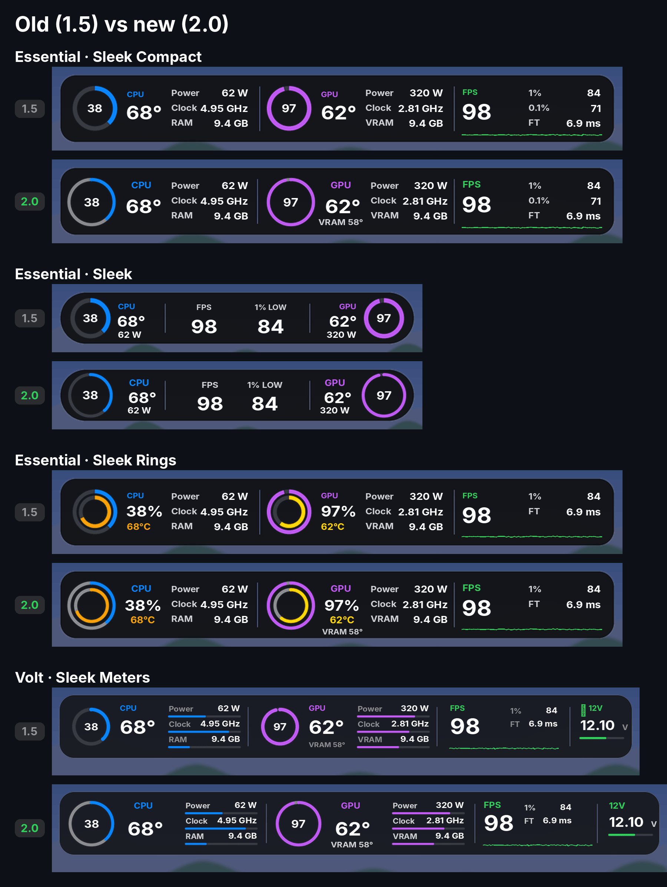

# 🆕 What's new

### 📱 Monitors & Widgets 2.0 beta · November 2026
> **Out now, as a beta.** [⬇️ Download](https://github.com/realHfde/Apple-Style-Inspired-RTSS-Overlay/raw/main/rainmeter/Monitors%20and%20Widgets%202.0%20beta.rmskin) · [📖 Install and what's in it](docs/monitors-and-widgets.md). It installs beside 1.7.1.

- **🖥️ 55 dashboards and widgets**: 21 new ones for 32:9, 21:9, 16:9 and portrait, and every 1.7.1 screen redone (Beta).
- **🎨 62 looks in one click**, 51 accents, plus your own colours.
- **🖼️ Hand-made Themes** with their own art, fonts and ornaments (Beta).
- **🎛️ A new Menu in two styles**, Console and Classic. Everything is set by clicking, no files to edit.
- **📐 One Scale slider**, 1 to 300 %, for every dashboard.
- **🎬 Photos, GIFs and videos** right on the dashboard.
- **✨ Motion** made in Blender.

### 🎮 Overlays 2.0 · October 2026
- **🌫️ New theme: Smoke** (replaces Clear). The old Clear panel let too much of the game show through: the text wasn't sharp and the busy picture behind it was distracting while playing. Smoke is a tinted-glass panel, lighter at the top and darker at the bottom, with a thin soft edge. You can still tell the game is behind it, but the numbers stay crisp on any scene. [See the difference](docs/overlays.md#themes).
- **📺 New TV designs:** **TV Pill**, **TV Line**, **TV Box** and **TV Side**, made and tested on 55" and 65" 4K TVs from the couch. 4K and 1080p packs.
- **💻 New laptop designs:** **Notch**, **Minibar**, **Island**, **Island Time** (with a clock) and **Card**, in their own laptop packs for 1920×1080, 1920×1200, 2560×1440, 2560×1600 and 2880×1800. Laptop temperature colours are tuned for laptops (CPU 90° / 95°, GPU 85° / 92°).
- **🌡️ VRAM temperature** is now on Essential's Sleek Compact, Sleek Meters, Sleek Meters Universal, Sleek Rings, Sleek Side and Performance. No HWiNFO needed.
- **✨ Every overlay polished:** thinner rounded rings, better spacing and alignment, easier-to-read grey labels, smooth panel edges, and graphs that are a line on a soft background (a plain line on White).
- **🔌 Fewer things to set up:** the temperatures, usage, power, clocks, RAM and VRAM now come from **RTSS itself**. MSI Afterburner is only used for **FPS, 1% low and 0.1% low**, and Volt only uses HWiNFO for the **12V cable**.
- **🧹 Simpler line-up:** the Power / Thermal limit text is gone, and so are Volt Sleek, the Volt "no 12V" versions and the old Island Bar (replaced by the new laptop designs). Had them? See [switching from older versions](docs/help.md#old-names).

<b>👀 Old (1.5) vs new (2.0)</b> (click to open)

Thinner rings, numbers centred in the rings, VRAM temperature added, cleaner spacing, and the Power / Thermal limit text removed.

### 📱 Monitors & Widgets 1.7.1 · October 2026
- **🧭 A cleaner Menu**, grouped into Look, This layout and Readings. Size now goes from **1% to 300%**, with a **Reset** button back to 100%. [See it](docs/monitors-and-widgets-1.7.1.md#monitor-options)
- **🖱️ Click a layout to switch:** while the Menu is open, click any layout and **This layout** (screen and size) changes that one. No need to reopen the Menu for each skin.
- **📊 Memory bars:** one **Off / On** switch shows RAM and VRAM out of your PC's **real** sizes, so a 12 GB or 24 GB card shows right. It replaces the fixed 8 / 16 / 32 GB choices.
- **📅 Date:** pick **21 October**, **October 21** or **10/21/2026**.
- **🔧 Fixed:** the desktop widgets could show the wrong total video memory (often 8 GB), and the Menu didn't change their RAM and VRAM bars.
- **✨ Tidier layouts:** case screens use their space better, bar screens show the FPS stats on one line, the repeated **Core clock** is gone from the second-monitor layouts, and **Horizontal 2** now shows RAM.
- **🖐️ Every skin can be dragged**, and installing over 1.7 keeps your settings.
- 🔜 **2.0 is in testing.** See the [roadmap](https://github.com/realHfde/Apple-Style-Inspired-RTSS-Overlay/discussions/12).

<b>Older updates</b> (click to open)

- **📱 Monitors & Widgets 1.7:** the **Smoke** and **Tint** themes, **16x9 Compact** and **Portrait Compact** layouts with network, everything in one **Menu**, and clearer folder names.
- **📱 Monitors & Widgets 1.6:** no empty border around the cards, new 12-hour / 24-hour **Clock** option, works on Rainmeter 4.5 and 5.
- **⚙️ Settings panel for Monitors & Widgets 1.5** (now called the **Menu**: right-click a skin → **Menu…**).
- **🔧 Fixed:** 4K 1.5x / 2x overlays show their rings, meters and panel correctly.
- **🏷️ New names (1.5):** the MSI Edition became **🟢 Essential**, the original overlays became **⚡ Volt**, and Apple Style Monitor became **📱 Monitors & Widgets**.
- **📱 Monitors & Widgets 1.4 (Rainmeter):** dashboards for a second monitor, HYTE Y70, Lian Li screens, Corsair Xeneon Edge and the desktop.
- **🔍 Bigger 4K versions:** every overlay also comes at **1.5×** and **2×** size for 4K.
- **🖥️ 7680x2160**, **3840x1600** and **5120x2160** resolutions, the **Float** theme, and step-by-step picture guides.

Thanks to everyone on Reddit who asked for these!

---
