# Apple-Style RTSS Overlays

Hey! These are clean, Apple-style performance overlays for **RivaTuner Statistics Server (RTSS)**. Pick a look you like, drop the files in, and see your FPS, temps, usage and more while you play. They're free, and there are 8 overlay designs in 4 themes, for screens from 1080p up to 5K2K, plus HYTE Y70 vertical screens.

If you like them, a ⭐ on GitHub or sharing them with a friend means a lot!

> Previews below are rendered with sample in-game numbers. Real colours and spacing may differ slightly in game.

## 🆕 What's new

**October 2026**
- **📱 HYTE Y70 screen support:** new **Sleek Vertical** overlay made for HYTE's vertical case screens, for the Y70 Touch (1100x3840), Y70 Ti (688x2560) and Y70 Touch Infinite (682x2560), plus 515x1920. Sleek Side works on them too. Both sit at the bottom centre.
- **Quick install:** one zip per resolution with every overlay and theme, ready to copy straight into the Overlays folder. See [Get started](#get-started).
- **New Float theme:** no background at all, just the numbers, rings and meters floating over your game. Less distracting, and nice on OLED screens. [See it below](#themes).
- **New resolutions:** 3840x1600 and 5120x2160 (5K2K) for every overlay and theme.
- **No 12V versions** of Compact, Meters, Meters Universal, Rings and Side, for graphics cards that don't report 12V or if you don't want it. Look for the folders ending in `-no-12v`. [See them below](#no-12v-versions).

Thanks to everyone on Reddit who asked for these!

---

<a id="get-started"></a>
## ⬇️ Get started

Takes about 5 minutes. Just follow these in order. 👇

### 1️⃣ Install the free programs

| Program | What it does |
|---|---|
| [**RivaTuner Statistics Server (RTSS)**](https://www.guru3d.com/download/rtss-rivatuner-statistics-server-download/) | Draws the overlay |
| [**MSI Afterburner**](https://www.msi.com/Landing/afterburner) | Usage, temperatures, power, FPS, 1% low |
| [**HWiNFO64**](https://www.hwinfo.com/) | Clocks, VRAM temp, 12V cable, GPU limit warnings (every overlay except Sleek) |
| [**Inter font**](https://rsms.me/inter/) | The font the overlays use. Without it the text won't line up ([how to install](#install-inter)) |

<a id="install-inter"></a>
### 🔤 Install the Inter font

| # | What to do |
|---|---|
| 1 | Go to [rsms.me/inter](https://rsms.me/inter/) and click **Download** |
| 2 | Find **Inter-4.1.zip** in your Downloads and click it |
| 3 | Click **Extract all** at the top, then **Extract** |
| 4 | In the folder that opens, **right-click Inter.ttc** |
| 5 | Click **Install for all users**. The Inter site recommends this, because some programs only see fonts installed for all users |


Then **restart RTSS** (close it from the tray and open it again).

<a id="hwinfo-setup-shared-memory"></a>
### 2️⃣ Turn on HWiNFO Shared Memory ⚠️

### Without this, clocks, VRAM temp, 12V and limits stay blank.

1. Start HWiNFO64 and tick **Sensors-only**, then click **Start**. In the sensors window, click the **gear** button at the bottom.

   

2. *(Optional)* In **Sensor Settings**, the **Global** polling period can stay at **2000 ms**. That's plenty for an overlay and keeps HWiNFO light.
3. Click **Main Settings** at the bottom.

   

4. Tick **Shared Memory Support** and click **OK**.

   

5. Keep HWiNFO running in the background (ticking **Auto Start** in the same window starts it with Windows).

> On the free version, Shared Memory switches itself off after **12 hours**. If values go blank after a long session, tick it again (or restart HWiNFO).

### 3️⃣ Set up MSI Afterburner

| # | What to do |
|---|---|
| 1 | Click the **gear** (Settings) on the left |
| 2 | Open the **Monitoring** tab |
| 3 | In the list, **tick** these (scroll down to find the CPU ones): **GPU usage, GPU temperature, Power, CPU usage, CPU temperature, CPU power, Framerate, Framerate 1% Low** |
| 4 | Click each ticked item and make sure **Show in On-Screen Display** is ❌ **unticked**, so Afterburner's own text doesn't stack on top of the overlay |

 

Click **OK** and keep Afterburner running in the background.

### 4️⃣ Set up RTSS

In the main RTSS window:

| # | Setting | Set it to | Why |
|---|---|---|---|
| 1 | **Show On-Screen Display** | ✅ **ON** | Nothing shows in game without it |
| 2 | **On-Screen Display support** | ✅ **ON** | Same, needed for any overlay |
| 3 | **On-Screen Display shadow** | ❌ **OFF** | Keeps text sharp (White theme looks blurry with it on) |
| 4 | **Setup** button | Click it | Opens the settings with the plugins |


Then in **Setup**:

| # | Setting | Set it to |
|---|---|---|
| 5 | **Plugins** tab | Open it |
| 6 | **OverlayEditor.dll** | ✅ **Ticked** (this is what loads the overlays) |


Still in **Setup**, check the **General** tab. These are the settings the FPS, 1% low and 0.1% low numbers depend on. If they're changed, the lows can show **0** or freeze:

| # | Setting | Set it to |
|---|---|---|
| 7 | **General** tab | Open it |
| 8 | **Framerate averaging interval** | **1000** |
| 9 | **Refresh period** | **500** |
| 10 | **Percentile calculation mode** | **integral** |
| 11 | **Percentile buffer** | **ring** (keeps the 1% / 0.1% lows updating live) |


Click **OK**.

### 5️⃣ Download the pack for your screen

Each pack has every overlay in every theme:

| Screen | Resolution | Download |
|---|---|---|
| 1080p | `1920x1080` | [⬇️ Download](https://github.com/realHfde/Apple-Style-Inspired-RTSS-Overlay/releases/latest/download/All.overlays.1920x1080.zip) |
| 1440p | `2560x1440` | [⬇️ Download](https://github.com/realHfde/Apple-Style-Inspired-RTSS-Overlay/releases/latest/download/All.overlays.2560x1440.zip) |
| 21:9 ultrawide | `3440x1440` | [⬇️ Download](https://github.com/realHfde/Apple-Style-Inspired-RTSS-Overlay/releases/latest/download/All.overlays.3440x1440.zip) |
| 24:10 ultrawide | `3840x1600` | [⬇️ Download](https://github.com/realHfde/Apple-Style-Inspired-RTSS-Overlay/releases/latest/download/All.overlays.3840x1600.zip) |
| 4K | `3840x2160` | [⬇️ Download](https://github.com/realHfde/Apple-Style-Inspired-RTSS-Overlay/releases/latest/download/All.overlays.3840x2160.zip) |
| 32:9 super-ultrawide | `5120x1440` | [⬇️ Download](https://github.com/realHfde/Apple-Style-Inspired-RTSS-Overlay/releases/latest/download/All.overlays.5120x1440.zip) |
| 5K2K ultrawide | `5120x2160` | [⬇️ Download](https://github.com/realHfde/Apple-Style-Inspired-RTSS-Overlay/releases/latest/download/All.overlays.5120x2160.zip) |
| 📱 HYTE Y70 Touch (1st gen) | `1100x3840` | [⬇️ Download](https://github.com/realHfde/Apple-Style-Inspired-RTSS-Overlay/releases/latest/download/All.overlays.1100x3840.zip) |
| 📱 HYTE Y70 Ti (2nd gen) | `688x2560` | [⬇️ Download](https://github.com/realHfde/Apple-Style-Inspired-RTSS-Overlay/releases/latest/download/All.overlays.688x2560.zip) |
| 📱 HYTE Y70 Touch Infinite (3rd gen) | `682x2560` | [⬇️ Download](https://github.com/realHfde/Apple-Style-Inspired-RTSS-Overlay/releases/latest/download/All.overlays.682x2560.zip) |
| 📱 Other vertical screens | `515x1920` | [⬇️ Download](https://github.com/realHfde/Apple-Style-Inspired-RTSS-Overlay/releases/latest/download/All.overlays.515x1920.zip) |

Not sure about your resolution? Right-click the desktop → **Display settings** → **Advanced Display**.

### 6️⃣ Copy the files into the Overlays folder

Unzip the pack and copy **all the files** straight into this folder:
```
C:\Program Files\RivaTuner Statistics Server\Plugins\Client\Overlays
```
### ⚠️ Not into a subfolder! Each `.ovl` needs its `_atlas.png` right next to it.

### 7️⃣ Load it and play 🎮

In RTSS, open **OverlayEditor → Layouts → Load**, pick your favourite, and launch a game. It shows at the top centre, on the right edge (Sleek Side and Performance), or at the bottom centre on HYTE screens.

<a id="two-gpus"></a>
### 🖥️ CPU with integrated graphics, or two GPUs?

### If GPU load, temperature or power show 0 or look wrong, the overlay is probably reading your integrated graphics.

The overlays read **GPU instance 0**. With a CPU that has built-in graphics, instance 0 can be the integrated GPU, and your graphics card is usually **1**. To switch:

| # | What to do |
|---|---|
| 1 | In OverlayEditor, click **Data sources** at the top |
| 2 | Select **GPU1 temperature** (then repeat for **GPU1 usage** and **GPU1 power**) |
| 3 | Click **Setup** |
| 4 | Change **Instance** from **0** to **1** |
| 5 | Click **OK**, then **OK** again, and save the layout |


 

Tip: watch the **Value** column in Data sources. Once it's right, GPU1 usage jumps up when you start a game.

<a id="move-an-overlay"></a>
### 📍 Move it anywhere you like

1. Open the overlay in **OverlayEditor**.
2. ### Turn off "Snap to grid" first! ⚠️
   Click **View** at the top, then click **Snap to grid** so the ✓ disappears. With snapping on, each piece snaps separately and the numbers slide out of place.

   

3. Select all the layers and drag the overlay where you want it, e.g. the lower-left corner.
4. **Save** the layout.

Everything stays lined up, and it remembers the new spot. (RTSS's own position box doesn't move these overlays, so this is the way to do it.)

<details>
<summary>Only want one overlay?</summary>

Download this repo (**Code → Download ZIP**), then open `overlays/` → the overlay → the theme (`dark`, `white`, `clear` or `float`) → your resolution, e.g. `overlays/sleek-meters/white/2560x1440`. Copy the `.ovl` and its `_atlas.png` into the Overlays folder.

</details>

Something not showing up? Check [Troubleshooting](#troubleshooting). Most issues take a few seconds to fix.

---

## Overlays

Here's the full lineup. Every overlay comes in **Dark, White, Clear and Float** ([see themes](#themes)).

### Sleek
A compact pill: CPU and GPU usage rings with temperature and power, FPS and 1% low in the middle.

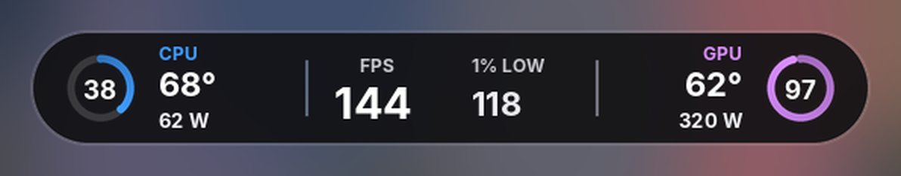

### Sleek Compact
Full stats in one wide bar: CPU, GPU, FPS with a frametime graph, 12V cable voltage, and GPU limit warnings that only appear when a limit is hit.

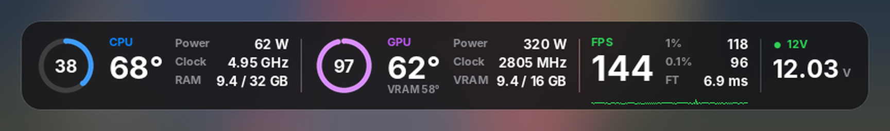

### Sleek Meters
Sleek Compact with a thin meter under every value, so you can see at a glance how close each one is to its limit.

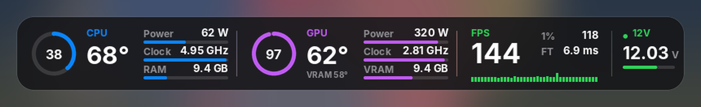

### Sleek Meters Universal
Sleek Meters with scales that fit **any build**, up to an RTX 5090 with a top-end CPU. The bars are set to the limits of today's fastest hardware, so nothing maxes out early on a high-end PC:

| Meter | Full at | Why |
|---|---|---|
| CPU power | 253 W | Intel Core i9 max turbo power; covers Ryzen 9 9950X3D too |
| CPU clock | 6.2 GHz | Core i9-14900KS max turbo, the fastest desktop CPU |
| GPU power | 600 W | RTX 5090 is rated 575 W on a 600 W 12V-2x6 connector |
| GPU clock | 3.2 GHz | Above the fastest boosting cards |
| RAM | 100% | Of whatever RAM you have installed |
| VRAM | 100% | Of whatever memory your graphics card has |

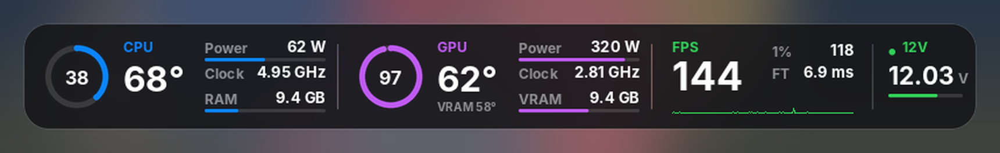

### Sleek Rings
Activity-style double rings: the outer ring is load and the inner ring is temperature.

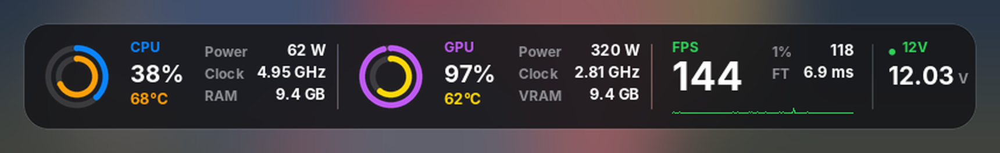

### Sleek Side
A vertical panel for the side of the screen, with CPU and GPU usage graphs.

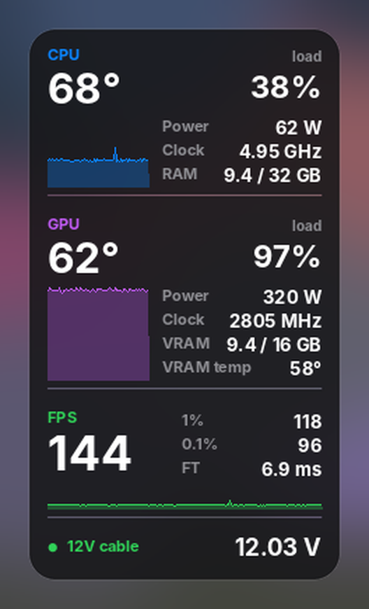

### Sleek Vertical 📱 (HYTE screen)
Made for **HYTE Y70 vertical case screens** (Y70 Touch, Y70 Ti, Y70 Touch Infinite) and other vertical displays. It's Sleek turned on its side: CPU ring on top, FPS and 1% low in the middle, GPU ring at the bottom. Sits at the bottom centre of the screen.

**How it looks on a vertical screen:**

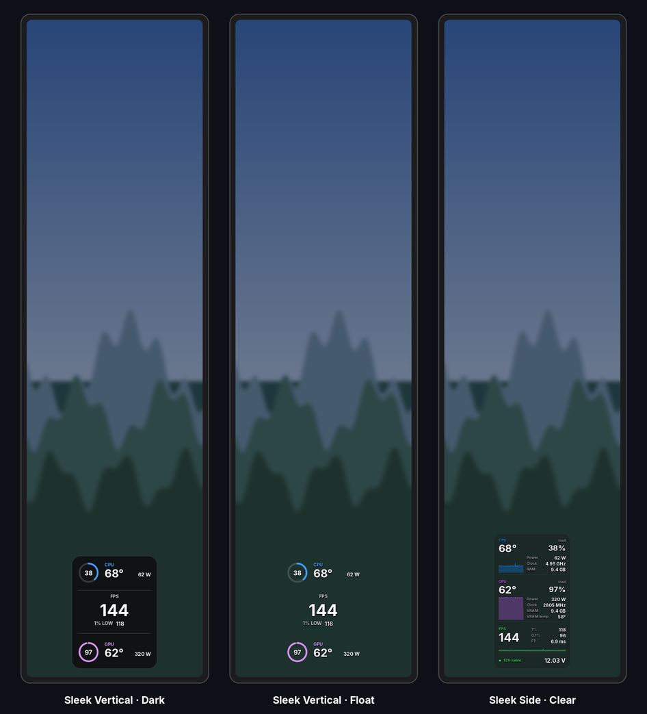

**All four themes:**

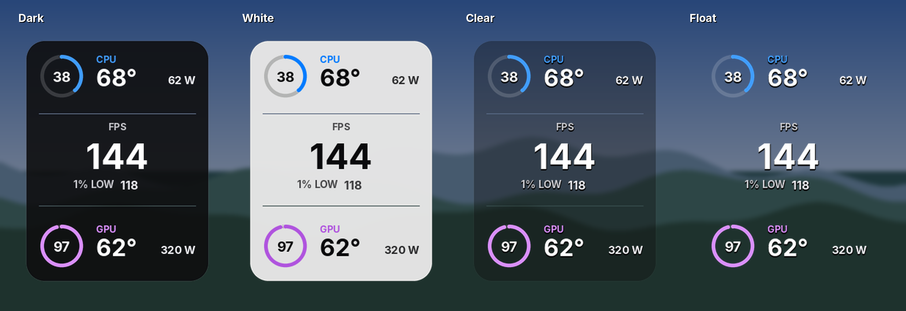

### Performance Overlay
Every number you could want, in a benchmark-style side panel: FPS, 1% / 0.1% lows and frametime with a frametime graph; CPU temp, load, power, clock and RAM; GPU temp, load, power, clock, voltage, fan, VRAM and VRAM temp; and CPU and GPU load graphs. Made for benchmarking and testing new parts.

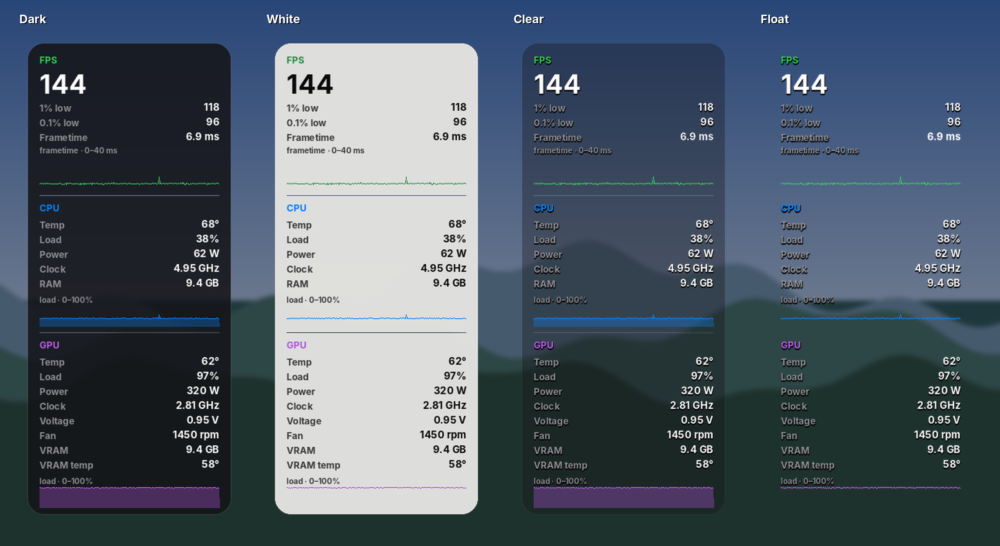

### No 12V versions
Compact, Meters, Meters Universal, Rings and Side also come **without the 12V cable section**, for graphics cards that don't report it or if you just don't want it. They're the same overlays, slightly smaller. Look for the folders ending in `-no-12v`.

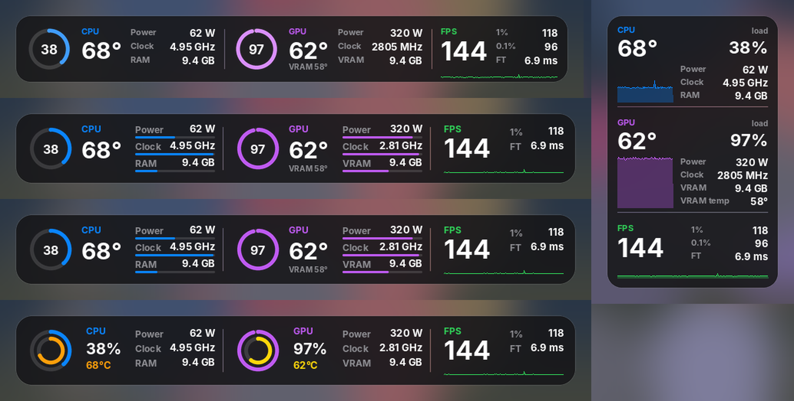

---

## Themes

Every overlay comes in four themes:

| Theme | Folder | Look |
|---|---|---|
| **Dark** | `dark` | Dark glass panel, white text |
| **White** | `white` | Soft light-grey panel with dark text, toned down so it isn't glaring. Turn off **On-Screen Display shadow** in RTSS for sharp text. |
| **Clear** | `clear` | Mostly see-through panel; every number has a drop shadow so it stays readable over bright scenes |
| **Float** | `float` | No panel at all: just the numbers, rings and meters with a drop shadow. Least distracting, and nice on OLED screens |


<details>
<summary><b>All previews: every overlay in Dark, White, Clear and Float</b> (click to open)</summary>

#### Sleek

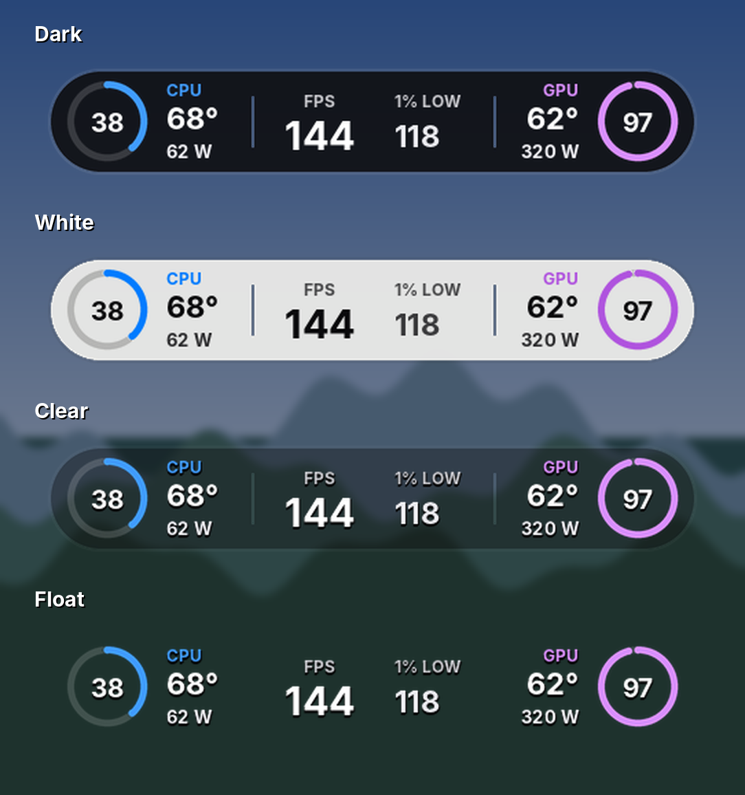

#### Sleek Compact

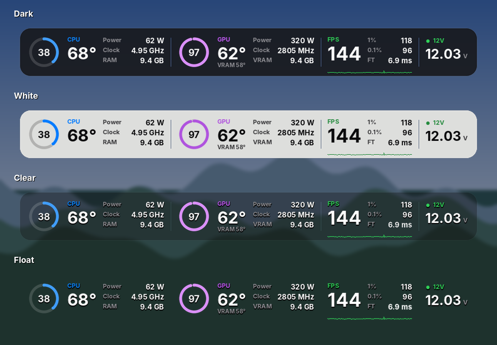

#### Sleek Compact No 12V

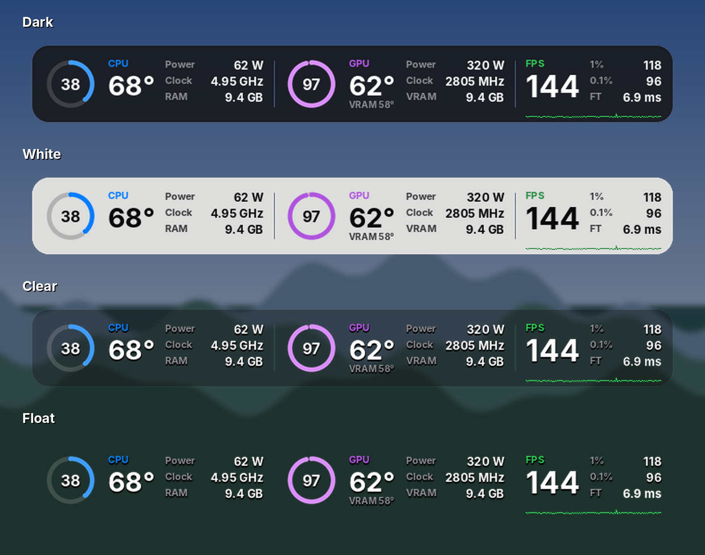

#### Sleek Meters

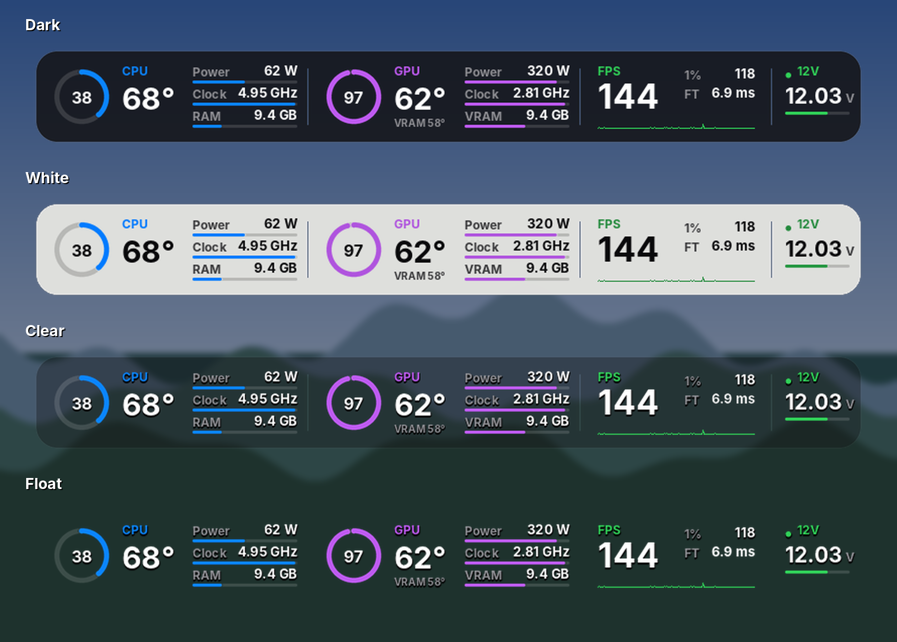

#### Sleek Meters No 12V

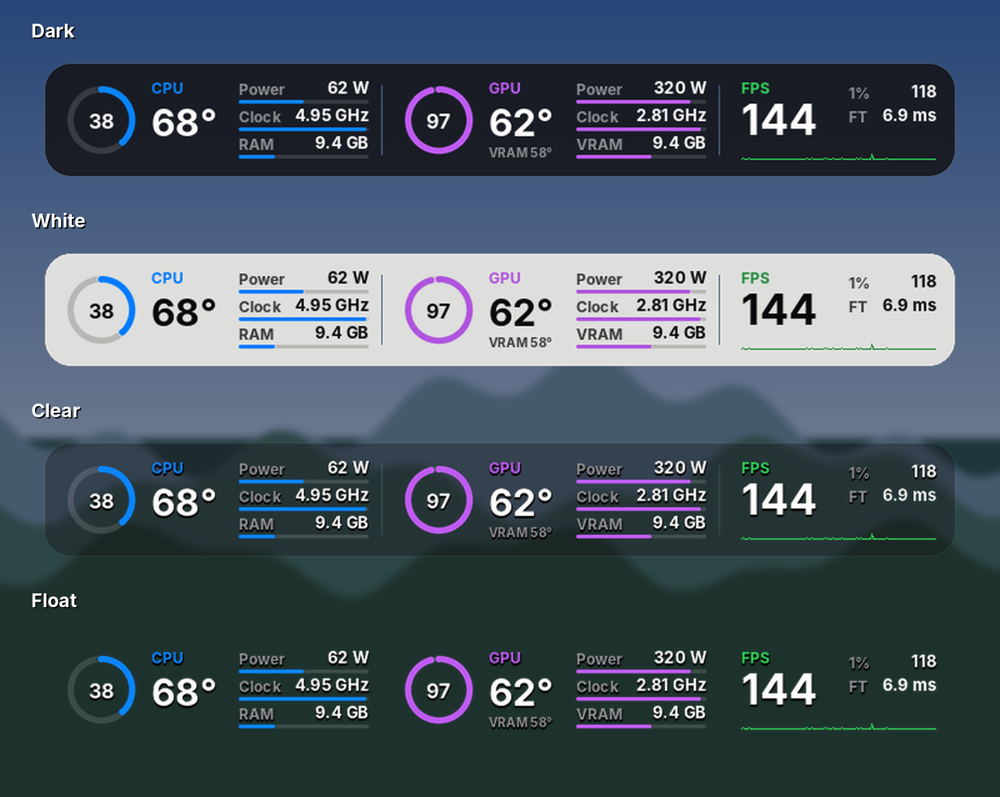

#### Sleek Meters Universal


#### Sleek Meters Universal No 12V


#### Sleek Rings

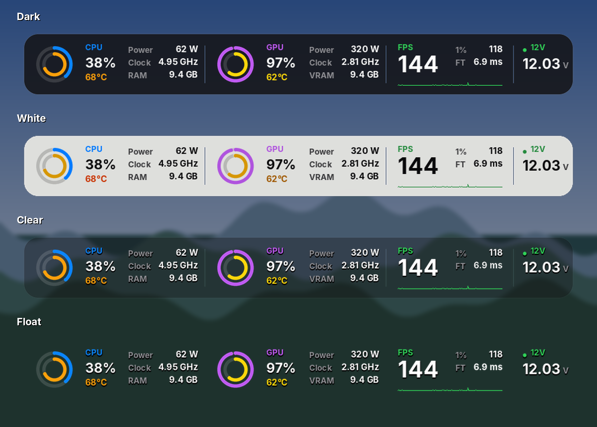

#### Sleek Rings No 12V

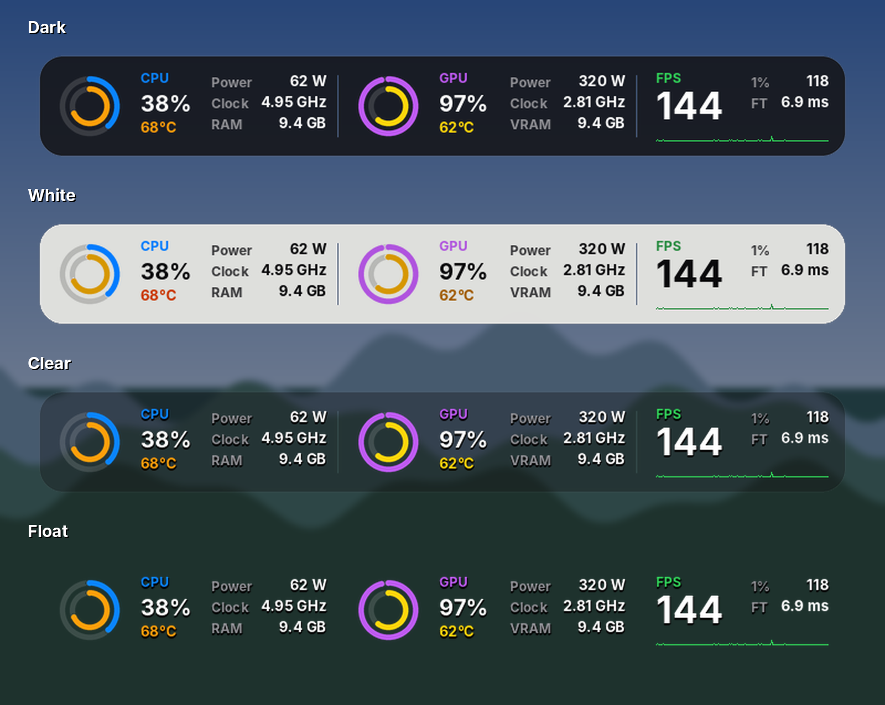

#### Sleek Vertical


#### Sleek Side

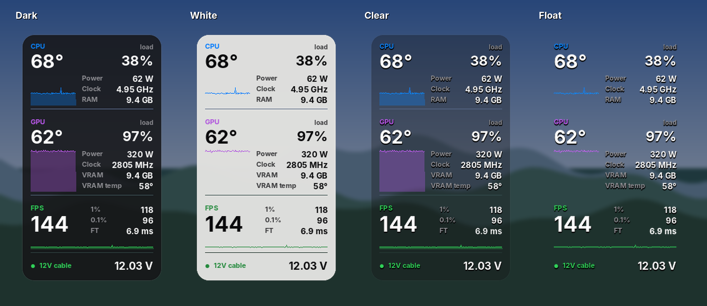

#### Sleek Side No 12V

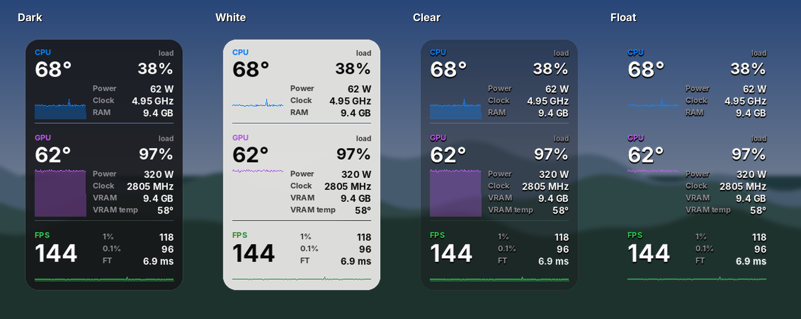

#### Performance Overlay


</details>

---

## Notes

- The **12V cable** reading needs a graphics card that reports its 16-pin connector voltage in HWiNFO. On cards that don't, use the **No 12V** versions.
- **The 12V monitor is a visual hint, not a safety system.** It only changes colour on the overlay: there's no pop-up or sound, so it only helps if you happen to look at it. Readings depend on your card's sensors and can be imprecise. It's no substitute for a properly seated, undamaged cable. For a real alert, set an alarm on the 12V reading in HWiNFO, which can show a warning or play a sound.
- The dot next to 12V turns **amber** below 11.85 V and **red** below 11.75 V. It only reacts once the GPU is drawing more than 150 W. At low power hardly any current flows through the cable, so even a bad connection barely lowers the voltage; a low reading only means something under real load. At idle or on the desktop, the dot stays green.
- **Sleek Meters** uses fixed scales for an upper-mid-range PC (CPU 120 W, GPU 360 W, CPU clock 5.05 GHz, GPU clock 2.9 GHz, RAM 32 GB, VRAM 16 GB). For a high-end PC, use **Sleek Meters Universal**.
- **Sleek Meters Universal:** to change a scale, open **Data sources** in OverlayEditor and edit the matching `pct` source's formula. For example, `x / 6` means 600 W is full; change it to `x / 3.6` for 360 W.
- The CPU clock shows the *effective* clock, so it reads very low at idle and close to your CPU's boost clock in games.

## Known limitations

These come from how RTSS's OverlayEditor works, so every OverlayEditor layout has them, not just these:

- **RTSS's position box and zoom slider don't move these overlays.** Move them in OverlayEditor instead ([how](#move-an-overlay)). A normal Afterburner overlay is one block of text that RTSS places where you choose. An OverlayEditor layout is made of separate layers (panel, rings, each number), and each layer has its own fixed spot on the screen. There's no "whole overlay" position for RTSS to move.
- **Each file is made for one screen resolution.** If you play some games at 1440p and others at 4K, the overlay won't be in the same place in both. Use the pack that matches the resolution you play at most.
- 🔬 **Working on it:** corner-anchored versions (e.g. bottom-left) that stay in their corner at any resolution. Testing now.

## Troubleshooting

| Problem | Fix |
|---|---|
| Overlay Editor looks empty | The overlay is placed for a full screen (top centre, or right edge for Side and Performance). **Maximize the Overlay Editor window** to see it. Also turn on **Show On-Screen Display** in the main RTSS window, or nothing shows in game. |
| CPU / GPU clocks are blank (next to GHz) | Clocks come from **HWiNFO**, not Afterburner. Follow the [HWiNFO setup](#hwinfo-setup-shared-memory). If it's running and they're still blank, open **Data sources**, select **CPU clock**, click **Setup** and pick your CPU's clock reading. Do the same for **GPU clock** (and the `pct` versions on Meters). |
| GPU load, temperature or power are blank | These come from **MSI Afterburner**. Make sure it's running, then go to **Settings → Monitoring** and enable *GPU usage, GPU temperature, Power, CPU usage, CPU temperature* and *CPU power*. With two GPUs (integrated + graphics card), open **Data sources**, select **GPU1 usage**, click **Setup** and pick your graphics card. Do the same for GPU1 temperature and GPU1 power. |
| Text looks different, too wide, or doesn't line up with the panel | The **Inter** font isn't installed, so Windows uses a different font. Install [Inter](https://rsms.me/inter/) and restart RTSS. |
| Garbled letters instead of the panel | The `_atlas.png` file is missing or in a subfolder. Put it next to the `.ovl` in the main Overlays folder. |
| Some values show `N/A` or are blank | HWiNFO isn't running, or Shared Memory Support is off. See [HWiNFO setup](#hwinfo-setup-shared-memory). |
| A value stays blank even with HWiNFO running | In OverlayEditor, open **Data sources**, select the row, click **Setup**, and pick the matching sensor from your HWiNFO list. |
| 1% / 0.1% show 0 | Normal outside a game. They fill in once a game is running. |
| Text looks blurry or smudged on the White theme | Turn off **On-Screen Display shadow** in the main RTSS window. The shadow is meant for white text on dark backgrounds; the Dark themes don't need it, and the Clear and Float themes have their own shadow built in. |

---

## License

MIT. Use them, change them and share them; just keep the license file with them. See [LICENSE](LICENSE).
