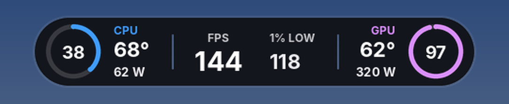
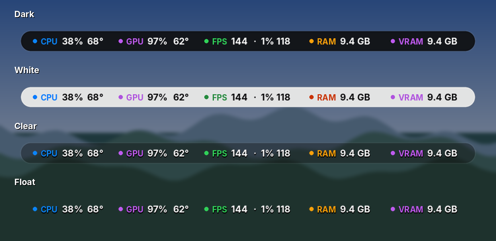
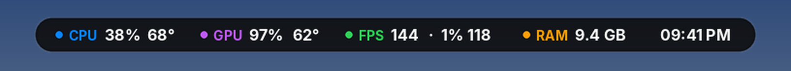
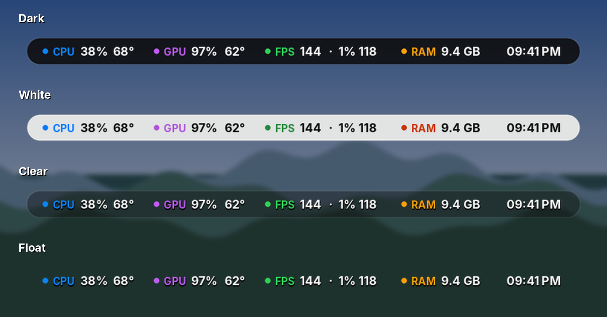
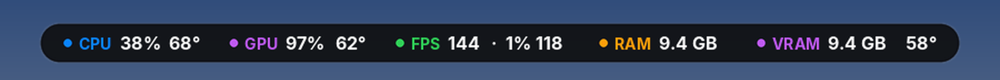
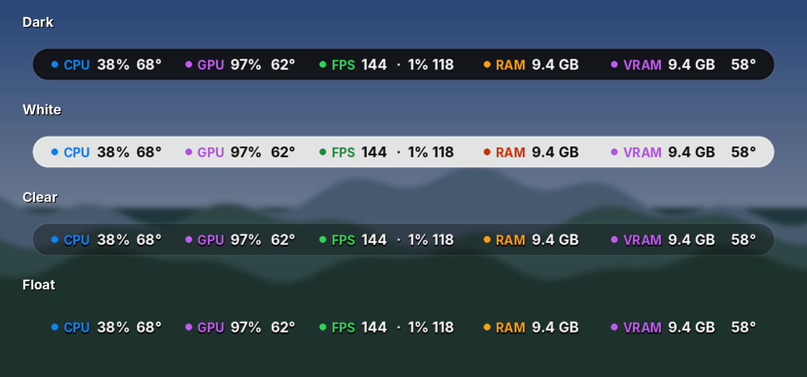

# Apple-Style RTSS Overlays

Hey! 👋 Clean, Apple-style performance stats for your PC: overlays for **RivaTuner Statistics Server (RTSS)** that show while you play, and **Monitors & Widgets** for your second screen, case screen or desktop. Free, in 4 themes, for screens from 1080p up to 5K2K, gaming laptops and TVs.

### Pick yours

<p align="center">
<a href="#essential"></a>
<a href="#volt"></a>
<a href="#rainmeter"></a>
</p>

<p align="center">
<a href="#laptops"></a>
<a href="#tvs"></a>
<a href="#themes"></a>
</p>

<p align="center"><a href="#get-started"><b>⬇️ Get started</b></a> · <a href="#whats-new"><b>🆕 What's new</b></a> · <a href="#themes"><b>🎨 Themes</b></a> · <a href="#troubleshooting"><b>🛠️ Troubleshooting</b></a></p>

**Not sure?** Pick **🟢 Essential**: it's the easiest to set up. Want to keep an eye on your 12V-2x6 / 12VHPWR cable? Pick **⚡ Volt**.

If you like them, a ⭐ on GitHub or sharing them with a friend means a lot!

> Previews below are rendered with sample in-game numbers. Real colours and spacing may differ slightly in game.

<a id="whats-new"></a>
## 🆕 What's new

**October 2026**
- **⚙️ New: Settings panel for Monitors & Widgets 1.5.** Right-click → Custom skin actions → **Settings…** and click the theme, FPS scale, meters, corners, gaps or GPU you want. (In 1.4 some of these were cut off the right-click menu.)
- **🔧 Fixed: 4K 1.5x / 2x overlays and TV Pill 4K** now show their rings, meters and panel correctly.
- **🏷️ New names:** the MSI Edition is now **🟢 Essential**, the original overlays are now **⚡ Volt**, and Apple Style Monitor is now **📱 Monitors & Widgets**. The files are renamed to match: overlays now start with `essential_` or `volt_`, the downloads are called **Essential…zip**, **Volt…zip** and **TV…zip**, and the Rainmeter skin installs as **MonitorsAndWidgets**. Nothing else changed. Had the old ones? See [switching from the old names](#old-names).
- **📱 New: Monitors & Widgets 1.4 (Rainmeter).** The same Apple look for your **desktop**: a full dashboard for a **second monitor**, layouts made for **HYTE Y70** case screens, **Lian Li** screens (8.8" Universal Screen, 9.2" O11 Vision-M, Lancool 207 Digital) and the **Corsair Xeneon Edge**, plus five smaller **desktop widgets**. Live while you play on your main screen. Right-click options for **RAM / VRAM meters**, **FPS chart scale** (60 to 480 fps), **rounded or square corners**, **gaps on / off**, size and theme. Needs only MSI Afterburner + Rainmeter. [See it below](#rainmeter).
- **🕘 New: Island Bar Time (Essential).** The same laptop bar with a 12-hour clock in place of VRAM, so you can see the time without leaving your game. Needs only MSI Afterburner + RTSS. In the laptop packs.
- **💻 New: Island Bar for gaming laptops.** One slim pill at the top of the screen with CPU, GPU, FPS, RAM and VRAM, only 38 px tall so it barely covers your game. In both Essential and Volt (which adds VRAM temperature). In the laptop packs: 1920x1200, 2560x1600 and 2880x1800.
- **🔍 Bigger 4K versions:** on a 4K screen the normal size can look small, so every overlay (Essential and Volt) now also comes at **1.5×** and **2×** size for 4K. Pick the one that looks right from your seat. Files end in `_1.5x` or `_2x`.

<details>
<summary><b>Older updates</b> (click to open)</summary>

- **🟢 New: Essential** (first called the MSI Edition): every overlay redesigned to need **only MSI Afterburner + RTSS**, with no HWiNFO. Bigger, easier-to-read text, plus a new design, **Simple Sleek**. If you don't need VRAM temperature or the 12V cable, this is the easiest way to get started. [See it below](#essential).
- **🖥️ 7680x2160** for 57" dual-4K super-ultrawides.
- **💻 Gaming laptop resolutions:** 1920x1200, 2560x1600 and 2880x1800 (16:10), for every overlay and theme.
- **📺 TV versions:** new **TV Pill** and **TV Side**, with big numbers made for gaming on a TV from the couch. Packs for 4K and 1080p TVs (any screen size).
- **CPU clock fixed:** now shows the real core speed (it read very low before). It comes from MSI Afterburner, so tick **CPU clock** in Afterburner's Monitoring tab ([step 3](#get-started)).
- **No more false "Voltage limit" warning:** it showed almost all the time on stock NVIDIA cards. Power and Thermal warnings stay, and in Meters, Universal and Rings they now sit neatly under the GPU ring.
- **Easier setup:** step-by-step picture guides for every setting, plus fixes for integrated graphics and moving the overlay.
- **Quick install:** one zip per resolution with every overlay and theme, ready to copy straight into the Overlays folder. See [Get started](#get-started).
- **New Float theme:** no background at all, just the numbers, rings and meters floating over your game. Less distracting, and nice on OLED screens. [See it below](#themes).
- **New resolutions:** 3840x1600 and 5120x2160 (5K2K) for every overlay and theme.
- **No 12V versions** of Compact, Meters, Meters Universal, Rings and Side, for graphics cards that don't report 12V or if you don't want it. Look for the folders ending in `-no-12v`. [See them below](#no-12v-versions).

</details>

Thanks to everyone on Reddit who asked for these!

---

<a id="get-started"></a>
## ⬇️ Get started

Takes about 5 minutes. Just follow these in order. 👇

### 🟢 First: which version do you want?

| | **🟢 Essential** (easiest) | **⚡ Volt** |
|---|---|---|
| **Needs** | MSI Afterburner + RTSS | MSI Afterburner + RTSS + **HWiNFO** |
| **Shows** | CPU & GPU usage, temps, power, clocks, RAM, VRAM, FPS, 1% / 0.1% lows, frametime, Power/Thermal limit warnings | All of that **plus 12V cable voltage and VRAM temperature** |
| **Setup** | Skip step 2 | All steps |

**Not sure? Pick Essential.** You can always switch to Volt later.

Want your stats on a **second screen, case screen or desktop** instead? That's [📱 Monitors & Widgets](#rainmeter), with its own setup.

### 1️⃣ Install the free programs

| Program | What it does |
|---|---|
| [**RivaTuner Statistics Server (RTSS)**](https://www.guru3d.com/download/rtss-rivatuner-statistics-server-download/) | Draws the overlay |
| [**MSI Afterburner**](https://www.msi.com/Landing/afterburner) | Usage, temperatures, power, CPU clock, FPS, 1% low |
| [**HWiNFO64**](https://www.hwinfo.com/) *(optional)* | **Not needed for [Essential](#essential).** Only the [Volt](#volt) overlays use it, for **12V cable voltage** and **VRAM temperature** (plus 0.1% lows, GPU clock and limit warnings). Sleek and the TV overlays don't need it either |
| [**Inter font**](https://rsms.me/inter/) | The font the overlays use. Without it the text won't line up ([how to install](#install-inter)) |

<a id="install-inter"></a>
### 🔤 Install the Inter font

| # | What to do |
|---|---|
| 1 | Go to [rsms.me/inter](https://rsms.me/inter/) and click **Download** |
| 2 | Find **Inter-4.1.zip** in your Downloads and click it |
| 3 | Click **Extract all** at the top, then **Extract** |
| 4 | In the folder that opens, **right-click Inter.ttc** |
| 5 | Click **Install for all users**. The Inter site recommends this, because some programs only see fonts installed for all users |


Then **restart RTSS** (close it from the tray and open it again).

<a id="hwinfo-setup-shared-memory"></a>
### 2️⃣ Turn on HWiNFO Shared Memory ⚠️

> **Using Essential, a TV overlay or Volt's Sleek?** You don't need HWiNFO, so skip to step 3. Every other overlay uses it for the 12V cable, VRAM temperature, 0.1% lows, GPU clock and limit warnings.

### Without this, 12V, VRAM temp, 0.1% lows, GPU clock and limits stay blank.

1. Start HWiNFO64 and tick **Sensors-only**, then click **Start**. In the sensors window, click the **gear** button at the bottom.

   

2. *(Optional)* In **Sensor Settings**, the **Global** polling period can stay at **2000 ms**. That's plenty for an overlay and keeps HWiNFO light.
3. Click **Main Settings** at the bottom.

   

4. Tick **Shared Memory Support** and click **OK**.

   

5. Keep HWiNFO running in the background (ticking **Auto Start** in the same window starts it with Windows).

> On the free version, Shared Memory switches itself off after **12 hours**. If values go blank after a long session, tick it again (or restart HWiNFO).

### 3️⃣ Set up MSI Afterburner

| # | What to do |
|---|---|
| 1 | Click the **gear** (Settings) on the left |
| 2 | Open the **Monitoring** tab |
| 3 | In the list, **tick** these (scroll down to find the CPU ones): **GPU usage, GPU temperature, Power, CPU usage, CPU temperature, CPU power, CPU clock, Framerate, Framerate 1% Low**<br>🟢 **Essential, also tick:** **Core clock, Framerate 0.1% Low, Power limit, Temp limit** (and **Fan tachometer, Core voltage** for Performance) |
| 4 | Click each ticked item and make sure **Show in On-Screen Display** is ❌ **unticked**, so Afterburner's own text doesn't stack on top of the overlay |

 

Click **OK** and keep Afterburner running in the background.

<a id="rtss-setup"></a>
### 4️⃣ Set up RTSS

In the main RTSS window:

| # | Setting | Set it to | Why |
|---|---|---|---|
| 1 | **Show On-Screen Display** | ✅ **ON** | Nothing shows in game without it |
| 2 | **On-Screen Display support** | ✅ **ON** | Same, needed for any overlay |
| 3 | **On-Screen Display shadow** | ❌ **OFF** | Keeps text sharp (White theme looks blurry with it on) |
| 4 | **Setup** button | Click it | Opens the settings with the plugins |


Then in **Setup**:

| # | Setting | Set it to |
|---|---|---|
| 5 | **Plugins** tab | Open it |
| 6 | **HotkeyHandler.dll** and **OverlayEditor.dll** | ✅ **Both ticked** (OverlayEditor is what loads the overlays) |


Still in **Setup**, check the **General** tab. These are the settings the FPS, 1% low and 0.1% low numbers depend on. If they're changed, the lows can show **0** or freeze:

| # | Setting | Set it to |
|---|---|---|
| 7 | **General** tab | Open it |
| 8 | **Framerate averaging interval** | **1000** |
| 9 | **Refresh period** | **500** |
| 10 | **Percentile calculation mode** | **integral** |
| 11 | **Percentile buffer** | **ring** (keeps the 1% / 0.1% lows updating live) |


Click **OK**.

### 5️⃣ Download the pack for your screen

Each pack has every overlay in every theme. **🟢 Essential** = no HWiNFO needed:

| Screen | Resolution | 🟢 Essential | ⚡ Volt |
|---|---|---|---|
| 1080p | `1920x1080` | [⬇️ Download](https://github.com/realHfde/Apple-Style-Inspired-RTSS-Overlay/releases/latest/download/Essential.overlays.1920x1080.zip) | [⬇️ Download](https://github.com/realHfde/Apple-Style-Inspired-RTSS-Overlay/releases/latest/download/Volt.overlays.1920x1080.zip) |
| 1440p | `2560x1440` | [⬇️ Download](https://github.com/realHfde/Apple-Style-Inspired-RTSS-Overlay/releases/latest/download/Essential.overlays.2560x1440.zip) | [⬇️ Download](https://github.com/realHfde/Apple-Style-Inspired-RTSS-Overlay/releases/latest/download/Volt.overlays.2560x1440.zip) |
| 21:9 ultrawide | `3440x1440` | [⬇️ Download](https://github.com/realHfde/Apple-Style-Inspired-RTSS-Overlay/releases/latest/download/Essential.overlays.3440x1440.zip) | [⬇️ Download](https://github.com/realHfde/Apple-Style-Inspired-RTSS-Overlay/releases/latest/download/Volt.overlays.3440x1440.zip) |
| 24:10 ultrawide | `3840x1600` | [⬇️ Download](https://github.com/realHfde/Apple-Style-Inspired-RTSS-Overlay/releases/latest/download/Essential.overlays.3840x1600.zip) | [⬇️ Download](https://github.com/realHfde/Apple-Style-Inspired-RTSS-Overlay/releases/latest/download/Volt.overlays.3840x1600.zip) |
| 4K | `3840x2160` | [⬇️ Download](https://github.com/realHfde/Apple-Style-Inspired-RTSS-Overlay/releases/latest/download/Essential.overlays.3840x2160.zip) | [⬇️ Download](https://github.com/realHfde/Apple-Style-Inspired-RTSS-Overlay/releases/latest/download/Volt.overlays.3840x2160.zip) |
| 4K, **bigger (1.5×)** 🔍 | `3840x2160` | [⬇️ Download](https://github.com/realHfde/Apple-Style-Inspired-RTSS-Overlay/releases/latest/download/Essential.overlays.3840x2160.1.5x.zip) | [⬇️ Download](https://github.com/realHfde/Apple-Style-Inspired-RTSS-Overlay/releases/latest/download/Volt.overlays.3840x2160.1.5x.zip) |
| 4K, **biggest (2×)** 🔍 | `3840x2160` | [⬇️ Download](https://github.com/realHfde/Apple-Style-Inspired-RTSS-Overlay/releases/latest/download/Essential.overlays.3840x2160.2x.zip) | [⬇️ Download](https://github.com/realHfde/Apple-Style-Inspired-RTSS-Overlay/releases/latest/download/Volt.overlays.3840x2160.2x.zip) |
| 32:9 super-ultrawide | `5120x1440` | [⬇️ Download](https://github.com/realHfde/Apple-Style-Inspired-RTSS-Overlay/releases/latest/download/Essential.overlays.5120x1440.zip) | [⬇️ Download](https://github.com/realHfde/Apple-Style-Inspired-RTSS-Overlay/releases/latest/download/Volt.overlays.5120x1440.zip) |
| 5K2K ultrawide (e.g. LG 45" / 40" 5K2K) | `5120x2160` | [⬇️ Download](https://github.com/realHfde/Apple-Style-Inspired-RTSS-Overlay/releases/latest/download/Essential.overlays.5120x2160.zip) | [⬇️ Download](https://github.com/realHfde/Apple-Style-Inspired-RTSS-Overlay/releases/latest/download/Volt.overlays.5120x2160.zip) |
| 32:9 dual-4K ultrawide (e.g. Samsung Odyssey Neo G9 57") | `7680x2160` | [⬇️ Download](https://github.com/realHfde/Apple-Style-Inspired-RTSS-Overlay/releases/latest/download/Essential.overlays.7680x2160.zip) | [⬇️ Download](https://github.com/realHfde/Apple-Style-Inspired-RTSS-Overlay/releases/latest/download/Volt.overlays.7680x2160.zip) |
| 💻 Laptop 16:10 (most budget / mid-range gaming laptops) | `1920x1200` | [⬇️ Download](https://github.com/realHfde/Apple-Style-Inspired-RTSS-Overlay/releases/latest/download/Essential.overlays.1920x1200.zip) | [⬇️ Download](https://github.com/realHfde/Apple-Style-Inspired-RTSS-Overlay/releases/latest/download/Volt.overlays.1920x1200.zip) |
| 💻 Laptop 16:10 (most new high-end gaming laptops) | `2560x1600` | [⬇️ Download](https://github.com/realHfde/Apple-Style-Inspired-RTSS-Overlay/releases/latest/download/Essential.overlays.2560x1600.zip) | [⬇️ Download](https://github.com/realHfde/Apple-Style-Inspired-RTSS-Overlay/releases/latest/download/Volt.overlays.2560x1600.zip) |
| 💻 Laptop 16:10 OLED | `2880x1800` | [⬇️ Download](https://github.com/realHfde/Apple-Style-Inspired-RTSS-Overlay/releases/latest/download/Essential.overlays.2880x1800.zip) | [⬇️ Download](https://github.com/realHfde/Apple-Style-Inspired-RTSS-Overlay/releases/latest/download/Volt.overlays.2880x1800.zip) |

<a id="tv-download"></a>
**📺 TV packs** (no HWiNFO needed, any TV size):

| TV | Resolution | Download |
|---|---|---|
| 📺 **4K TV** (43", 55", 65", 75", 85"…) | `3840x2160` | [⬇️ Download TV pack](https://github.com/realHfde/Apple-Style-Inspired-RTSS-Overlay/releases/latest/download/TV.overlays.3840x2160.zip) |
| 📺 1080p TV | `1920x1080` | [⬇️ Download TV pack](https://github.com/realHfde/Apple-Style-Inspired-RTSS-Overlay/releases/latest/download/TV.overlays.1920x1080.zip) |

Only copy in **one** TV pack, the one that matches your TV. The files end in `_4k` or `_1080p`.

**Not sure about your resolution?** Open Windows **Settings → System → Display → Advanced display** and look at **Desktop mode**. The first two numbers are your resolution (e.g. **5120 × 1440** → download the `5120x1440` pack):


### 6️⃣ Copy the files into the Overlays folder

Unzip the pack and copy **all the files** straight into this folder:
```
C:\Program Files\RivaTuner Statistics Server\Plugins\Client\Overlays
```
### ⚠️ Not into a subfolder! Each `.ovl` needs its `_atlas.png` right next to it.

It should look like this. Every overlay is a **pair**: the `.ovl` file and its `_atlas.png`, side by side, directly in the **Overlays** folder:

| # | Check |
|---|---|
| 1 | The address bar ends in **RivaTuner Statistics Server › Plugins › Client › Overlays** |
| 2 | Each `.ovl` has its matching `_atlas.png` right next to it (e.g. `essential_sleek.ovl` + `essential_sleek_atlas.png`). Essential files start with `essential_`, Volt files with `volt_` |


### 7️⃣ Load it and play 🎮

In RTSS, open **OverlayEditor → Layouts → Load**, pick your favourite, and launch a game. It shows at the top centre, or on the right edge (Sleek Side and Performance).

<a id="smooth"></a>
### 🧈 Keep it smooth (no stutter)

The overlay itself is light: it redraws every **500 ms** (the RTSS refresh period from [step 4](#rtss-setup)). Stutter usually comes from the monitoring apps reading sensors too often, so:

| # | App | Setting | Set it to |
|---|---|---|---|
| 1 | **MSI Afterburner** | Settings → Monitoring → **Hardware polling period** | **1000** ms |
| 2 | **HWiNFO** *(Volt only)* | Sensor Settings → General → **Global** polling period | **2000** ms |
| 3 | **HWiNFO** *(Volt only)* | Same box: **Disk S.M.A.R.T. every** … cycles and **Emb. Controller every** … cycles | **100** and **10** (checks drives and the embedded controller less often, the usual stutter cause), then click **Set** |

 

Want the lightest setup? Use **🟢 Essential**: it only needs Afterburner + RTSS, with no HWiNFO at all.

<a id="hotkey"></a>
### ⌨️ Show / hide the overlay with a hotkey

| # | What to do |
|---|---|
| 1 | Open **MSI Afterburner** → **Settings** (gear) |
| 2 | Open the **On-Screen Display** tab |
| 3 | Click the box next to **Toggle On-Screen Display** and press the key you want (e.g. **F10**) |
| 4 | Click **OK** |


Now press that key in game to show or hide the overlay. Handy for screenshots and recordings.

<a id="two-gpus"></a>
### 🖥️ CPU with integrated graphics, or two GPUs?

### If GPU load, temperature or power show 0 or look wrong, the overlay is probably reading your integrated graphics.

The overlays read **GPU instance 0**. With a CPU that has built-in graphics, instance 0 is often the integrated GPU and your graphics card is **1**. ✅ Tested and confirmed on a PC with integrated graphics.

**Which number is your graphics card?** Open **Task Manager** (Ctrl + Shift + Esc) → **Performance** and look at the GPU list. The number next to your graphics card (e.g. **GPU 1**) is the **Instance** to use:


To switch:

| # | What to do |
|---|---|
| 1 | In OverlayEditor, click **Data sources** at the top |
| 2 | Select **GPU1 temperature** (then repeat for **GPU1 usage** and **GPU1 power**) |
| 3 | Click **Setup** |
| 4 | Change **Instance** from **0** to your graphics card's number from Task Manager (usually **1**) |
| 5 | Click **OK**, then **OK** again, and save the layout |


 

Tip: watch the **Value** column in Data sources. Once it's right, GPU1 usage jumps up when you start a game.

<a id="move-an-overlay"></a>
### 📍 Move it anywhere you like

1. Open the overlay in **OverlayEditor**.
2. ### Turn off "Snap to grid" first! ⚠️
   Click **View** at the top, then click **Snap to grid** so the ✓ disappears. With snapping on, each piece snaps separately and the numbers slide out of place.

   

3. Select all the layers and drag the overlay where you want it, e.g. the lower-left corner.
4. **Save** the layout.

Everything stays lined up, and it remembers the new spot. (RTSS's own position box doesn't move these overlays, so this is the way to do it.)

<details>
<summary>Only want one overlay?</summary>

Download this repo (**Code → Download ZIP**), then open `overlays/` → the overlay → the theme (`dark`, `white`, `clear` or `float`) → your resolution, e.g. `overlays/volt/sleek-meters/white/2560x1440` or `overlays/essential/sleek-meters/white/2560x1440`. Copy the `.ovl` and its `_atlas.png` into the Overlays folder.

</details>

Something not showing up? Check [Troubleshooting](#troubleshooting). Most issues take a few seconds to fix.

---

<a id="essential"></a>
<a id="msi-edition"></a>
## 🟢 Essential (RTSS + MSI Afterburner, no HWiNFO)

### Only needs MSI Afterburner + RTSS. Perfect if you don't need VRAM temperature or the 12V cable.

Every overlay with **bigger, easier-to-read text**, in **Dark, White, Clear and Float**, for every resolution. Files start with `essential_`. Tap **See all 4 themes** under any overlay.

<p align="center"><a href="#get-started"></a><br><sub>Skip step 2, no HWiNFO needed</sub></p>

<table>
<tr>
<td width="50%" valign="top" align="center"><br><b>Simple Sleek 🆕</b><br><sub>One slim pill: CPU and GPU rings with temp, power and clock, FPS, 1% low and frametime</sub><details><summary><sub>🎨 See all 4 themes</sub></summary></details></td>
<td width="50%" valign="top" align="center"><br><b>Sleek</b><br><sub>CPU and GPU rings with temp and power, big FPS and 1% low</sub><details><summary><sub>🎨 See all 4 themes</sub></summary></details></td>
</tr>
<tr>
<td width="50%" valign="top" align="center"><br><b>Sleek Compact</b><br><sub>CPU, GPU (power, clock, RAM / VRAM) and FPS with 1%, 0.1%, frametime and a graph</sub><details><summary><sub>🎨 See all 4 themes</sub></summary></details></td>
<td width="50%" valign="top" align="center"><br><b>Sleek Meters</b><br><sub>Compact with a meter under each value, scaled for a mid-range PC</sub><details><summary><sub>🎨 See all 4 themes</sub></summary></details></td>
</tr>
<tr>
<td width="50%" valign="top" align="center"><br><b>Sleek Meters Universal</b><br><sub>Meters scaled for <b>any</b> PC, up to an RTX 5090 (<a href="#meter-scales">scales</a>)</sub><details><summary><sub>🎨 See all 4 themes</sub></summary></details></td>
<td width="50%" valign="top" align="center"><br><b>Sleek Rings</b><br><sub>Double rings: load outside, temperature inside</sub><details><summary><sub>🎨 See all 4 themes</sub></summary></details></td>
</tr>
<tr>
<td width="50%" valign="top" align="center"><br><b>Sleek Side</b><br><sub>A panel for the side of the screen with CPU / GPU load graphs and FPS</sub><details><summary><sub>🎨 See all 4 themes</sub></summary></details></td>
<td width="50%" valign="top" align="center"><br><b>Performance</b><br><sub>Every number for benchmarking, with graphs</sub><details><summary><sub>🎨 See all 4 themes</sub></summary></details></td>
</tr>
</table>

Gaming laptop? See [💻 Laptops](#laptops) for Island Bar and Island Bar Time.

<p align="center"><a href="#get-started"></a><br><sub>Skip step 2, no HWiNFO needed</sub></p>

---

<a id="volt"></a>
## ⚡ Volt (RTSS + MSI Afterburner + HWiNFO)

### Everything in Essential, plus the 12V-2x6 / 12VHPWR cable monitor and VRAM temperature.

Volt reads your graphics card's 12V cable voltage and VRAM temperature through HWiNFO ([step 2](#hwinfo-setup-shared-memory)), and shows GPU limit warnings only when a limit is hit. Files start with `volt_`. Tap **See all 4 themes** under any overlay.

<p align="center"><a href="#get-started"></a><br><sub>Do every step, including step 2 (HWiNFO)</sub></p>

<table>
<tr>
<td width="50%" valign="top" align="center"><br><b>Sleek</b><br><sub>A compact pill: CPU and GPU rings with temperature and power, FPS and 1% low</sub><details><summary><sub>🎨 See all 4 themes</sub></summary></details></td>
<td width="50%" valign="top" align="center"><br><b>Sleek Compact</b><br><sub>Full stats in one wide bar, with a frametime graph and the 12V cable voltage</sub><details><summary><sub>🎨 See all 4 themes</sub></summary></details></td>
</tr>
<tr>
<td width="50%" valign="top" align="center"><br><b>Sleek Meters</b><br><sub>Compact with a thin meter under every value, so you see how close each one is to its limit</sub><details><summary><sub>🎨 See all 4 themes</sub></summary></details></td>
<td width="50%" valign="top" align="center"><br><b>Sleek Meters Universal</b><br><sub>Meters scaled for <b>any</b> build, up to an RTX 5090 (<a href="#meter-scales">scales</a>)</sub><details><summary><sub>🎨 See all 4 themes</sub></summary></details></td>
</tr>
<tr>
<td width="50%" valign="top" align="center"><br><b>Sleek Rings</b><br><sub>Activity-style double rings: load outside, temperature inside</sub><details><summary><sub>🎨 See all 4 themes</sub></summary></details></td>
<td width="50%" valign="middle" align="center"><b><a id="no-12v-versions"></a>No 12V versions</b><br><sub>Compact, Meters, Meters Universal, Rings and Side also come <b>without the 12V section</b>, for cards that don't report it. They're in the same pack, with <code>no12v</code> in the file name.</sub></td>
</tr>
<tr>
<td width="50%" valign="top" align="center"><br><b>Sleek Side</b><br><sub>A side panel with CPU and GPU usage graphs, VRAM temperature and the 12V cable</sub><details><summary><sub>🎨 See all 4 themes</sub></summary></details></td>
<td width="50%" valign="top" align="center"><br><b>Performance</b><br><sub>Every number for benchmarking: voltage, fan, VRAM temp and load graphs too</sub><details><summary><sub>🎨 See all 4 themes</sub></summary></details></td>
</tr>
</table>

Gaming laptop? See [💻 Laptops](#laptops).

<p align="center"><a href="#get-started"></a><br><sub>Do every step, including step 2 (HWiNFO)</sub></p>

---

<a id="laptops"></a>
## 💻 Laptops

### One slim pill at the top of the screen, only 38 px tall, so it barely covers your game.

Made for laptop screens where every pixel counts. In the 💻 laptop packs: **1920x1200**, **2560x1600** and **2880x1800** (step 5 of [Get started](#get-started)).

<table>
<tr><td align="center"><br><b>Island Bar</b> · 🟢 Essential<br><sub>CPU, GPU, FPS · 1% low, RAM and VRAM</sub><details><summary><sub>🎨 See all 4 themes</sub></summary></details></td></tr>
<tr><td align="center"><br><b>Island Bar Time</b> · 🟢 Essential<br><sub>The same bar with a 12-hour clock instead of VRAM</sub><details><summary><sub>🎨 See all 4 themes</sub></summary></details></td></tr>
<tr><td align="center"><br><b>Island Bar</b> · ⚡ Volt<br><sub>Adds VRAM temperature (needs HWiNFO)</sub><details><summary><sub>🎨 See all 4 themes</sub></summary></details></td></tr>
</table>

<p align="center"><a href="#get-started"></a><br><sub>Pick a 💻 laptop pack in step 5 · Essential skips step 2</sub></p>

---

<a id="tvs"></a>
## 📺 TVs

### Big numbers you can read from the couch.

**TV Pill** shows CPU and GPU temperature, power and usage rings, FPS and 1% low. **TV Side** is a panel on the right edge with FPS, 1% low, and CPU/GPU temperature, load and power. Both come in **Dark, White, Clear and Float** and only need **MSI Afterburner** (no HWiNFO).

TV size doesn't matter, only resolution: a 55" and an 85" 4K TV use the same 4K TV pack. Files start with `tv_` and end in `_4k` or `_1080p`.


<p align="center"><a href="#get-started"></a><br><sub>Pick a <a href="#tv-download">📺 TV pack</a> · skip step 2</sub></p>

---

<a id="themes"></a>
## 🎨 Themes

Every overlay (Essential, Volt, laptop and TV) comes in four themes:

| Theme | Folder | Look |
|---|---|---|
| **Dark** | `dark` | Dark glass panel, white text |
| **White** | `white` | Soft light-grey panel with dark text, toned down so it isn't glaring. Turn off **On-Screen Display shadow** in RTSS for sharp text. |
| **Clear** | `clear` | Mostly see-through panel; every number has a drop shadow so it stays readable over bright scenes |
| **Float** | `float` | No panel at all: just the numbers, rings and meters with a drop shadow. Least distracting, and nice on OLED screens |


---

<a id="old-names"></a>
## 🏷️ Switching from the old names

The overlays and the Rainmeter skin got new names in **v1.5**. Nothing else changed, but the old copies don't get replaced automatically:

| You had | Now called | What to do |
|---|---|---|
| **MSI Edition** (`msi_…` files) | **🟢 Essential** (`essential_…`) | Copy in the new pack, then delete the old `msi_…` files from the Overlays folder so they don't show twice in **Layouts → Load** |
| The original overlays (`sleek.ovl`, `sleek_compact.ovl`…) | **⚡ Volt** (`volt_…`) | The same: copy in the new pack, then delete the old files whose names start with `sleek`, `performance_overlay` or `island_bar` |
| TV overlays (`tv_pill.ovl`, `tv_side.ovl`…) | **📺 TV** (`tv_…_4k` / `tv_…_1080p`) | Delete the old `tv_pill…` and `tv_side…` files (and any `volt_tv_…` ones), then copy in the one TV pack for your TV |
| **Apple Style Monitor** (Rainmeter) | **📱 Monitors & Widgets** | In **Manage**, unload the **AppleStyleMonitor** skins and load the same layout from **MonitorsAndWidgets**. Then delete the folder `Documents\Rainmeter\Skins\AppleStyleMonitor` |

Your settings in RTSS stay as they are. If you moved an overlay in OverlayEditor, move the new one the same way and save it.

## Notes

- The **12V cable** reading needs a graphics card that reports its 16-pin connector voltage in HWiNFO. On cards that don't, use the **No 12V** versions.
- **The 12V monitor is a visual hint, not a safety system.** It only changes colour on the overlay: there's no pop-up or sound, so it only helps if you happen to look at it. Readings depend on your card's sensors and can be imprecise. It's no substitute for a properly seated, undamaged cable. For a real alert, set an alarm on the 12V reading in HWiNFO, which can show a warning or play a sound.
- The dot next to 12V turns **amber** below 11.85 V and **red** below 11.75 V. It only reacts once the GPU is drawing more than 150 W. At low power hardly any current flows through the cable, so even a bad connection barely lowers the voltage; a low reading only means something under real load. At idle or on the desktop, the dot stays green.
- **Sleek Meters** uses fixed scales for an upper-mid-range PC (CPU 120 W, GPU 360 W, CPU clock 5.05 GHz, GPU clock 2.9 GHz, RAM 32 GB, VRAM 16 GB). For a high-end PC, use **Sleek Meters Universal**.
<a id="meter-scales"></a>
- **Sleek Meters Universal** (Essential and Volt) fills its bars at the limits of today's fastest hardware, so nothing maxes out early on a high-end PC:

  | Meter | Full at | Why |
  |---|---|---|
  | CPU power | 300 W | Above the max turbo power of today's top Intel and AMD CPUs |
  | CPU clock | 7.0 GHz | Headroom above the fastest desktop CPUs (about 6.2 GHz) |
  | GPU power | 800 W | Room for an RTX 5090 (575 W) and overclocked cards |
  | GPU clock | 4.0 GHz | Above the fastest boosting cards |
  | RAM | 64 GB | Fits 32 GB and 64 GB builds |
  | VRAM | 32 GB | Fits every card up to an RTX 5090 (32 GB) |
- **Sleek Meters Universal:** to change a scale, open **Data sources** in OverlayEditor and edit the matching `pct` source's formula. For example, `x / 8` means 800 W is full; change it to `x / 3.6` for 360 W.
- The CPU clock comes from **MSI Afterburner** and shows the real core speed. Make sure **CPU clock** is ticked in Afterburner's Monitoring tab.
- GPU limit warnings show **Power** and **Thermal** limits only. NVIDIA's voltage limit flag is left out on purpose: it's active almost all the time on stock cards and isn't a problem.

## Known limitations

These come from how RTSS's OverlayEditor works, so every OverlayEditor layout has them, not just these:

- **RTSS's position box and zoom slider don't move these overlays.** Move them in OverlayEditor instead ([how](#move-an-overlay)). A normal Afterburner overlay is one block of text that RTSS places where you choose. An OverlayEditor layout is made of separate layers (panel, rings, each number), and each layer has its own fixed spot on the screen. There's no "whole overlay" position for RTSS to move.
- **Each file is made for one screen resolution.** If you play some games at 1440p and others at 4K, the overlay won't be in the same place in both. Use the pack that matches the resolution you play at most.

## Troubleshooting

| Problem | Fix |
|---|---|
| Overlay doesn't appear in a game | In RTSS click **Setup**, stay on the **General** tab, scroll down to **Compatibility properties** and tick ✅ **Enable benchmark mode**, then click **OK**. Sometimes this makes the overlay appear.<br> |
| Overlay Editor looks empty | The overlay is placed for a full screen (top centre, or right edge for Side and Performance). **Maximize the Overlay Editor window** to see it. Also turn on **Show On-Screen Display** in the main RTSS window, or nothing shows in game. |
| CPU clock is blank or N/A | The CPU clock comes from **MSI Afterburner**. Go to **Settings → Monitoring** and tick **CPU clock**, then click Apply. |
| GPU clock is blank | **Essential:** tick **Core clock** in Afterburner's Monitoring tab. **Volt:** the GPU clock comes from **HWiNFO**. Follow the [HWiNFO setup](#hwinfo-setup-shared-memory). If it's running and still blank, open **Data sources**, select **GPU clock**, click **Setup** and pick your GPU's clock reading. |
| GPU load, temperature or power are blank | These come from **MSI Afterburner**. Make sure it's running, then go to **Settings → Monitoring** and enable *GPU usage, GPU temperature, Power, CPU usage, CPU temperature, CPU power* and *CPU clock*. With two GPUs (integrated + graphics card), open **Data sources**, select **GPU1 usage**, click **Setup** and pick your graphics card. Do the same for GPU1 temperature and GPU1 power. |
| Text looks different, too wide, or doesn't line up with the panel | The **Inter** font isn't installed, so Windows uses a different font. Install [Inter](https://rsms.me/inter/) and restart RTSS. |
| Garbled letters instead of the panel | The `_atlas.png` file is missing or in a subfolder. Put it next to the `.ovl` in the main Overlays folder. |
| Some values show `N/A` or are blank | HWiNFO isn't running, or Shared Memory Support is off. See [HWiNFO setup](#hwinfo-setup-shared-memory). |
| A value stays blank even with HWiNFO running | In OverlayEditor, open **Data sources**, select the row, click **Setup**, and pick the matching sensor from your HWiNFO list. |
| 1% / 0.1% show 0 | Normal outside a game. They fill in once a game is running. In **Essential**, also tick **Framerate 1% Low** and **Framerate 0.1% Low** in Afterburner, and check the [RTSS General settings](#rtss-setup). |
| Want 12V or VRAM temperature? | Those need **HWiNFO**, so use the **⚡ Volt** overlays and follow [step 2](#hwinfo-setup-shared-memory). |
| Text looks blurry or smudged on the White theme | Turn off **On-Screen Display shadow** in the main RTSS window. The shadow is meant for white text on dark backgrounds; the Dark themes don't need it, and the Clear and Float themes have their own shadow built in. |

---

<a id="rainmeter"></a>
## 📱 Monitors & Widgets (Rainmeter + MSI Afterburner)

### Your stats on a second monitor, a case screen (HYTE, Lian Li), a Corsair Xeneon Edge or your desktop, live while you play.

RTSS overlays only show **inside a game**. Monitors & Widgets is a set of **Rainmeter** skins that sit on the **desktop** of any screen instead, in the same Apple style. Put it on a second monitor, a HYTE or Lian Li case screen, a Corsair Xeneon Edge or your desktop and watch your PC while you game on the main one. It only needs **MSI Afterburner + Rainmeter**, with no HWiNFO and no RTSS.

<p align="center"><a href="#monitor-setup"></a><br><sub>Rainmeter + MSI Afterburner · about 5 minutes</sub></p>


**What it shows:** CPU and GPU usage, temperature, clock and power, CPU and GPU temperature graphs, GPU core and memory clock, FPS, 1% and 0.1% lows, frame time with a chart, RAM, VRAM, free space on C:, network speed, and separate CPU, GPU and FPS charts for the last 2 minutes, plus the time, date and uptime.

### Pick your screen

<p align="center"><a href="#mw-second"><b>🖥️ Second monitor</b></a> · <a href="#mw-hyte"><b>HYTE Y70</b></a> · <a href="#mw-lianli"><b>Lian Li</b></a> · <a href="#mw-xeneon"><b>Corsair Xeneon Edge</b></a> · <a href="#mw-desktop"><b>Desktop widgets</b></a></p>

**Classic** is one panel that fills the whole screen. **Widgets** are separate rounded cards with your wallpaper showing between them. Every case-screen layout was checked at the screen's real size, so the text stays readable on the small screens too.

<a id="mw-second"></a>
### 🖥️ Second monitor

| Screen | Resolution | Load this |
|---|---|---|
| Normal monitor (1080p, 1440p, 4K) | 16:9 | **Second Screen → 16x9** |
| Monitor turned upright | 1080x1920 | **Second Screen → Portrait** |
| Either, as one solid panel | 16:9 or 1080x1920 | **Second Screen → 16x9 Box** or **Portrait Box** |

<table>
<tr>
<td width="50%" align="center"><a href="previews/rainmeter/second-screen-layouts.png"></a><br><sub><b>16x9 and Portrait</b> · separate cards</sub></td>
<td width="50%" align="center"><a href="previews/rainmeter/box-versions.png"></a><br><sub><b>Box versions</b> · one solid panel, thin dividers instead of gaps</sub></td>
</tr>
</table>

<a id="mw-hyte"></a>
### HYTE Y70

| Screen | Resolution | Load this |
|---|---|---|
| HYTE Y70 Touch (1st gen, 14.1") | 1100x3840 | **Case Screen Classic** or **Case Screen Widgets** |
| HYTE Y70 Touch Infinite (14.5" / 14.9") | 688x2560 / 682x2560 | **Case Screen Classic** or **Case Screen Widgets** |

<table>
<tr>
<td width="100%" align="center"><a href="previews/rainmeter/case-screens.png"></a><br><sub><b>Upright case screens</b> · HYTE Y70, plus Lian Li 8.8" and Lancool 207 set upright</sub></td>
</tr>
</table>

<a id="mw-lianli"></a>
### Lian Li

| Screen | Resolution | Load this |
|---|---|---|
| 8.8" Universal Screen (sideways) | 1920x480 | **Bar Screen Classic** or **Bar Screen Widgets** |
| 9.2" O11 Vision-M kit | 1920x462 | **Bar Screen Classic** or **Bar Screen Widgets** |
| 8.8" Universal Screen (upright) | 480x1920 | **Case Screen Classic** or **Case Screen Widgets** |
| Lancool 207 Digital (6", sideways, how it sits in the case) | 1600x720 | **Bar Screen Classic** or **Bar Screen Widgets** → *Lian Li Lancool 207 1600x720* |
| Lancool 207 Digital (6", set to portrait) | 720x1600 | **Case Screen Classic** or **Case Screen Widgets** |

<table>
<tr>
<td width="50%" align="center"><a href="previews/rainmeter/bar-screens.png"></a><br><sub><b>8.8" and 9.2" bar screens</b></sub></td>
<td width="50%" align="center"><a href="previews/rainmeter/lancool-sideways.png"></a><br><sub><b>Lancool 207 Digital</b> · sideways, with big text</sub></td>
</tr>
</table>

<a id="mw-xeneon"></a>
### Corsair Xeneon Edge

| Screen | Resolution | Load this |
|---|---|---|
| Xeneon Edge (14.5", sideways) | 2560x720 | **Bar Screen Classic** or **Bar Screen Widgets** → *Corsair Xeneon Edge 2560x720* |
| Xeneon Edge (14.5", upright) | 720x2560 | **Case Screen Classic** or **Case Screen Widgets** → *Corsair Xeneon Edge upright 720x2560* |

It connects with HDMI or USB-C, so Windows sees it as a normal monitor.

<table>
<tr>
<td width="100%" align="center"><a href="previews/rainmeter/xeneon-edge.png"></a><br><sub><b>Sideways and upright</b></sub></td>
</tr>
</table>

<a id="mw-desktop"></a>
### Desktop widgets

Smaller panels for your normal desktop: **Sidebar**, **Alternate Sidebar**, **Alternate Vertical**, **Horizontal** and **Alternate Horizontal**. Pick a size and drag them anywhere. Their RAM and VRAM bars use your PC's real total.

<table>
<tr>
<td width="100%" align="center"><a href="previews/rainmeter/desktop-widgets.png"></a><br><sub><b>5 widgets</b> · any screen</sub></td>
</tr>
</table>

<p align="center"><a href="#monitor-setup"></a><br><sub>Rainmeter + MSI Afterburner · about 5 minutes</sub></p>

<a id="monitor-options"></a>
### Make it yours (Settings panel)

Right-click any skin → **Custom skin actions** → **Settings…**. A panel opens in the middle of that screen: click any option and every Monitors & Widgets skin you have open switches straight away. Close it with **×**.


| Option | What it does |
|---|---|
| **RAM meter: off / 16 / 32 / 64 GB** | Adds "of 32 GB" and a bar under RAM. **Off** shows plain numbers (the default) |
| **VRAM meter: off / 8 / 16 / 32 GB** | The same for VRAM. A bar turns **red** above 90% |
| **FPS scale: auto / 60 / 120 / 144 / 165 / 240 / 360 / 480 fps** | The top of the FPS charts. Pick your **FPS cap**, or your **monitor's refresh rate** if you don't cap. **Auto** zooms to your recent FPS |
| **Corners: rounded / square** | Square looks cleaner when a skin sits in the corner of a screen |
| **Gaps: on / off** | **Off** makes the cards reach right to the edges of the screen when you use **Fit to monitor** (great with square corners). See [which layouts have gaps](#gaps) |
| **Theme: Dark / White / Clear / Float** | Same four themes as the overlays |
| **GPU: 1 / 2** | Pick **2** if your PC has integrated graphics and the GPU numbers look wrong |


<a id="gaps"></a>
**Which layouts have gaps?** Only the ones made of separate cards. The **Gaps** option changes these:

| Has gaps (Gaps option works) | One solid panel (no gaps to remove) |
|---|---|
| Second Screen → **16x9** and **Portrait** | Second Screen → **16x9 Box** and **Portrait Box** |
| **Case Screen Widgets** (all screens) | **Case Screen Classic** (all screens) |
| **Bar Screen Widgets** (Lian Li bars, Lancool 207, Xeneon Edge) | **Bar Screen Classic** (Lian Li bars, Lancool 207, Xeneon Edge) |
| | The five **desktop widgets** (one box each) |

Want edge to edge? Use a **Box** or **Classic** layout, or turn **Gaps: off** on a card layout. Add **Corners: square** for sharp edges.

<a id="monitor-setup"></a>
### ⬇️ Set it up (about 5 minutes)

**1️⃣ Install the programs**

| Program | What it does |
|---|---|
| [**Rainmeter**](https://www.rainmeter.net/) | Shows the skins on your desktop |
| [**MSI Afterburner**](https://www.msi.com/Landing/afterburner) | Reads your temperatures, clocks, power and FPS. Keep it running in the background |

You **don't** need to install the Inter font for this one: it comes inside the pack.

**2️⃣ Turn on the readings in MSI Afterburner**

Open Afterburner → **Settings → Monitoring**. In the list, tick each of these, then press **OK**:

*GPU temperature, GPU usage, Memory usage, Core clock, Memory clock, Power, CPU temperature, CPU clock, CPU power, Framerate, Frametime, Framerate 1% low, Framerate 0.1% low.*

Anything that isn't ticked shows **"–"** on the skin. FPS, the lows and frame time only fill in **while a game is running** (Afterburner gets them from RTSS, which installs together with Afterburner).


**3️⃣ Install the skin**

Download **`Monitors and Widgets 1.5.rmskin`** from the [Monitors & Widgets 1.5 release](https://github.com/realHfde/Apple-Style-Inspired-RTSS-Overlay/releases/tag/monitor-1.5) (or the [`rainmeter`](rainmeter) folder) and double-click it, then click **Install**. The 16:9 dashboard opens straight away.

**4️⃣ Pick your layout**

Right-click the Rainmeter icon in the taskbar tray → **Manage**, open **MonitorsAndWidgets**, then the folder for your screen (see the table above). Click the layout file, for example **Second Screen → 16x9 Box**, and click **Load**. Each folder can show one layout at a time; unload the ones you don't use.


**5️⃣ Put it on your screen**

Right-click the skin → **Custom skin actions**:

- **Fit to monitor 1 / 2 / 3**: fills that whole screen. This is the one for a HYTE or Lian Li screen or a second monitor. Not sure which number is which? In **Manage**, the **Display monitor** list shows each screen's number and name.
- **Size: 150% / 125% / 100% / 75% / 50%**: a set size you can drag anywhere. **100% (real size)** is the size it has on the real case screen.
- **Center on its monitor** puts it back in the middle.
- **Settings…** opens the [Settings panel](#monitor-options) for the theme, FPS scale, meters, corners, gaps and GPU.


It remembers its size, screen and options after a restart.

**6️⃣ HYTE and Lian Li screens only**

- **Lian Li:** in **L-Connect 3**, switch the screen to **secondary screen** mode so Windows uses it as a normal monitor.
- **HYTE and Corsair Xeneon Edge:** make sure the screen shows up as a monitor in **Windows Settings → System → Display**. Set it to **Landscape** or **Portrait** to match how it's mounted.
- **Upright screens:** set the screen to **Portrait** in Windows display settings and use a Case Screen layout.
- **Lancool 207 Digital:** set the screen to **Landscape** (1600x720) in Windows display settings and use the *Lian Li Lancool 207 1600x720* layout in **Bar Screen Classic** or **Bar Screen Widgets**.
- **Taskbar:** turn off **Settings → Personalization → Taskbar → Taskbar behaviors → "Show my taskbar on all displays"**, or Windows puts a taskbar on the small screen too and the skin can't fill it.

### Good to know

- **No VRAM temperature or fan speed.** Most graphics cards don't send these to Afterburner, so they're left out to keep it working on every PC.
- The **charts fill up over time**: they start empty and cover the last 2 minutes (frame time: the last 60 seconds) once full.
- **Frame time** is worked out from your FPS if Afterburner doesn't send it.
- **Network** is your internet download (blue) and upload (orange) speed.
- **Made and tested on Windows 11** with a 5120x1440 and a 2560x1440 monitor. The HYTE, Lian Li and Xeneon Edge layouts are sized from each screen's official resolution and size; if you have one, I'd love a photo!

### Troubleshooting

| Problem | Fix |
|---|---|
| A value shows **"–"** | That reading isn't ticked in Afterburner's **Monitoring** tab ([step 2](#rainmeter)), or Afterburner isn't running. FPS, 1% / 0.1% lows and frame time only show **during a game**. |
| Everything is **0** or blank | Start **MSI Afterburner** and keep it running. |
| GPU numbers look wrong on a laptop or a PC with integrated graphics | Right-click → Custom skin actions → **Settings…** → **GPU: 2**. |
| It fills the wrong screen | Use **Fit to monitor 1 / 2 / 3** and check the numbers in Manage → **Display monitor**. |
| It's too big on my monitor | Pick a **Size** (100% or smaller) from the right-click menu. |
| The FPS chart sits at the top or bottom | Set **FPS scale** to your FPS cap or refresh rate, or **auto**. |
| Gaps at the edges or corners when it fills a screen | Pick **Gaps: off** and **Corners: square**. Also check you picked the layout for your screen's shape (16x9 for a normal monitor, Portrait for an upright one). |
| A strip is left empty on the case screen | Turn off **"Show my taskbar on all displays"** in Windows taskbar settings. |
| Text from other skins shows behind it | That's Rainmeter's built-in **illustro** skins. In Manage, open **illustro** and **Unload** each one. |
| The Lian Li screen doesn't show up in Windows | Turn on **secondary screen** mode in L-Connect 3. |

---

## License

MIT. Use them, change them and share them; just keep the license file with them. See [LICENSE](LICENSE).
