# Apple-Style RTSS Overlays

Clean, Apple-style performance overlays for **RivaTuner Statistics Server (RTSS)**, built with the RTSS OverlayEditor plugin.

> Previews below are rendered with sample in-game numbers. Real colours and spacing may differ slightly in game.

---

## Overlays

### Sleek
A compact pill: CPU and GPU usage rings with temperature and power, FPS and 1% low in the middle.


### Sleek Compact
Full stats in one wide bar: CPU, GPU, FPS with a frametime graph, 12V cable voltage, and GPU limit warnings that only appear when a limit is hit.


### Sleek Meters
Sleek Compact with a thin meter under every value, so you can see at a glance how close each one is to its limit.


### Sleek Meters Universal
Sleek Meters with scales that fit **any build**, up to an RTX 5090 with a top-end CPU. The bars are set to the limits of today's fastest hardware, so nothing maxes out early on a high-end PC:

| Meter | Full at | Why |
|---|---|---|
| CPU power | 253 W | Intel Core i9 max turbo power; covers Ryzen 9 9950X3D too |
| CPU clock | 6.2 GHz | Core i9-14900KS max turbo, the fastest desktop CPU |
| GPU power | 600 W | RTX 5090 is rated 575 W on a 600 W 12V-2x6 connector |
| GPU clock | 3.2 GHz | Above the fastest boosting cards |
| RAM | 100% | Of whatever RAM you have installed |
| VRAM | 100% | Of whatever memory your graphics card has |


### Sleek Rings
Activity-style double rings: the outer ring is load and the inner ring is temperature.


### Sleek Side
A vertical panel for the side of the screen, with CPU and GPU usage graphs.


### Performance Overlay
Every number you could want, in a benchmark-style side panel: FPS, 1% / 0.1% lows and frametime with a frametime graph; CPU temp, load, power, clock and RAM; GPU temp, load, power, clock, voltage, fan, VRAM and VRAM temp; and CPU and GPU load graphs. Made for benchmarking and testing new parts.

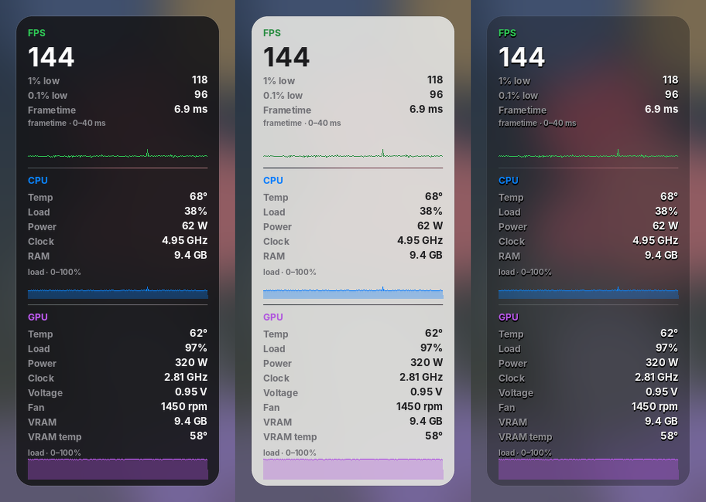

### No 12V versions
Compact, Meters, Meters Universal, Rings and Side also come **without the 12V cable section**, for graphics cards that don't report it or if you just don't want it. They're the same overlays, slightly smaller. Look for the folders ending in `-no-12v`.


---

## Themes

Every overlay comes in three themes:

| Theme | Folder | Look |
|---|---|---|
| **Dark** | `dark` | Dark glass panel, white text |
| **White** | `white` | Soft light-grey panel with dark text, toned down so it isn't glaring. Turn off **On-Screen Display shadow** in RTSS for sharp text. |
| **Clear** | `clear` | Mostly see-through panel; every number has a drop shadow so it stays readable over bright scenes |

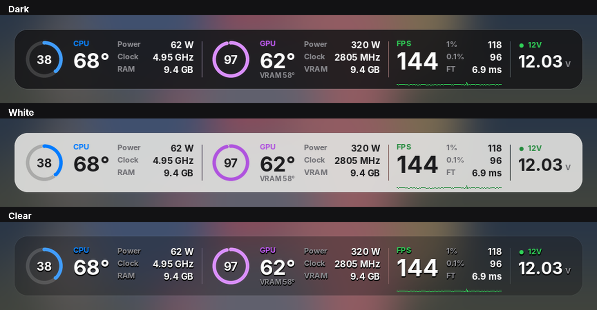

<details>
<summary>All white and clear previews</summary>

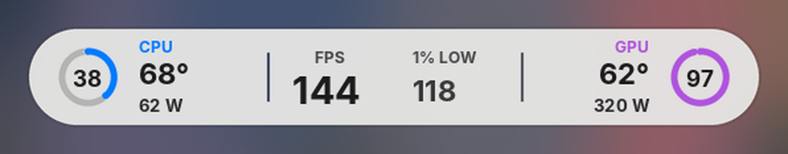
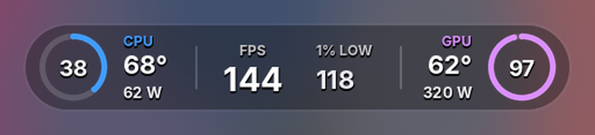
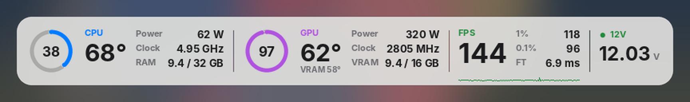
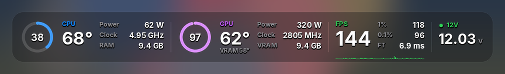
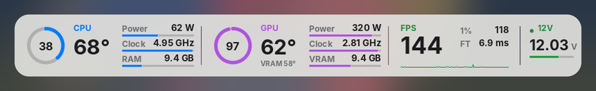
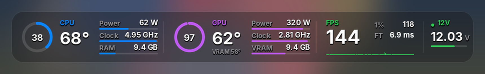
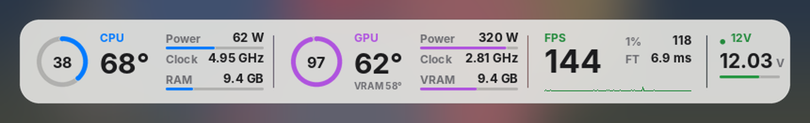
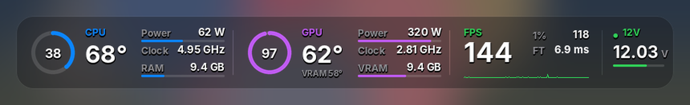
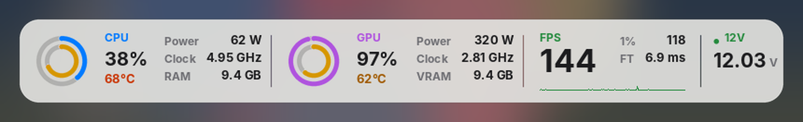
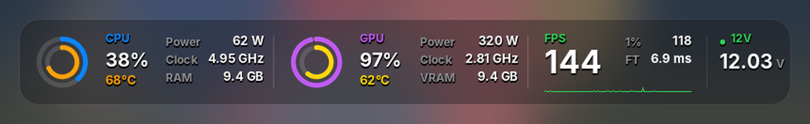
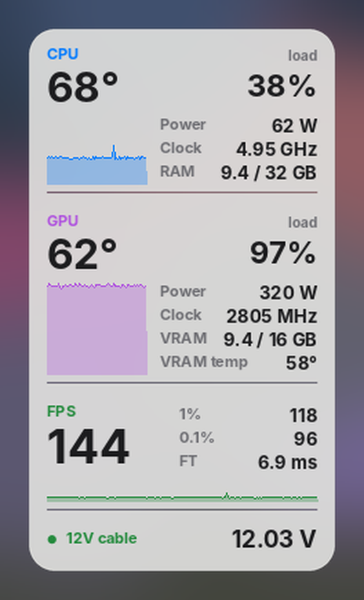 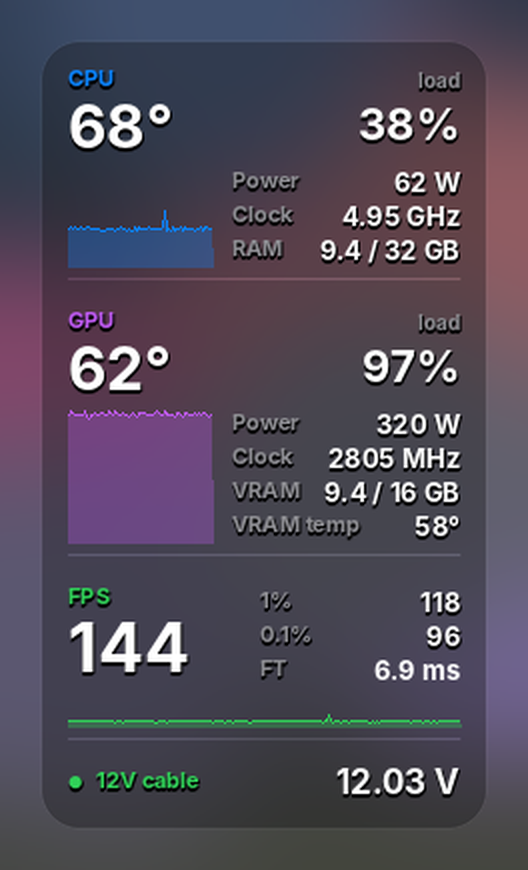

</details>

---

## Requirements

| Program | Why |
|---|---|
| [RivaTuner Statistics Server](https://www.guru3d.com/download/rtss-rivatuner-statistics-server-download/) with the **OverlayEditor** plugin enabled | Draws the overlay |
| [MSI Afterburner](https://www.msi.com/Landing/afterburner) | CPU/GPU usage, temperature, power, FPS, 1% low |
| [HWiNFO64](https://www.hwinfo.com/) | Clocks, VRAM temperature, GPU voltage and fan, 12V cable voltage, GPU limit warnings (needed by every overlay except Sleek) |

**HWiNFO setup:** run it in **Sensors-only** mode, open **Settings**, tick **Shared Memory Support**, and keep it running in the background. On the free version this switches itself off after 12 hours, so tick it again if values go blank.

---

## Install

1. Download this repo (**Code → Download ZIP**) and unzip it.
2. Inside `overlays/`, open the overlay you want, then the theme (`dark`, `white` or `clear`), then the folder for **your screen resolution**. For example: `overlays/sleek-meters/white/2560x1440`.

   | Folder | Screen |
   |---|---|
   | `1920x1080` | 1080p |
   | `2560x1440` | 1440p |
   | `3440x1440` | 21:9 ultrawide |
   | `3840x1600` | 24:10 ultrawide |
   | `3840x2160` | 4K |
   | `5120x1440` | 32:9 super-ultrawide |
   | `5120x2160` | 5K2K ultrawide |

3. Copy **both files** in that folder (the `.ovl` and its `_atlas.png`) into:
   ```
   C:\Program Files\RivaTuner Statistics Server\Plugins\Client\Overlays
   ```
   Put them directly in that folder, **not in a subfolder**. Each overlay looks for its image in that exact folder.
4. In RTSS, open **OverlayEditor**, go to **Layouts → Load**, and pick the overlay.

The resolution versions only change **where** the overlay sits: centred at the top, or on the right edge for Sleek Side and the Performance Overlay. On a 4K or 5K2K screen it will look smaller, so use the **On-Screen Display zoom** slider in RTSS to make it bigger. On any screen you can also drag it wherever you like in OverlayEditor.

---

## Notes

- The **12V cable** reading needs a graphics card that reports its 16-pin connector voltage in HWiNFO. On cards that don't, use the **No 12V** versions.
- **The 12V monitor is a visual hint, not a safety system.** It only changes colour on the overlay: there's no pop-up or sound, so it only helps if you happen to look at it. Readings depend on your card's sensors and can be imprecise. It's no substitute for a properly seated, undamaged cable. For a real alert, set an alarm on the 12V reading in HWiNFO, which can show a warning or play a sound.
- The dot next to 12V turns **amber** below 11.85 V and **red** below 11.75 V. It only reacts once the GPU is drawing more than 150 W. At low power hardly any current flows through the cable, so even a bad connection barely lowers the voltage; a low reading only means something under real load. At idle or on the desktop, the dot stays green.
- **Sleek Meters** uses fixed scales for an upper-mid-range PC (CPU 120 W, GPU 360 W, CPU clock 5.05 GHz, GPU clock 2.9 GHz, RAM 32 GB, VRAM 16 GB). For a high-end PC, use **Sleek Meters Universal**.
- **Sleek Meters Universal:** to change a scale, open **Data sources** in OverlayEditor and edit the matching `pct` source's formula. For example, `x / 6` means 600 W is full; change it to `x / 3.6` for 360 W.
- The CPU clock shows the *effective* clock, so it reads very low at idle and close to your CPU's boost clock in games.

## Troubleshooting

| Problem | Fix |
|---|---|
| Garbled letters instead of the panel | The `_atlas.png` file is missing or in a subfolder. Put it next to the `.ovl` in the main Overlays folder. |
| Some values show `N/A` or are blank | HWiNFO isn't running, or Shared Memory Support is off. |
| A value stays blank even with HWiNFO running | In OverlayEditor, open **Data sources**, select the row, click **Setup**, and pick the matching sensor from your HWiNFO list. |
| 1% / 0.1% show 0 | Normal outside a game. They fill in once a game is running. |
| Text looks blurry or smudged on the White theme | Turn off **On-Screen Display shadow** in the main RTSS window. The shadow is meant for white text on dark backgrounds; the Dark themes don't need it, and the Clear themes have their own shadow built in. |

---

## License

MIT. Use them, change them and share them; just keep the license file with them. See [LICENSE](LICENSE).
