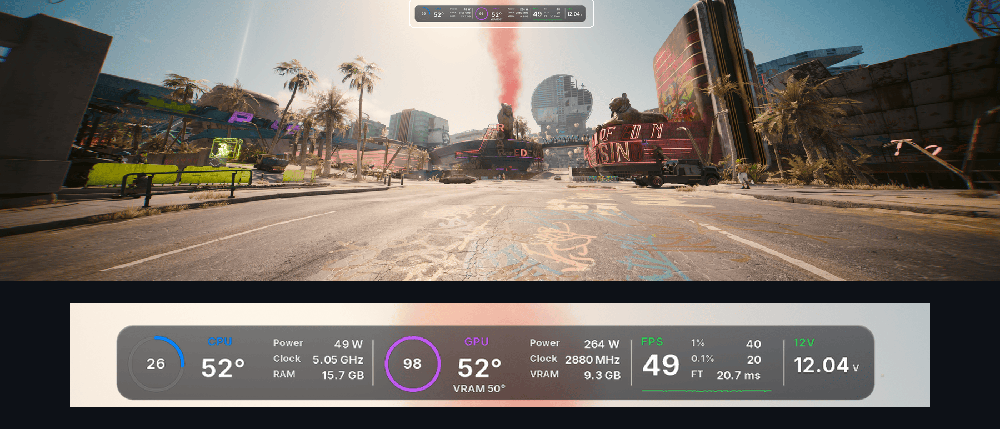
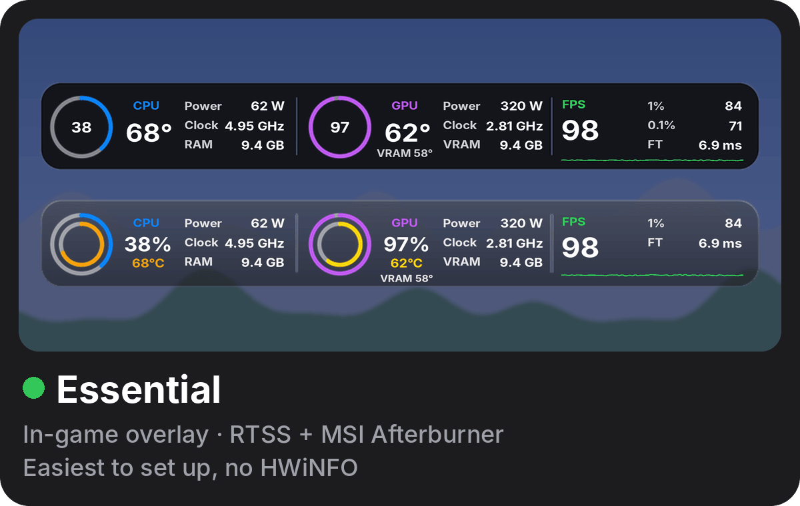
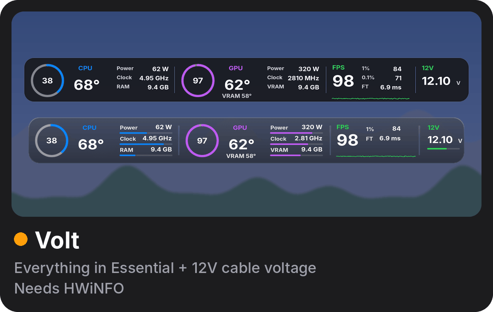
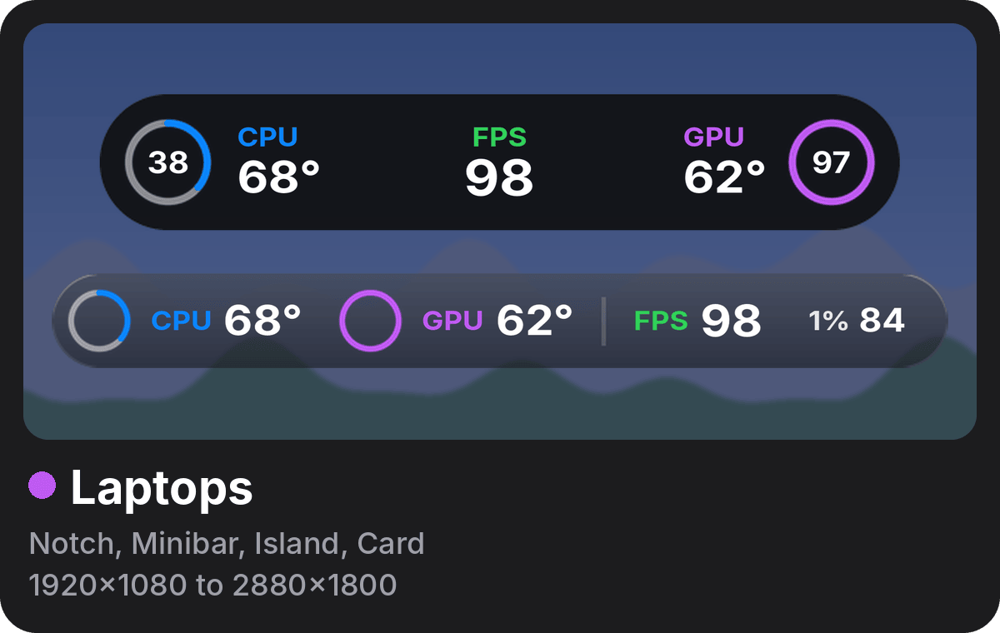
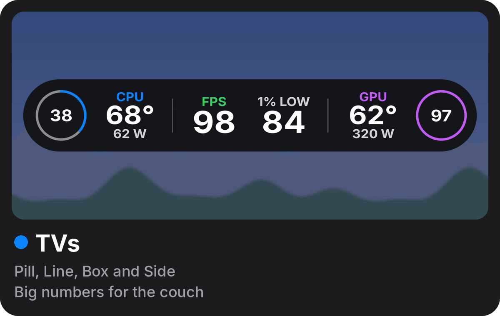
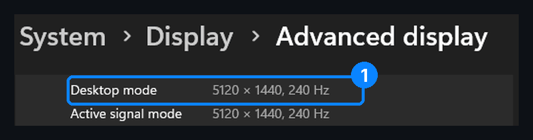
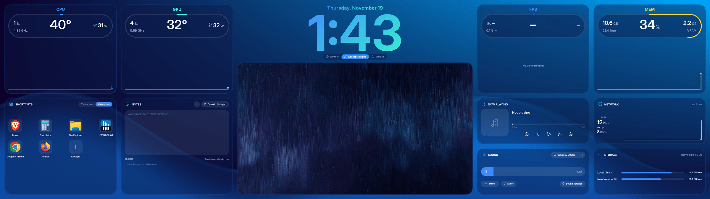
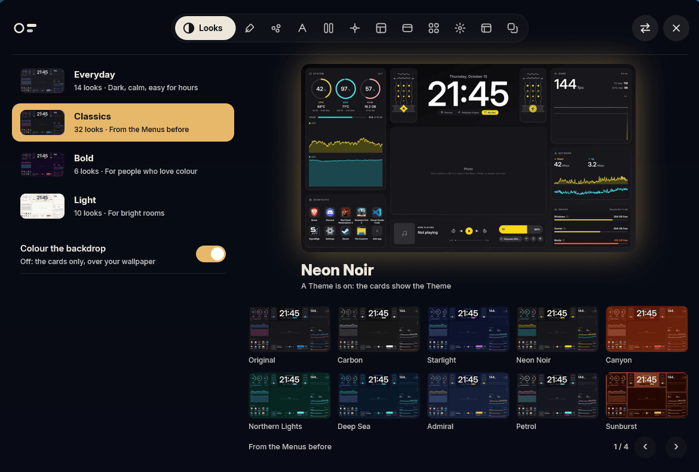
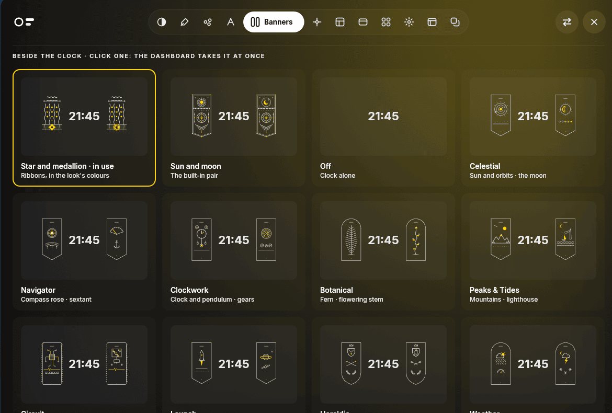

<h1 align="center">Ring Pill Overlays & Monitors and Widgets</h1>

Clean performance stats for your PC: inside your games, and on your second screen. Free and open source. ⭐ <b>Thank you for 100 stars!</b> 💜

<a href="#download"><b>⬇️ Download</b></a> · <a href="docs/overlay-setup.md"><b>🧭 Set up</b></a> · <a href="CHANGELOG.md"><b>🆕 What's new</b></a> · <a href="docs/help.md"><b>🛠️ Help</b></a>

<table>
<tr>
<td width="50%" valign="top">
<h3>🎮 Ring Pill Overlays</h3>
CPU, GPU, FPS and frame time <b>inside your games</b>. 23 designs in four themes, for screens from 1080p to 7680×2160, laptops and TVs.  
Needs MSI Afterburner + RTSS  
<a href="#overlays"><b>👀 See them</b></a> · <a href="#download"><b>⬇️ Download</b></a> · <a href="docs/overlay-setup.md"><b>🧭 Set up</b></a>
</td>
<td width="50%" valign="top">
<h3>🖥️ Monitors & Widgets</h3>
A dashboard <b>on your desktop</b>: a second monitor, a case screen or your main screen. 62 looks, hand-made Themes and its own Menu.  
Needs Rainmeter + MSI Afterburner  
<a href="#rainmeter"><b>👀 See it</b></a> · <a href="https://github.com/realHfde/Apple-Style-Inspired-RTSS-Overlay/raw/main/rainmeter/Monitors%20and%20Widgets%202.0%20beta.rmskin"><b>⬇️ Download 2.0 beta</b></a> · <a href="docs/monitors-and-widgets.md"><b>🧭 Set up</b></a>
</td>
</tr>
</table>

> 🆕 **Monitors & Widgets 2.0 beta is out**: new dashboards, 62 looks, Themes and a new Menu. **Overlays 2.0** brought the Smoke theme, TV and laptop designs. [Everything that's new](CHANGELOG.md)

## 🎮 Ring Pill Overlays

 <b>⚡ Volt Sleek Compact</b> · Smoke theme · Cyberpunk 2077 · 5120×1440

### Pick yours

<table>
<tr>
<td width="50%" align="center"> <a href="docs/overlays.md#essential">👀 See all 8</a> · <a href="#download">⬇️ Download</a></td>
<td width="50%" align="center"> <a href="docs/overlays.md#volt">👀 See all 6</a> · <a href="#download">⬇️ Download</a></td>
</tr>
<tr>
<td width="50%" align="center"> <a href="docs/overlays.md#laptops">👀 See all 5</a> · <a href="#laptop-download">⬇️ Download</a></td>
<td width="50%" align="center"> <a href="docs/overlays.md#tvs">👀 See all 4</a> · <a href="#tv-download">⬇️ Download</a></td>
</tr>
</table>

**Not sure?** Pick **🟢 Essential**: it's the easiest to set up. Want to keep an eye on your 12V-2x6 / 12VHPWR cable? Pick **⚡ Volt**. Every overlay comes in four themes: **Dark, White, Smoke and Float** ([see them](docs/overlays.md#themes)).

### ⬇️ Download

Each pack has every overlay in every theme, sorted into **Dark**, **White**, **Smoke** and **Float** folders. **🟢 Essential** = no HWiNFO needed.

> 💻 **On a laptop?** Use the [laptop packs](#laptop-download) below.

| Screen | Resolution | 🟢 Essential | ⚡ Volt |
|---|---|---|---|
| 1080p | `1920x1080` | [⬇️ Download](https://github.com/realHfde/Apple-Style-Inspired-RTSS-Overlay/releases/latest/download/Essential.overlays.1920x1080.zip) | [⬇️ Download](https://github.com/realHfde/Apple-Style-Inspired-RTSS-Overlay/releases/latest/download/Volt.overlays.1920x1080.zip) |
| 1440p | `2560x1440` | [⬇️ Download](https://github.com/realHfde/Apple-Style-Inspired-RTSS-Overlay/releases/latest/download/Essential.overlays.2560x1440.zip) | [⬇️ Download](https://github.com/realHfde/Apple-Style-Inspired-RTSS-Overlay/releases/latest/download/Volt.overlays.2560x1440.zip) |
| 21:9 ultrawide | `3440x1440` | [⬇️ Download](https://github.com/realHfde/Apple-Style-Inspired-RTSS-Overlay/releases/latest/download/Essential.overlays.3440x1440.zip) | [⬇️ Download](https://github.com/realHfde/Apple-Style-Inspired-RTSS-Overlay/releases/latest/download/Volt.overlays.3440x1440.zip) |
| 24:10 ultrawide | `3840x1600` | [⬇️ Download](https://github.com/realHfde/Apple-Style-Inspired-RTSS-Overlay/releases/latest/download/Essential.overlays.3840x1600.zip) | [⬇️ Download](https://github.com/realHfde/Apple-Style-Inspired-RTSS-Overlay/releases/latest/download/Volt.overlays.3840x1600.zip) |
| 4K | `3840x2160` | [⬇️ Download](https://github.com/realHfde/Apple-Style-Inspired-RTSS-Overlay/releases/latest/download/Essential.overlays.3840x2160.zip) | [⬇️ Download](https://github.com/realHfde/Apple-Style-Inspired-RTSS-Overlay/releases/latest/download/Volt.overlays.3840x2160.zip) |
| 4K, **bigger (1.5×)** 🔍 | `3840x2160` | [⬇️ Download](https://github.com/realHfde/Apple-Style-Inspired-RTSS-Overlay/releases/latest/download/Essential.overlays.3840x2160.1.5x.zip) | [⬇️ Download](https://github.com/realHfde/Apple-Style-Inspired-RTSS-Overlay/releases/latest/download/Volt.overlays.3840x2160.1.5x.zip) |
| 4K, **biggest (2×)** 🔍 | `3840x2160` | [⬇️ Download](https://github.com/realHfde/Apple-Style-Inspired-RTSS-Overlay/releases/latest/download/Essential.overlays.3840x2160.2x.zip) | [⬇️ Download](https://github.com/realHfde/Apple-Style-Inspired-RTSS-Overlay/releases/latest/download/Volt.overlays.3840x2160.2x.zip) |
| 32:9 super-ultrawide | `5120x1440` | [⬇️ Download](https://github.com/realHfde/Apple-Style-Inspired-RTSS-Overlay/releases/latest/download/Essential.overlays.5120x1440.zip) | [⬇️ Download](https://github.com/realHfde/Apple-Style-Inspired-RTSS-Overlay/releases/latest/download/Volt.overlays.5120x1440.zip) |
| 5K2K ultrawide (e.g. LG 45" / 40" 5K2K) | `5120x2160` | [⬇️ Download](https://github.com/realHfde/Apple-Style-Inspired-RTSS-Overlay/releases/latest/download/Essential.overlays.5120x2160.zip) | [⬇️ Download](https://github.com/realHfde/Apple-Style-Inspired-RTSS-Overlay/releases/latest/download/Volt.overlays.5120x2160.zip) |
| 32:9 dual-4K (e.g. Samsung Odyssey Neo G9 57") | `7680x2160` | [⬇️ Download](https://github.com/realHfde/Apple-Style-Inspired-RTSS-Overlay/releases/latest/download/Essential.overlays.7680x2160.zip) | [⬇️ Download](https://github.com/realHfde/Apple-Style-Inspired-RTSS-Overlay/releases/latest/download/Volt.overlays.7680x2160.zip) |

<b>💻 Laptop packs</b> (click to open)

**💻 Laptop packs** (no HWiNFO needed). Two choices for every laptop screen:
- **Laptop designs**: the slim Notch, Minibar, Island and Card, made for laptops.
- **Normal designs**: the regular 🟢 Essential overlays (Sleek, Sleek Compact, Rings and the rest), sized for your laptop screen.

| Laptop screen | Resolution | 💻 Laptop designs | 🟢 Normal designs |
|---|---|---|---|
| 💻 Full HD | `1920x1080` | [⬇️ Download](https://github.com/realHfde/Apple-Style-Inspired-RTSS-Overlay/releases/latest/download/Laptop.overlays.1920x1080.zip) | [⬇️ Download](https://github.com/realHfde/Apple-Style-Inspired-RTSS-Overlay/releases/latest/download/Essential.overlays.1920x1080.zip) |
| 💻 16:10 (most budget / mid-range gaming laptops) | `1920x1200` | [⬇️ Download](https://github.com/realHfde/Apple-Style-Inspired-RTSS-Overlay/releases/latest/download/Laptop.overlays.1920x1200.zip) | [⬇️ Download](https://github.com/realHfde/Apple-Style-Inspired-RTSS-Overlay/releases/latest/download/Essential.overlays.1920x1200.zip) |
| 💻 QHD | `2560x1440` | [⬇️ Download](https://github.com/realHfde/Apple-Style-Inspired-RTSS-Overlay/releases/latest/download/Laptop.overlays.2560x1440.zip) | [⬇️ Download](https://github.com/realHfde/Apple-Style-Inspired-RTSS-Overlay/releases/latest/download/Essential.overlays.2560x1440.zip) |
| 💻 16:10 (most new high-end gaming laptops) | `2560x1600` | [⬇️ Download](https://github.com/realHfde/Apple-Style-Inspired-RTSS-Overlay/releases/latest/download/Laptop.overlays.2560x1600.zip) | [⬇️ Download](https://github.com/realHfde/Apple-Style-Inspired-RTSS-Overlay/releases/latest/download/Essential.overlays.2560x1600.zip) |
| 💻 16:10 OLED | `2880x1800` | [⬇️ Download](https://github.com/realHfde/Apple-Style-Inspired-RTSS-Overlay/releases/latest/download/Laptop.overlays.2880x1800.zip) | [⬇️ Download](https://github.com/realHfde/Apple-Style-Inspired-RTSS-Overlay/releases/latest/download/Essential.overlays.2880x1800.zip) |

<b>📺 TV packs</b> (click to open)

**📺 TV packs** (no HWiNFO needed, any TV size):

| TV | Resolution | Download |
|---|---|---|
| 📺 **4K TV** (43", 55", 65", 75", 85"…) | `3840x2160` | [⬇️ Download TV pack](https://github.com/realHfde/Apple-Style-Inspired-RTSS-Overlay/releases/latest/download/TV.overlays.3840x2160.zip) |
| 📺 1080p TV | `1920x1080` | [⬇️ Download TV pack](https://github.com/realHfde/Apple-Style-Inspired-RTSS-Overlay/releases/latest/download/TV.overlays.1920x1080.zip) |

<b>❓ Not sure about your resolution?</b> (click to open)

Open Windows **Settings → System → Display → Advanced display** and look at **Desktop mode**. The first two numbers are your resolution (e.g. **5120 × 1440** → download the `5120x1440` pack):

> The overlays follow your **resolution**, not your screen size: a 27" and a 32" 4K monitor (or a 55" and an 85" 4K TV) use the same pack. Windows display scaling doesn't change them either.

### 🧭 Set up (about 5 minutes)

1. Install **MSI Afterburner with RTSS** and the **Inter font**. For Volt only, also **HWiNFO**.
2. Download the pack for your screen and copy the files from one theme folder into RTSS's `Overlays` folder.
3. In RTSS, load the `.ovl` in the Overlay Editor. Play!

**[📖 The full guide, step by step with pictures](docs/overlay-setup.md)** · [🧰 Optional extras](docs/overlay-extras.md) (hotkey, two GPUs, moving an overlay)

## 🖥️ Monitors & Widgets

RTSS overlays only show inside a game. Monitors & Widgets sits on the **desktop** instead, on any screen: a clock, your photo or video, what's playing, your apps, CPU, GPU, memory, FPS, network and drives. It is made for **Rainmeter**.

| | 🆕 **2.0 beta** | **1.7.1** |
|---|---|---|
| **What it is** | The new one: 55 dashboards and widgets, 62 looks, Themes, a new Menu | The stable one: 33 skins for second monitors, case screens and the desktop |
| **Download** | [**⬇️ Monitors and Widgets 2.0 beta**](https://github.com/realHfde/Apple-Style-Inspired-RTSS-Overlay/raw/main/rainmeter/Monitors%20and%20Widgets%202.0%20beta.rmskin) | [⬇️ Monitors and Widgets 1.7.1](https://github.com/realHfde/Apple-Style-Inspired-RTSS-Overlay/releases/tag/monitor-1.7.1) |
| **Guide** | [📖 2.0 beta: install and what's in it](docs/monitors-and-widgets.md) | [📖 1.7.1: screens and setup](docs/monitors-and-widgets-1.7.1.md) |

2.0 beta installs **beside** 1.7.1 and does not touch it, so you can try it and keep both.

<table>
<tr>
<td width="50%" align="center"> 62 looks in one click</td>
<td width="50%" align="center"> Its own Menu. No files to edit</td>
</tr>
</table>

**[👀 See every screen it comes for, and how to set it up](docs/monitors-and-widgets.md)**

## 🛠️ Help

- **Something not showing?** [Troubleshooting and notes](docs/help.md), or for Monitors & Widgets [2.0 beta](docs/monitors-and-widgets.md#help) and [1.7.1](docs/monitors-and-widgets-1.7.1.md).
- **Still stuck?** Open an [issue](https://github.com/realHfde/Apple-Style-Inspired-RTSS-Overlay/issues) with a screenshot and your resolution. I reply to every one.
- **Show us yours!** Share your setup in [Show and tell](https://github.com/realHfde/Apple-Style-Inspired-RTSS-Overlay/discussions/10). What I'm working on is in the [roadmap](https://github.com/realHfde/Apple-Style-Inspired-RTSS-Overlay/discussions/12).

## Credits

Idea, design direction and testing by realHfde. AI helped build the files, scale them to every resolution and make the previews.

## License

MIT. Use them, change them and share them; just keep the license file with them. See [LICENSE](LICENSE).
