# Apple-Style RTSS Overlays

Hey! 👋 Clean, Apple-style performance stats for your PC: overlays for **RivaTuner Statistics Server (RTSS)** that show while you play, and **Monitors & Widgets** for your second screen, case screen or desktop. Free, for screens from 1080p up to 7680×2160, gaming laptops, TVs and case screens.

### Pick yours

Click a picture to **👀 see it**. Every card also has a **⬇️ Download** link that takes you straight to the files.

<table>
<tr>
<td width="50%" align="center"><a href="#essential">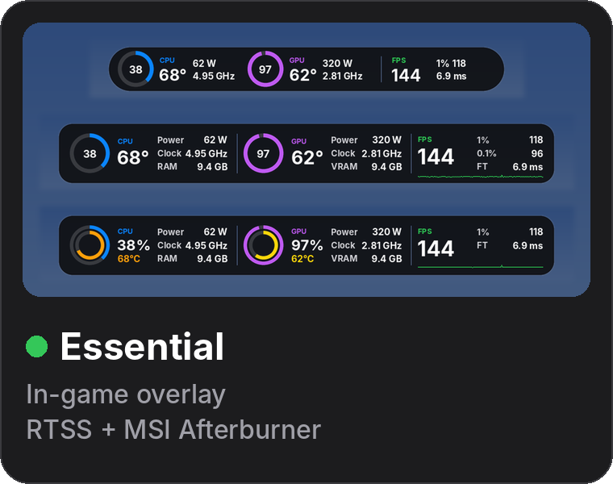</a><br><a href="#essential">👀 Preview</a> · <a href="#download">⬇️ Download</a></td>
<td width="50%" align="center"><a href="#volt">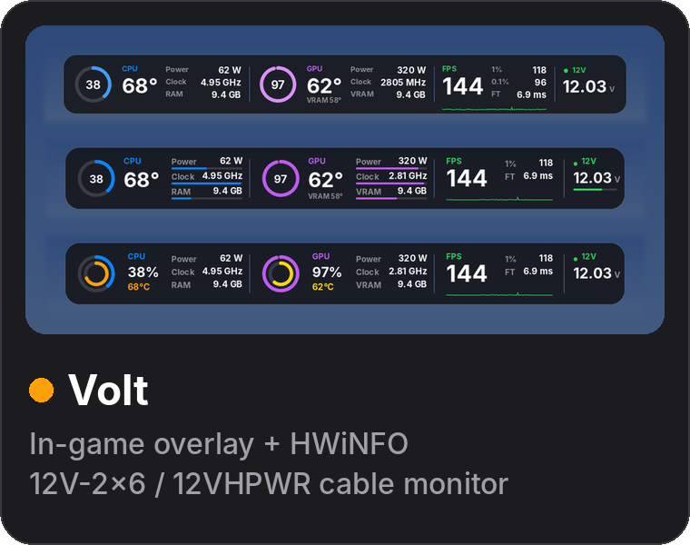</a><br><a href="#volt">👀 Preview</a> · <a href="#download">⬇️ Download</a></td>
</tr>
<tr>
<td width="50%" align="center"><a href="#rainmeter">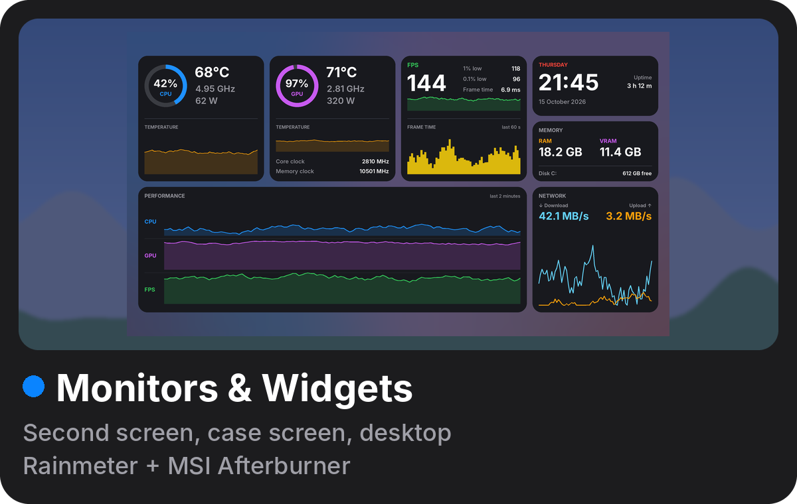</a><br><a href="#rainmeter">👀 Preview</a> · <a href="#monitor-setup">⬇️ Download</a></td>
<td width="50%" align="center"><a href="#laptops">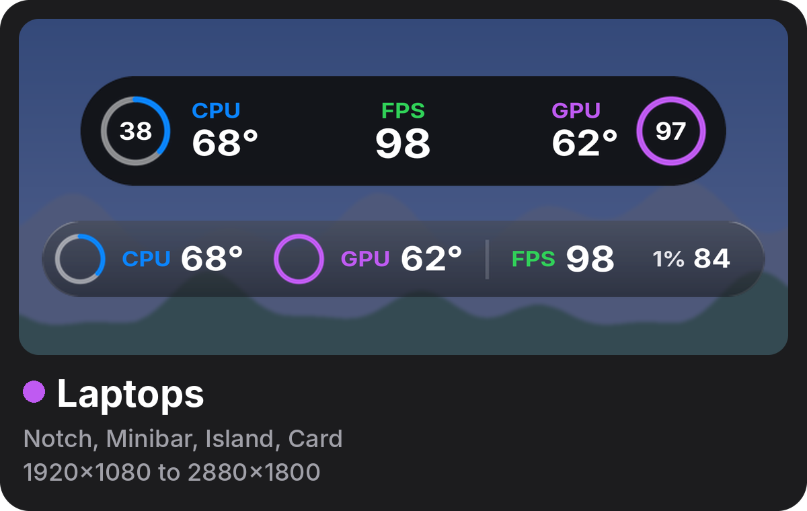</a><br><a href="#laptops">👀 Preview</a> · <a href="#laptop-download">⬇️ Download</a></td>
</tr>
<tr>
<td width="50%" align="center"><a href="#tvs">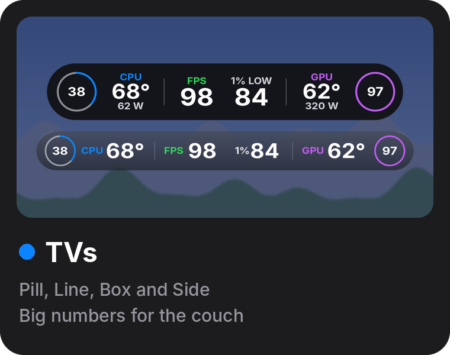</a><br><a href="#tvs">👀 Preview</a> · <a href="#tv-download">⬇️ Download</a></td>
<td width="50%" align="center"><a href="#themes">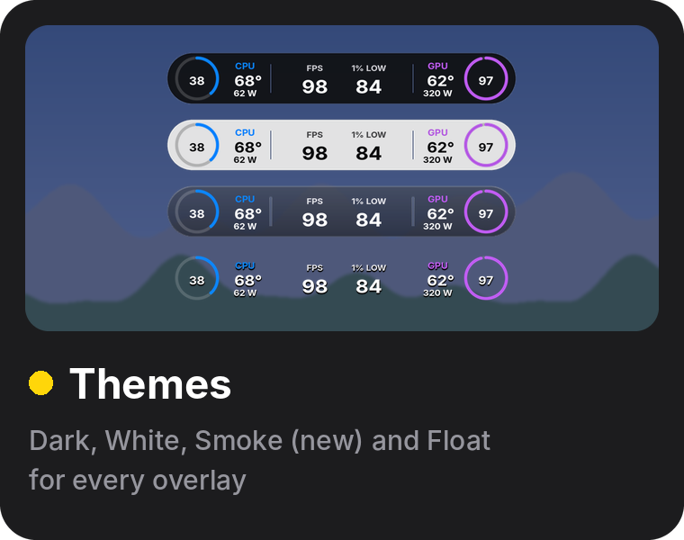</a><br><a href="#themes">👀 See the 4 themes</a></td>
</tr>
</table>

**Not sure?** Pick **🟢 Essential**: it's the easiest to set up. Want to keep an eye on your 12V-2x6 / 12VHPWR cable? Pick **⚡ Volt**.

<p align="center"><a href="#get-started"><b>🧭 Get started</b></a> · <a href="#download"><b>⬇️ Downloads</b></a> · <a href="#whats-new"><b>🆕 What's new</b></a> · <a href="#themes"><b>🎨 Themes</b></a> · <a href="#troubleshooting"><b>🛠️ Troubleshooting</b></a></p>

## 📣 Announcement

- **Overlays 2.0 is here:** a new **Smoke** theme replaces Clear, new **TV** and **laptop** designs, VRAM temperature on most Essential overlays, and every overlay polished. See [What's new](#whats-new).
- **Monitors & Widgets 1.7.1 is out:** a cleaner Menu, real RAM and VRAM sizes, a date option and tidier layouts. See [What's new](#whats-new).
- **Monitors & Widgets 2.0 is in testing:** every layout remade in a new dashboard look that fits any screen by itself, with 17 themes. It isn't ready yet, so **1.7.1** is the current version.
- **I'll still reply to every issue and problem.** Open an [issue](https://github.com/realHfde/Apple-Style-Inspired-RTSS-Overlay/issues) with a screenshot and your resolution.
- See the [roadmap](https://github.com/realHfde/Apple-Style-Inspired-RTSS-Overlay/discussions/12) for what I'm working on.

### 🎮 In game

<p align="center">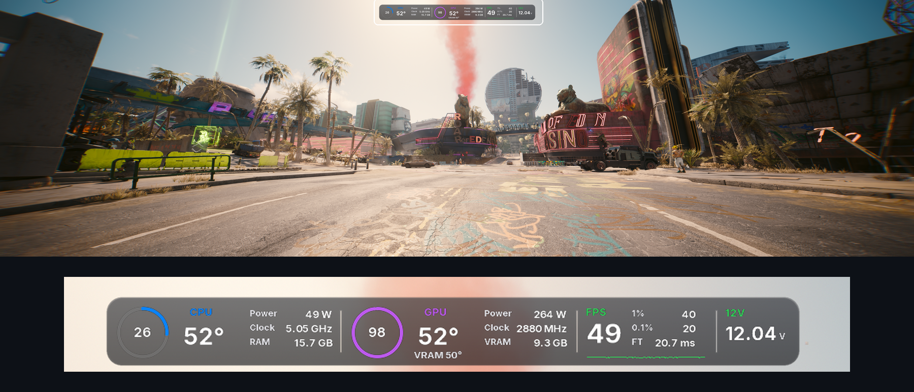<br><sub><b>⚡ Volt Sleek Compact</b> · 🆕 Smoke theme · Cyberpunk 2077 · 5120×1440</sub></p>

<details>
<summary><b>More in-game shots</b> (click to open)</summary>

<p align="center">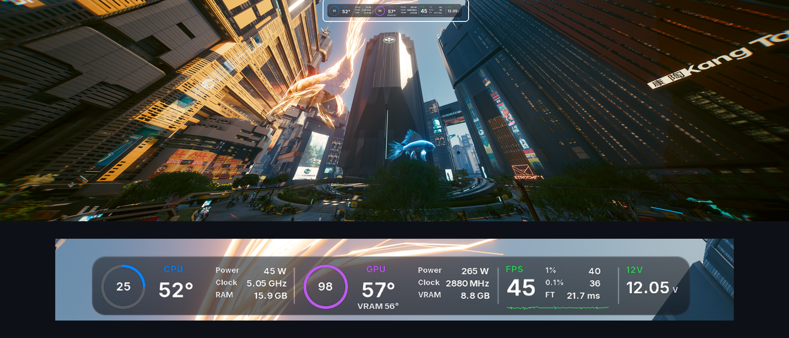<br><sub><b>Smoke</b> over a busy city · Cyberpunk 2077</sub></p>

<p align="center">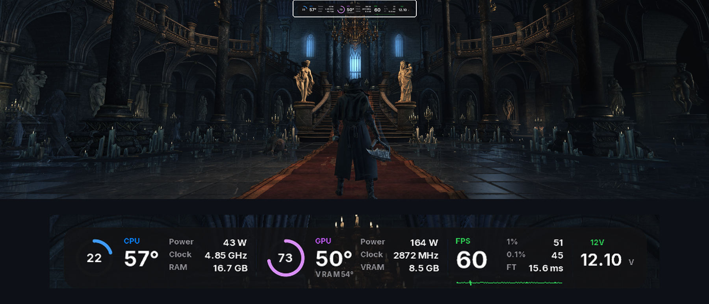<br><sub><b>Dark</b> theme on a dark scene</sub></p>

</details>

<p align="center">📸 <b>Show us yours!</b> Share a screenshot or photo of your setup in <a href="https://github.com/realHfde/Apple-Style-Inspired-RTSS-Overlay/discussions/10">Show and tell</a>.<br>If you like them, a ⭐ on GitHub or sharing them with a friend means a lot!</p>

> Previews below are made with sample numbers. Real colours and spacing can differ slightly in game.

<a id="whats-new"></a>
## 🆕 What's new

### 🎮 Overlays 2.0 · October 2026
- **🌫️ New theme: Smoke** (replaces Clear). The old Clear panel let too much of the game show through: the text wasn't sharp and the busy picture behind it was distracting while playing. Smoke is a tinted-glass panel, lighter at the top and darker at the bottom, with a thin soft edge. You can still tell the game is behind it, but the numbers stay crisp on any scene. [See the difference](#themes).
- **📺 New TV designs:** **TV Pill**, **TV Line**, **TV Box** and **TV Side**, made and tested on 55" and 65" 4K TVs from the couch. 4K and 1080p packs.
- **💻 New laptop designs:** **Notch**, **Minibar**, **Island**, **Island Time** (with a clock) and **Card**, in their own laptop packs for 1920×1080, 1920×1200, 2560×1440, 2560×1600 and 2880×1800. Laptop temperature colours are tuned for laptops (CPU 90° / 95°, GPU 85° / 92°).
- **🌡️ VRAM temperature** is now on Essential's Sleek Compact, Sleek Meters, Sleek Meters Universal, Sleek Rings, Sleek Side and Performance. No HWiNFO needed.
- **✨ Every overlay polished:** thinner rounded rings, better spacing and alignment, easier-to-read grey labels, smooth panel edges, and graphs that are a line on a soft background (a plain line on White).
- **🔌 Fewer things to set up:** the temperatures, usage, power, clocks, RAM and VRAM now come from **RTSS itself**. MSI Afterburner is only used for **FPS, 1% low and 0.1% low**, and Volt only uses HWiNFO for the **12V cable**.
- **🧹 Simpler line-up:** the Power / Thermal limit text is gone, and so are Volt Sleek, the Volt "no 12V" versions and the old Island Bar (replaced by the new laptop designs). Had them? See [switching from older versions](#old-names).

<details>
<summary><b>👀 Old (1.5) vs new (2.0)</b> (click to open)</summary>

<p align="center">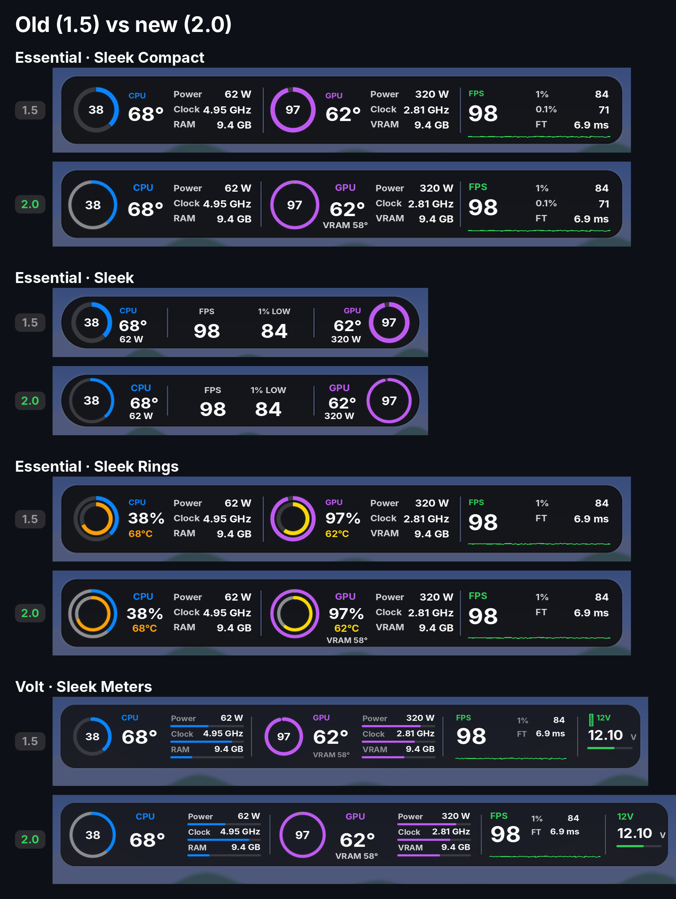</p>

Thinner rings, numbers centred in the rings, VRAM temperature added, cleaner spacing, and the Power / Thermal limit text removed.

</details>

### 📱 Monitors & Widgets 1.7.1 · October 2026
- **🧭 A cleaner Menu**, grouped into Look, This layout and Readings. Size now goes from **1% to 300%**, with a **Reset** button back to 100%. [See it](#monitor-options)
- **🖱️ Click a layout to switch:** while the Menu is open, click any layout and **This layout** (screen and size) changes that one. No need to reopen the Menu for each skin.
- **📊 Memory bars:** one **Off / On** switch shows RAM and VRAM out of your PC's **real** sizes, so a 12 GB or 24 GB card shows right. It replaces the fixed 8 / 16 / 32 GB choices.
- **📅 Date:** pick **21 October**, **October 21** or **10/21/2026**.
- **🔧 Fixed:** the desktop widgets could show the wrong total video memory (often 8 GB), and the Menu didn't change their RAM and VRAM bars.
- **✨ Tidier layouts:** case screens use their space better, bar screens show the FPS stats on one line, the repeated **Core clock** is gone from the second-monitor layouts, and **Horizontal 2** now shows RAM.
- **🖐️ Every skin can be dragged**, and installing over 1.7 keeps your settings.
- 🔜 **2.0 is in testing.** See the [roadmap](https://github.com/realHfde/Apple-Style-Inspired-RTSS-Overlay/discussions/12).

<details>
<summary><b>Older updates</b> (click to open)</summary>

- **📱 Monitors & Widgets 1.7:** the **Smoke** and **Tint** themes, **16x9 Compact** and **Portrait Compact** layouts with network, everything in one **Menu**, and clearer folder names.
- **📱 Monitors & Widgets 1.6:** no empty border around the cards, new 12-hour / 24-hour **Clock** option, works on Rainmeter 4.5 and 5.
- **⚙️ Settings panel for Monitors & Widgets 1.5** (now called the **Menu**: right-click a skin → **Menu…**).
- **🔧 Fixed:** 4K 1.5x / 2x overlays show their rings, meters and panel correctly.
- **🏷️ New names (1.5):** the MSI Edition became **🟢 Essential**, the original overlays became **⚡ Volt**, and Apple Style Monitor became **📱 Monitors & Widgets**.
- **📱 Monitors & Widgets 1.4 (Rainmeter):** dashboards for a second monitor, HYTE Y70, Lian Li screens, Corsair Xeneon Edge and the desktop.
- **🔍 Bigger 4K versions:** every overlay also comes at **1.5×** and **2×** size for 4K.
- **🖥️ 7680x2160**, **3840x1600** and **5120x2160** resolutions, the **Float** theme, and step-by-step picture guides.

</details>

Thanks to everyone on Reddit who asked for these!

---

<a id="get-started"></a>
## 🧭 Get started

> ⚡ **Already have MSI Afterburner and RTSS? Quick start**
> 1. Install the **[Inter font](#install-inter)**. For Volt only, also **HWiNFO** with [Shared Memory](#hwinfo-setup-shared-memory) on.
> 2. Afterburner → Settings → **Monitoring**: tick **Framerate**, **Framerate 1% Low** and **Framerate 0.1% Low** (On-Screen Display off).
> 3. [Download the pack](#download) for your resolution and copy the files from one theme folder into `C:\Program Files (x86)\RivaTuner Statistics Server\Plugins\Client\Overlays`.
> 4. RTSS → **Setup → Plugins → OverlayEditor.dll → Setup** → **Layouts → Load** → pick the `.ovl`. Play!
>
> **Nothing showing in game?** Follow the full setup below, step by step.

**New to this?** Takes about 5 minutes. Follow these in order. 👇

### 🟢 First: which version do you want?

| Version | 👀 Preview | ⬇️ Download | Needs | Shows |
|---|---|---|---|---|
| 🟢 **Essential** (easiest) | [See it](#essential) | [Pick your screen](#download) | MSI Afterburner + RTSS | CPU & GPU usage, temps, power, clocks, RAM, VRAM, VRAM temp, FPS, 1% / 0.1% lows, frametime |
| ⚡ **Volt** | [See it](#volt) | [Pick your screen](#download) | MSI Afterburner + RTSS + **HWiNFO** | All of that **plus the 12V cable voltage** |
| 💻 **Laptops** | [See it](#laptops) | [Laptop packs](#laptop-download) | MSI Afterburner + RTSS | Slim bars and a card made for laptop screens |
| 📺 **TVs** | [See it](#tvs) | [TV packs](#tv-download) | MSI Afterburner + RTSS | Big numbers for the couch |
| 📱 **Monitors & Widgets** | [See it](#rainmeter) | [Its own download](#monitor-setup) | MSI Afterburner + **Rainmeter** (no RTSS setup) | Your stats on a **second monitor**, a **case screen** (**HYTE Y70**, **Lian Li** 8.8" / 9.2" / Lancool 207), a **Corsair Xeneon Edge** or your desktop |

**Only Volt needs HWiNFO (step 2).** Everyone else skips it. You can always switch from Essential to Volt later.

### 1️⃣ Install the free programs

| Program | Why you need it |
|---|---|
| [**MSI Afterburner**](https://www.msi.com/Landing/afterburner) **with RTSS** | **Install this one.** Its installer has a box for **RivaTuner Statistics Server (RTSS)**: keep it ticked and you get both in one go. RTSS draws the overlay. Afterburner gives it the **FPS, 1% low and 0.1% low** numbers: RTSS can't hand those to the overlays on its own. |
| [**HWiNFO64**](https://www.hwinfo.com/) *(Volt only)* | Reads the **12V cable voltage**. Not needed for Essential, laptops or TVs. |
| [**Inter font**](https://rsms.me/inter/) | The font the overlays use. Without it the text won't line up ([how to install](#install-inter)). |

> Already have RTSS on its own? It works, but install Afterburner too, or FPS and the lows stay blank. Don't install a second RTSS on top of the one that comes with Afterburner.

<a id="install-inter"></a>
### 🔤 Install the Inter font

| # | What to do |
|---|---|
| 1 | Go to [rsms.me/inter](https://rsms.me/inter/) and click **Download** |
| 2 | Find **Inter-4.1.zip** in your Downloads and click it |
| 3 | Click **Extract all** at the top, then **Extract** |
| 4 | In the folder that opens, **right-click Inter.ttc** |
| 5 | Click **Install for all users**. Some programs only see fonts installed for all users |

<details>
<summary>📷 Show the pictures</summary>

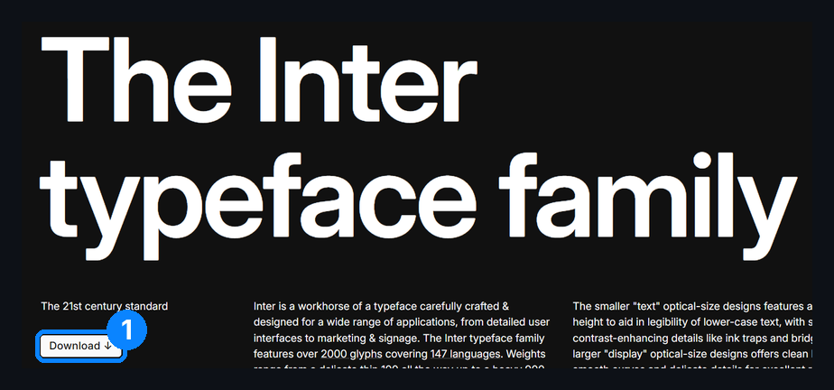

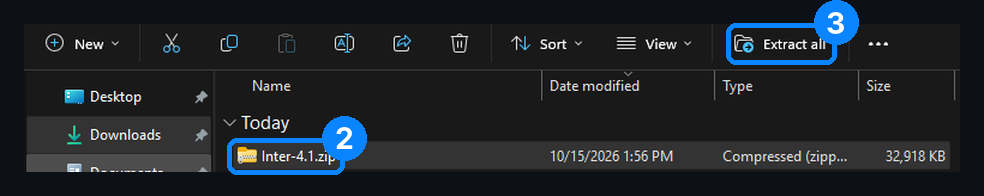

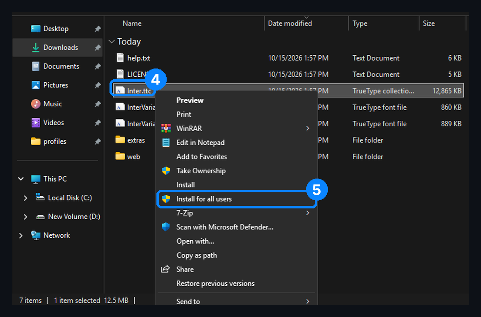

</details>

Then **restart RTSS** (close it from the tray and open it again).

<a id="hwinfo-setup-shared-memory"></a>
### 2️⃣ Turn on HWiNFO Shared Memory ⚡ (Volt only)

### 🛑 Using Essential, a laptop or a TV overlay? You don't need HWiNFO. Skip to [step 3](#afterburner-setup).

### ⚡ Volt only: without this, the 12V cable stays blank.

1. Start HWiNFO64 and tick **Sensors-only**, then click **Start**. In the sensors window, click the **gear** button at the bottom.

   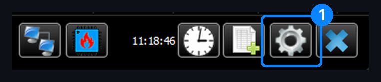

2. *(Optional)* In **Sensor Settings**, the **Global** polling period can stay at **2000 ms**. That's plenty for an overlay and keeps HWiNFO light.
3. Click **Main Settings** at the bottom.

   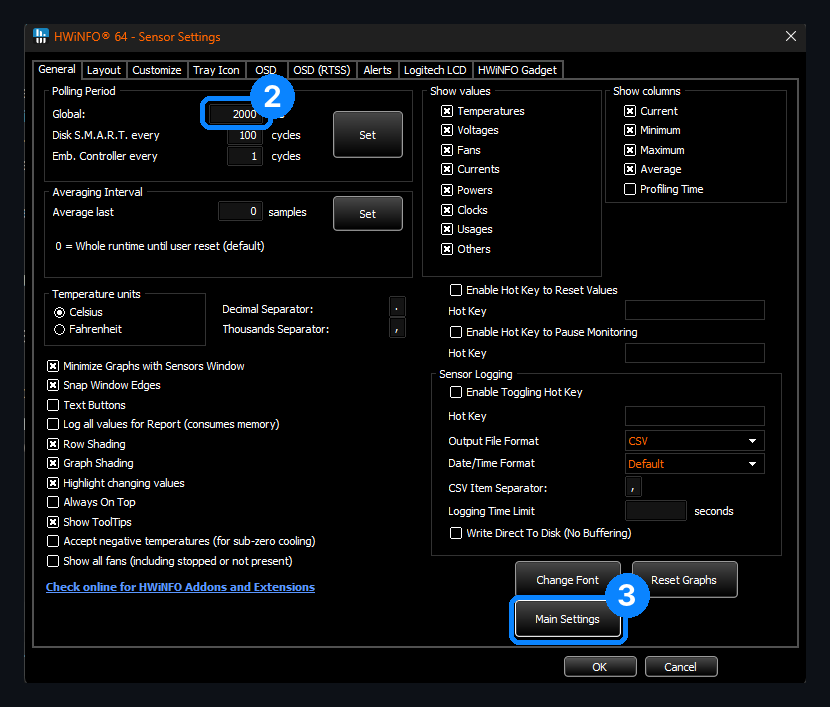

4. Tick **Shared Memory Support** and click **OK**.

   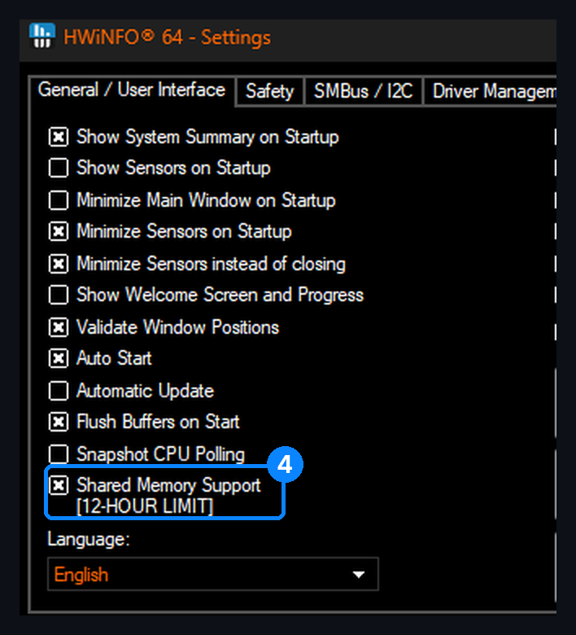

5. Keep HWiNFO running in the background (ticking **Auto Start** in the same window starts it with Windows).

> On the free version, Shared Memory switches itself off after **12 hours**. If 12V goes blank after a long session, tick it again (or restart HWiNFO).

<a id="afterburner-setup"></a>
### 3️⃣ Set up MSI Afterburner

| # | What to do |
|---|---|
| 1 | Click the **gear** (Settings) on the left |
| 2 | Open the **Monitoring** tab |
| 3 | **Scroll down** the list to the bottom and **tick** these three: **Framerate**, **Framerate 1% Low** and **Framerate 0.1% Low** |
| 4 | Click each ticked item and make sure **Show in On-Screen Display** is ❌ **unticked**, so Afterburner's own text doesn't stack on top of the overlay |
| 5 | Click **Apply**, then **OK** |

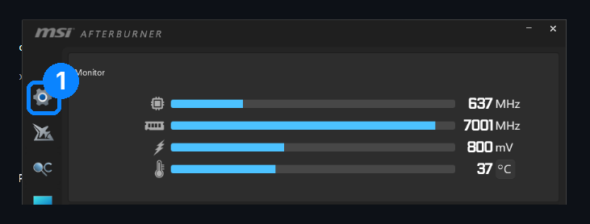 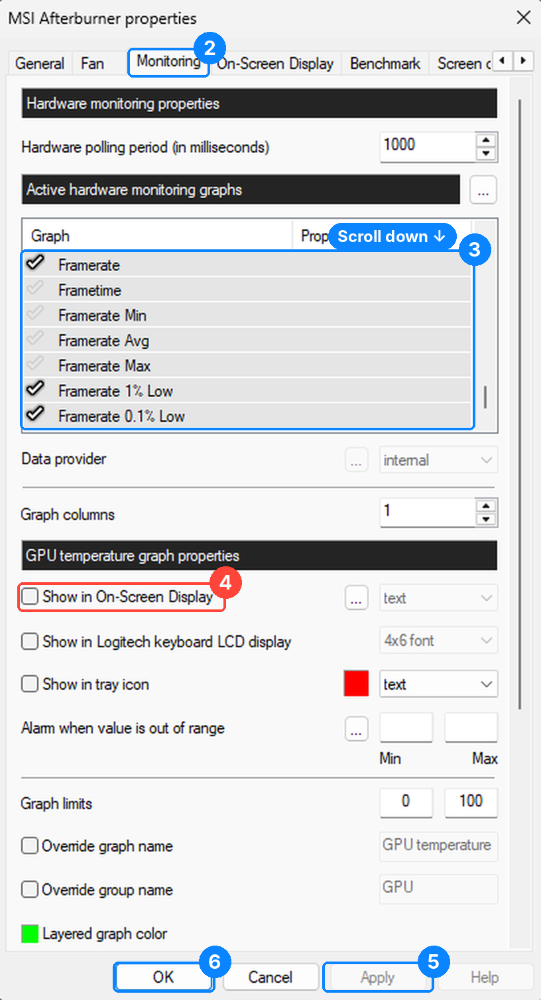

That's all the overlays need from Afterburner: everything else comes from RTSS itself. Ticking more doesn't hurt.

Keep Afterburner running in the background.

<a id="rtss-setup"></a>
### 4️⃣ Set up RTSS (picture guide)

Open RTSS (the monitor icon in your taskbar tray). The numbers in the pictures match the steps.

| # | In the main RTSS window | Set it to | Why |
|---|---|---|---|
| 1 | **Show On-Screen Display** | ✅ **ON** | Nothing shows in game without it |
| 2 | **On-Screen Display support** | ✅ **ON** | Also needed for any overlay |
| 3 | **On-Screen Display shadow** | ❌ **OFF** | Keeps text sharp (White looks blurry with it on) |
| 4 | **Setup** button (bottom) | Click it | Opens the settings window |

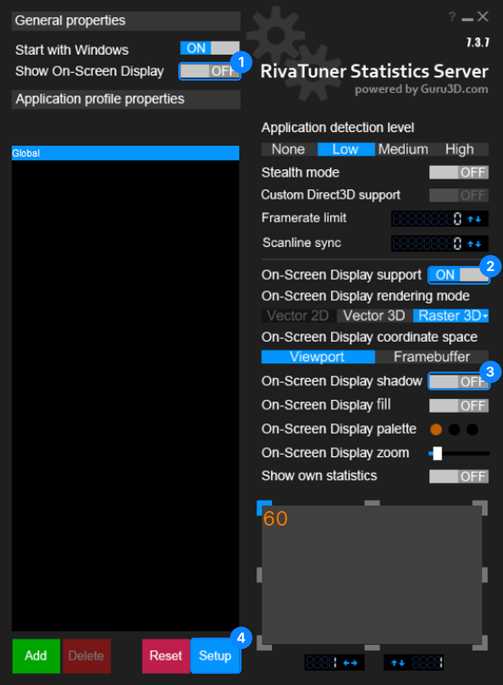

<a id="benchmark-tip"></a>
In **Setup**, stay on the **General** tab. The FPS, 1% low and 0.1% low numbers depend on these. If they're changed, the lows can show **0** or freeze:

| # | In **Setup → General** tab | Set it to |
|---|---|---|
| 5 | **General** tab | It opens on this tab |
| 6 | **Framerate averaging interval** | **1000** |
| 7 | **Refresh period** | **500** |
| 8 | **Percentile calculation mode** | **integral** |
| 9 | **Percentile buffer** | **ring** (keeps the 1% / 0.1% lows updating live) |
| 10 | **Enable benchmark mode**: **scroll down** to *Compatibility properties* | ✅ **ON**. Sometimes this is what makes the overlay show up in a game |

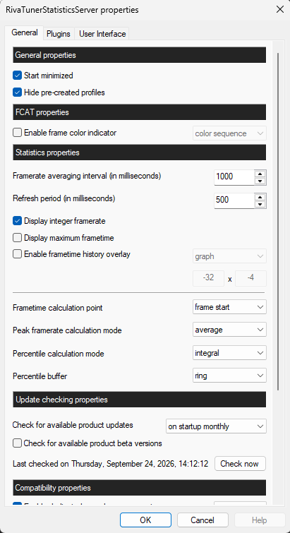 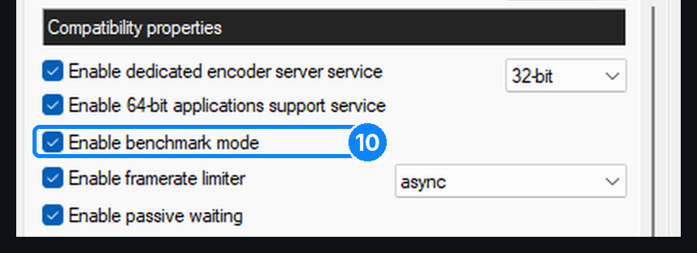

Then open the **Plugins** tab:

| # | In **Setup → Plugins** tab | Do this |
|---|---|---|
| 11 | **HotkeyHandler.dll** | ✅ Tick it |
| 12 | **OverlayEditor.dll** | ✅ Tick it, then **click its name** so it's highlighted in blue |
| 13 | **Setup** button (under the list) | Click it. This opens the **Overlay editor**, where you load the overlays. ⚠️ It only opens if OverlayEditor.dll is both **ticked and highlighted** |

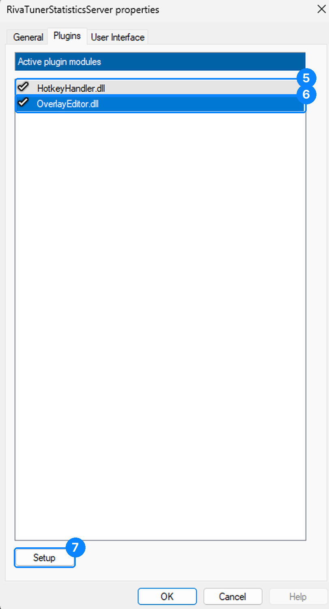

Close the Overlay editor for now and click **OK** in Setup. You'll open it again in [step 7](#load-it) to load your overlay.

<a id="download"></a>
### 5️⃣ Download the pack for your screen

Each pack has every overlay in every theme, sorted into **Dark**, **White**, **Smoke** and **Float** folders. **🟢 Essential** = no HWiNFO needed.

> 💻 **On a laptop?** Use the [laptop packs](#laptop-download) below.

| Screen | Resolution | 🟢 Essential | ⚡ Volt |
|---|---|---|---|
| 1080p | `1920x1080` | [⬇️ Download](https://github.com/realHfde/Apple-Style-Inspired-RTSS-Overlay/releases/latest/download/Essential.overlays.1920x1080.zip) | [⬇️ Download](https://github.com/realHfde/Apple-Style-Inspired-RTSS-Overlay/releases/latest/download/Volt.overlays.1920x1080.zip) |
| 1440p | `2560x1440` | [⬇️ Download](https://github.com/realHfde/Apple-Style-Inspired-RTSS-Overlay/releases/latest/download/Essential.overlays.2560x1440.zip) | [⬇️ Download](https://github.com/realHfde/Apple-Style-Inspired-RTSS-Overlay/releases/latest/download/Volt.overlays.2560x1440.zip) |
| 21:9 ultrawide | `3440x1440` | [⬇️ Download](https://github.com/realHfde/Apple-Style-Inspired-RTSS-Overlay/releases/latest/download/Essential.overlays.3440x1440.zip) | [⬇️ Download](https://github.com/realHfde/Apple-Style-Inspired-RTSS-Overlay/releases/latest/download/Volt.overlays.3440x1440.zip) |
| 24:10 ultrawide | `3840x1600` | [⬇️ Download](https://github.com/realHfde/Apple-Style-Inspired-RTSS-Overlay/releases/latest/download/Essential.overlays.3840x1600.zip) | [⬇️ Download](https://github.com/realHfde/Apple-Style-Inspired-RTSS-Overlay/releases/latest/download/Volt.overlays.3840x1600.zip) |
| 4K | `3840x2160` | [⬇️ Download](https://github.com/realHfde/Apple-Style-Inspired-RTSS-Overlay/releases/latest/download/Essential.overlays.3840x2160.zip) | [⬇️ Download](https://github.com/realHfde/Apple-Style-Inspired-RTSS-Overlay/releases/latest/download/Volt.overlays.3840x2160.zip) |
| 4K, **bigger (1.5×)** 🔍 | `3840x2160` | [⬇️ Download](https://github.com/realHfde/Apple-Style-Inspired-RTSS-Overlay/releases/latest/download/Essential.overlays.3840x2160.1.5x.zip) | [⬇️ Download](https://github.com/realHfde/Apple-Style-Inspired-RTSS-Overlay/releases/latest/download/Volt.overlays.3840x2160.1.5x.zip) |
| 4K, **biggest (2×)** 🔍 | `3840x2160` | [⬇️ Download](https://github.com/realHfde/Apple-Style-Inspired-RTSS-Overlay/releases/latest/download/Essential.overlays.3840x2160.2x.zip) | [⬇️ Download](https://github.com/realHfde/Apple-Style-Inspired-RTSS-Overlay/releases/latest/download/Volt.overlays.3840x2160.2x.zip) |
| 32:9 super-ultrawide | `5120x1440` | [⬇️ Download](https://github.com/realHfde/Apple-Style-Inspired-RTSS-Overlay/releases/latest/download/Essential.overlays.5120x1440.zip) | [⬇️ Download](https://github.com/realHfde/Apple-Style-Inspired-RTSS-Overlay/releases/latest/download/Volt.overlays.5120x1440.zip) |
| 5K2K ultrawide (e.g. LG 45" / 40" 5K2K) | `5120x2160` | [⬇️ Download](https://github.com/realHfde/Apple-Style-Inspired-RTSS-Overlay/releases/latest/download/Essential.overlays.5120x2160.zip) | [⬇️ Download](https://github.com/realHfde/Apple-Style-Inspired-RTSS-Overlay/releases/latest/download/Volt.overlays.5120x2160.zip) |
| 32:9 dual-4K (e.g. Samsung Odyssey Neo G9 57") | `7680x2160` | [⬇️ Download](https://github.com/realHfde/Apple-Style-Inspired-RTSS-Overlay/releases/latest/download/Essential.overlays.7680x2160.zip) | [⬇️ Download](https://github.com/realHfde/Apple-Style-Inspired-RTSS-Overlay/releases/latest/download/Volt.overlays.7680x2160.zip) |

<a id="laptop-download"></a>
**💻 Laptop packs** (no HWiNFO needed). Two choices for every laptop screen:
- **Laptop designs**: the slim Notch, Minibar, Island and Card, made for laptops.
- **Normal designs**: the regular 🟢 Essential overlays (Sleek, Sleek Compact, Rings and the rest), sized for your laptop screen.

| Laptop screen | Resolution | 💻 Laptop designs | 🟢 Normal designs |
|---|---|---|---|
| 💻 Full HD | `1920x1080` | [⬇️ Download](https://github.com/realHfde/Apple-Style-Inspired-RTSS-Overlay/releases/latest/download/Laptop.overlays.1920x1080.zip) | [⬇️ Download](https://github.com/realHfde/Apple-Style-Inspired-RTSS-Overlay/releases/latest/download/Essential.overlays.1920x1080.zip) |
| 💻 16:10 (most budget / mid-range gaming laptops) | `1920x1200` | [⬇️ Download](https://github.com/realHfde/Apple-Style-Inspired-RTSS-Overlay/releases/latest/download/Laptop.overlays.1920x1200.zip) | [⬇️ Download](https://github.com/realHfde/Apple-Style-Inspired-RTSS-Overlay/releases/latest/download/Essential.overlays.1920x1200.zip) |
| 💻 QHD | `2560x1440` | [⬇️ Download](https://github.com/realHfde/Apple-Style-Inspired-RTSS-Overlay/releases/latest/download/Laptop.overlays.2560x1440.zip) | [⬇️ Download](https://github.com/realHfde/Apple-Style-Inspired-RTSS-Overlay/releases/latest/download/Essential.overlays.2560x1440.zip) |
| 💻 16:10 (most new high-end gaming laptops) | `2560x1600` | [⬇️ Download](https://github.com/realHfde/Apple-Style-Inspired-RTSS-Overlay/releases/latest/download/Laptop.overlays.2560x1600.zip) | [⬇️ Download](https://github.com/realHfde/Apple-Style-Inspired-RTSS-Overlay/releases/latest/download/Essential.overlays.2560x1600.zip) |
| 💻 16:10 OLED | `2880x1800` | [⬇️ Download](https://github.com/realHfde/Apple-Style-Inspired-RTSS-Overlay/releases/latest/download/Laptop.overlays.2880x1800.zip) | [⬇️ Download](https://github.com/realHfde/Apple-Style-Inspired-RTSS-Overlay/releases/latest/download/Essential.overlays.2880x1800.zip) |

<a id="tv-download"></a>
**📺 TV packs** (no HWiNFO needed, any TV size):

| TV | Resolution | Download |
|---|---|---|
| 📺 **4K TV** (43", 55", 65", 75", 85"…) | `3840x2160` | [⬇️ Download TV pack](https://github.com/realHfde/Apple-Style-Inspired-RTSS-Overlay/releases/latest/download/TV.overlays.3840x2160.zip) |
| 📺 1080p TV | `1920x1080` | [⬇️ Download TV pack](https://github.com/realHfde/Apple-Style-Inspired-RTSS-Overlay/releases/latest/download/TV.overlays.1920x1080.zip) |

**Not sure about your resolution?** Open Windows **Settings → System → Display → Advanced display** and look at **Desktop mode**. The first two numbers are your resolution (e.g. **5120 × 1440** → download the `5120x1440` pack):

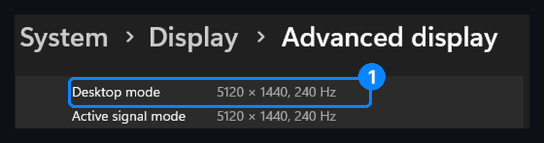

> The overlays follow your **resolution**, not your screen size: a 27" and a 32" 4K monitor (or a 55" and an 85" 4K TV) use the same pack. Windows display scaling doesn't change them either.

### 6️⃣ Copy the files into the Overlays folder

Unzip the pack, open the theme folder you want (**Dark**, **White**, **Smoke** or **Float**, or several) and copy **the files inside** straight into RTSS's Overlays folder:

```
C:\Program Files (x86)\RivaTuner Statistics Server\Plugins\Client\Overlays
```

That's where RTSS installs by default. If you installed it somewhere else, open RTSS's install folder and go to **Plugins → Client → Overlays**.

### ⚠️ Copy the files, not the theme folder! Each `.ovl` needs its `_atlas.png` right next to it, directly in **Overlays**.

| # | Check |
|---|---|
| 1 | The address bar ends in **RivaTuner Statistics Server › Plugins › Client › Overlays** |
| 2 | Each `.ovl` has its matching `_atlas.png` right next to it (e.g. `essential_sleek_smoke.ovl` + `essential_sleek_smoke_atlas.png`) |

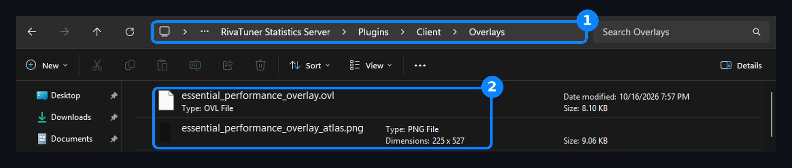

The theme is in the file name: no ending = **Dark**, then `_white`, `_smoke` and `_float`.

<a id="load-it"></a>
### 7️⃣ Load it and play 🎮

Open the Overlay editor the same way as in step 4: **RTSS → Setup → Plugins → select OverlayEditor.dll → Setup**.

| # | In the Overlay editor | Do this |
|---|---|---|
| 1 | **Layouts** menu (top left) | Click it |
| 2 | **Load** | Click it |

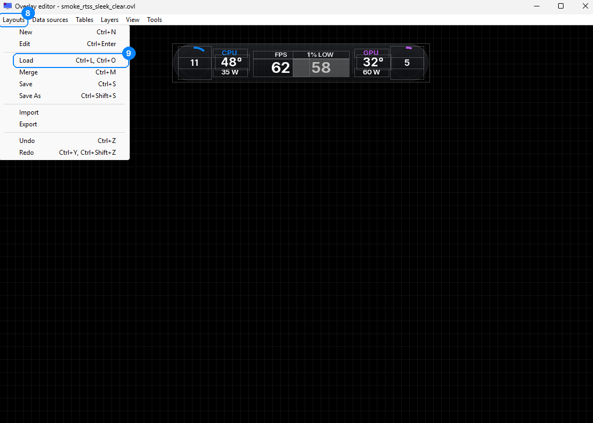

| # | In the Open window | Do this |
|---|---|---|
| 3 | Pick your overlay | e.g. `essential_sleek_smoke.ovl` |
| 4 | **Open** | Click it, then launch a game |

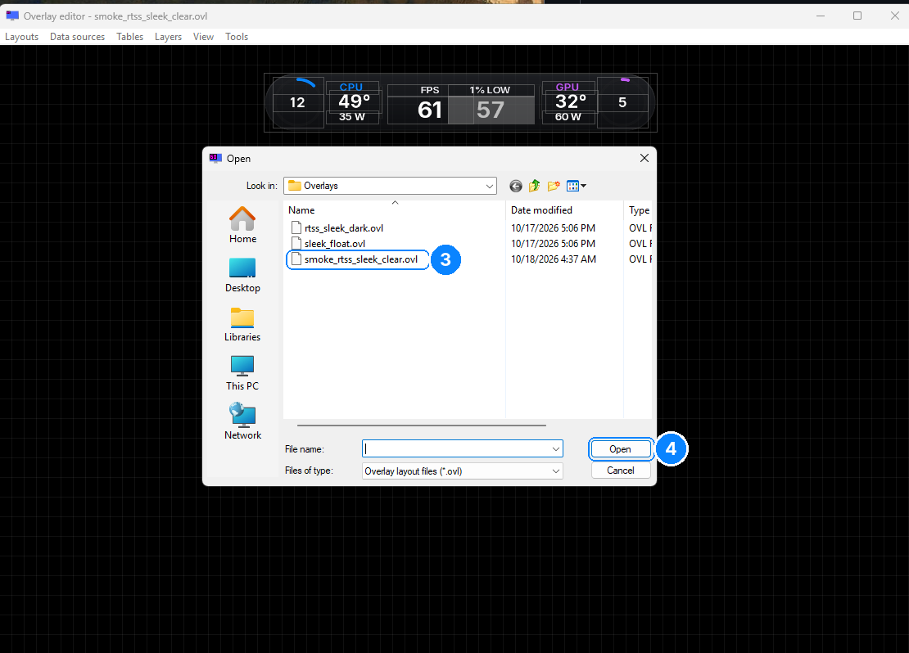

Can't see your overlay in the editor? These are demo pictures. Maximize the Overlay editor (full screen) to see your overlay where it will sit in game: at the top centre, or on the right edge for Sleek Side and Performance.

### 🧰 Optional extras

Click the ones you need to open them:

<a id="smooth"></a>
<details>
<summary><h3>🧈 Keep it smooth (no stutter)</h3></summary>

The overlay itself is light: it redraws every **500 ms** (the RTSS refresh period from [step 4](#rtss-setup)). Stutter usually comes from monitoring apps reading sensors too often, so:

| # | App | Setting | Set it to |
|---|---|---|---|
| 1 | **MSI Afterburner** | Settings → Monitoring → **Hardware polling period** | **1000** ms |
| 2 | **HWiNFO** *(Volt only)* | Sensor Settings → General → **Global** polling period | **2000** ms |
| 3 | **HWiNFO** *(Volt only)* | Same box: **Disk S.M.A.R.T. every** … cycles and **Emb. Controller every** … cycles | **100** and **10**, then click **Set** |

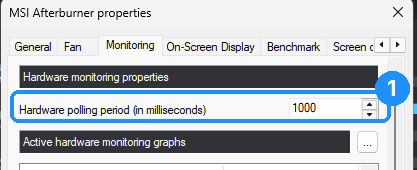 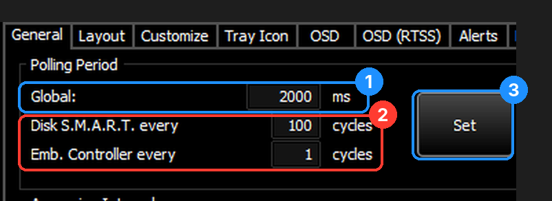

Want the lightest setup? Use **🟢 Essential**: no HWiNFO at all.

</details>

<a id="hotkey"></a>
<details>
<summary><h3>⌨️ Show / hide the overlay with a hotkey</h3></summary>

Pick **one** of the two ways. Both do the same thing.

**Option A: in RTSS** (works without Afterburner)

| # | What to do |
|---|---|
| 1 | Open **RTSS** and click **Setup**, then open the **Plugins** tab |
| 2 | Click the name **HotkeyHandler.dll** so it's highlighted (keep it ticked) |
| 3 | Click **Setup** under the list |
| 4 | Click the box next to **Toggle On-Screen Display** and press the key you want (e.g. **F10**) |
| 5 | Click **OK**, then **OK** again in RTSS Setup |

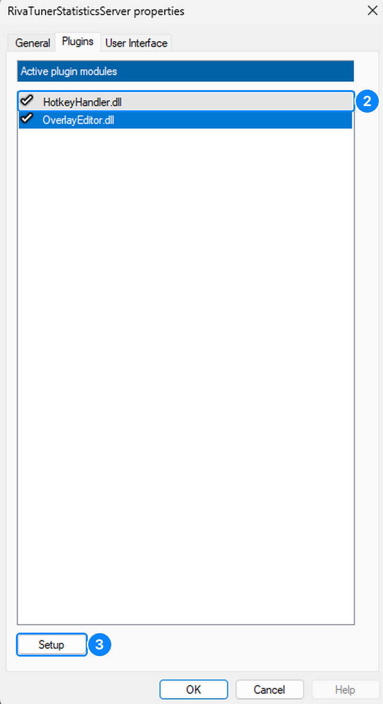 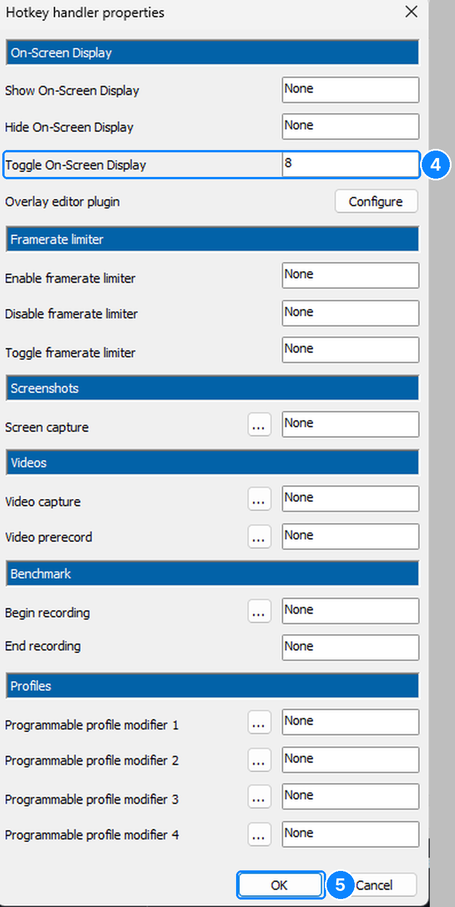

**Option B: in MSI Afterburner**

| # | What to do |
|---|---|
| 1 | Open **MSI Afterburner** → **Settings** (gear) |
| 2 | Open the **On-Screen Display** tab |
| 3 | Click the box next to **Toggle On-Screen Display** and press the key you want (e.g. **F10**) |
| 4 | Click **Apply** |
| 5 | Click **OK** |

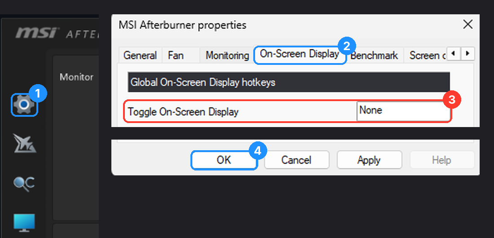

Now press that key in game to show or hide the overlay. Handy for screenshots and recordings.

</details>

<a id="two-gpus"></a>
<details>
<summary><h3>🖥️ CPU with integrated graphics, or two GPUs?</h3></summary>

**If GPU load, temperature or power show 0 or look wrong, the overlay is probably reading your integrated graphics.**

**Which number is your graphics card?** Open **Task Manager** (Ctrl + Shift + Esc) → **Performance** and look at the GPU list. The number next to your graphics card (e.g. **GPU 1**) is the one to use:

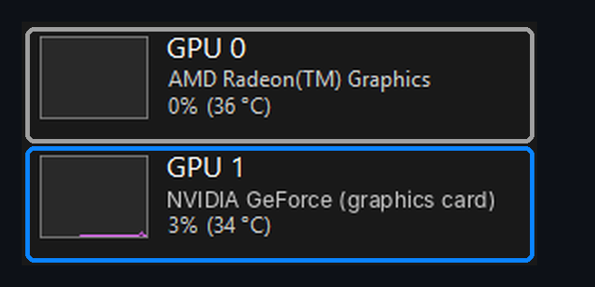

| # | What to do |
|---|---|
| 1 | In the Overlay editor, click **Data sources** at the top |
| 2 | Select **GPU1 temperature** (then repeat for every other row that starts with **GPU**) |
| 3 | Click **Setup** |
| 4 | Pick your graphics card (change the GPU number from **0** to your card's number from Task Manager, usually **1**) |
| 5 | Click **OK**, then **OK** again, and **save** the layout |

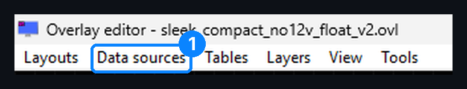

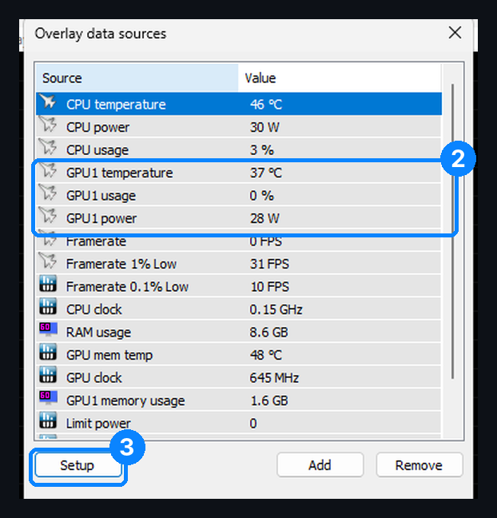 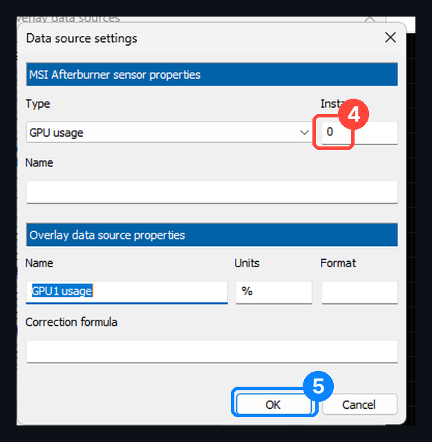

Tip: watch the **Value** column in Data sources. Once it's right, GPU usage jumps up when you start a game.

</details>

<a id="move-an-overlay"></a>
<details>
<summary><h3>📍 Move it anywhere you like</h3></summary>

1. Open the overlay in the **Overlay editor**.
2. ### Turn off "Snap to grid" first! ⚠️
   Click **View** at the top, then click **Snap to grid** so the ✓ disappears. With snapping on, each piece snaps separately and the numbers slide out of place.

   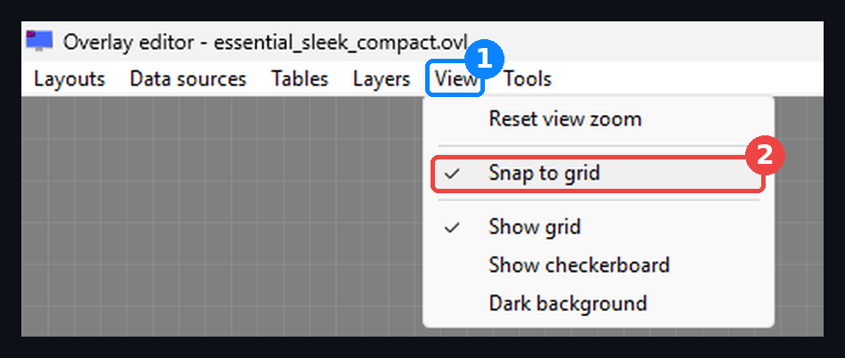

3. Select all the layers and drag the overlay where you want it, e.g. the lower-left corner.
4. **Save** the layout.

Everything stays lined up, and it remembers the new spot. (RTSS's own position box doesn't move these overlays, so this is the way to do it.)

</details>

<details>
<summary><h3>📦 Only want one overlay?</h3></summary>

Download this repo (**Code → Download ZIP**), then open `overlays/` → the version → the overlay → the theme (`dark`, `white`, `smoke` or `float`) → your resolution, e.g. `overlays/essential/sleek-meters/smoke/2560x1440`. Copy the `.ovl` and its `_atlas.png` into the Overlays folder.

</details>

Something not showing up? Check [Troubleshooting](#troubleshooting). Most issues take a few seconds to fix.

---

<a id="essential"></a>
<a id="msi-edition"></a>
## 🟢 Essential (RTSS + MSI Afterburner, no HWiNFO)

### The easiest one: only needs MSI Afterburner + RTSS.

Every overlay in **Dark, White, Smoke and Float**, for every resolution. Files start with `essential_`. Tap **See all 4 themes** under any overlay.

<p align="center"><a href="#download"><b>⬇️ Download Essential</b></a> · <a href="#get-started">🧭 How to set it up</a> (skip step 2)</p>

<table>
<tr>
<td width="50%" valign="top" align="center">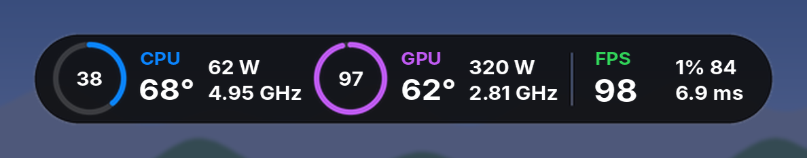<br><b>Simple Sleek</b><br><sub>One slim pill: CPU and GPU rings with temp, power and clock, FPS, 1% low and frametime</sub><details><summary><sub>🎨 See all 4 themes</sub></summary>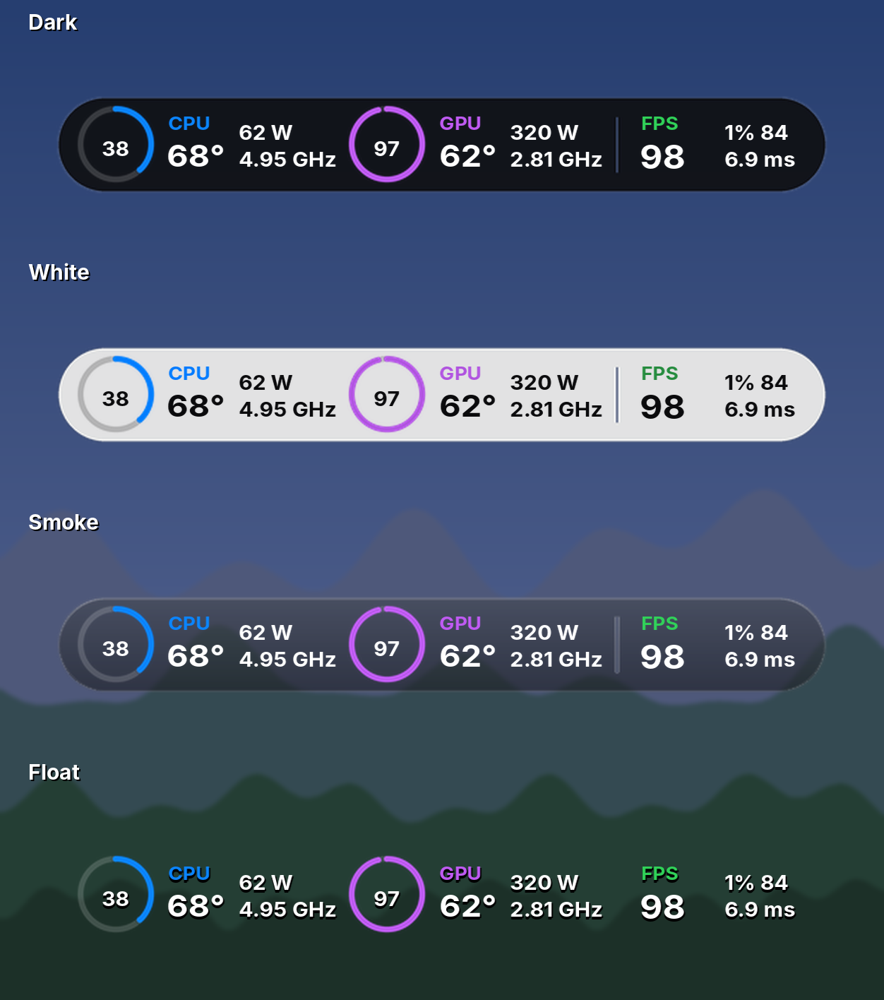</details></td>
<td width="50%" valign="top" align="center">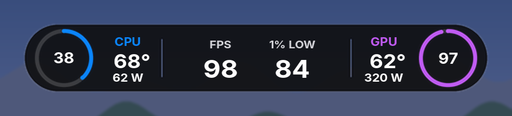<br><b>Sleek</b><br><sub>CPU and GPU rings with temp and power, big FPS and 1% low</sub><details><summary><sub>🎨 See all 4 themes</sub></summary>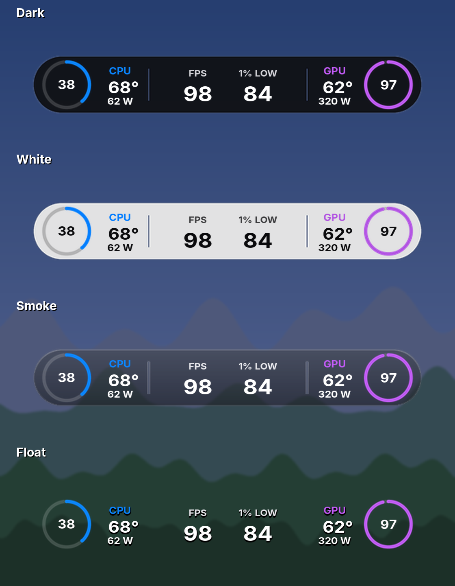</details></td>
</tr>
<tr>
<td width="50%" valign="top" align="center">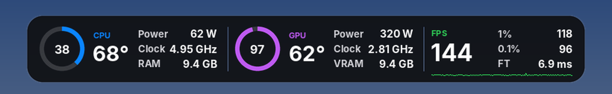<br><b>Sleek Compact</b><br><sub>CPU, GPU (power, clock, RAM / VRAM, VRAM temp) and FPS with 1%, 0.1%, frametime and a graph</sub><details><summary><sub>🎨 See all 4 themes</sub></summary>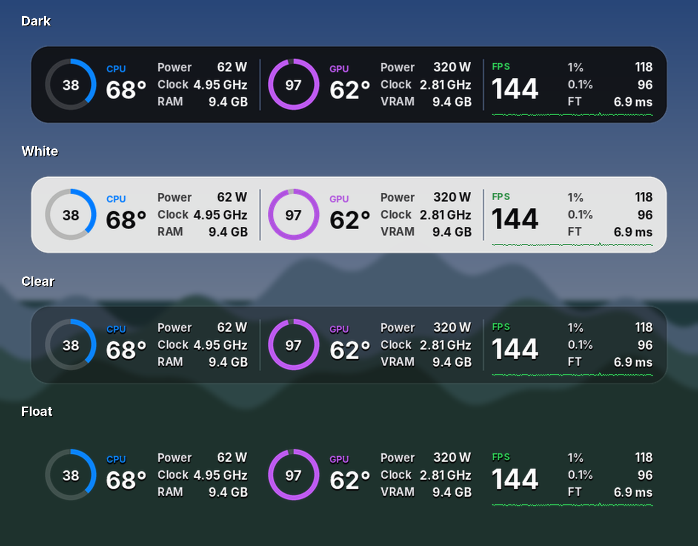</details></td>
<td width="50%" valign="top" align="center">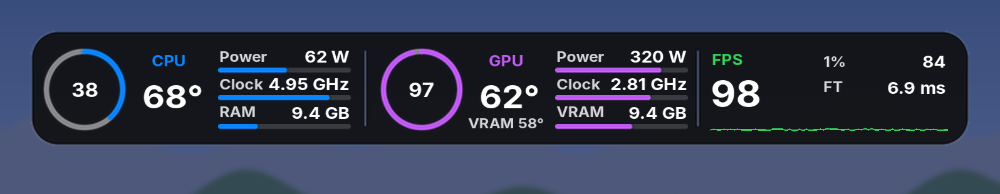<br><b>Sleek Meters</b><br><sub>Compact with a meter under each value, scaled for a mid-range PC</sub><details><summary><sub>🎨 See all 4 themes</sub></summary>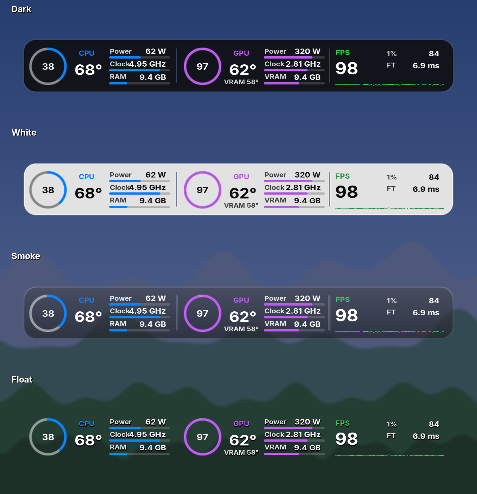</details></td>
</tr>
<tr>
<td width="50%" valign="top" align="center">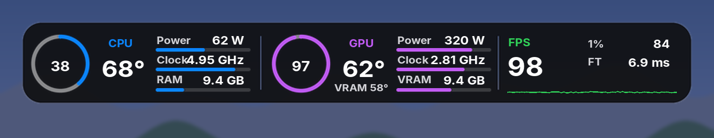<br><b>Sleek Meters Universal</b><br><sub>Meters scaled for <b>any</b> PC, up to an RTX 5090 (<a href="#meter-scales">scales</a>)</sub><details><summary><sub>🎨 See all 4 themes</sub></summary></details></td>
<td width="50%" valign="top" align="center">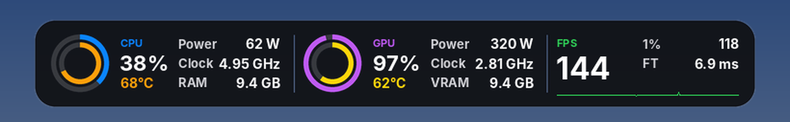<br><b>Sleek Rings</b><br><sub>Double rings: load outside, temperature inside</sub><details><summary><sub>🎨 See all 4 themes</sub></summary>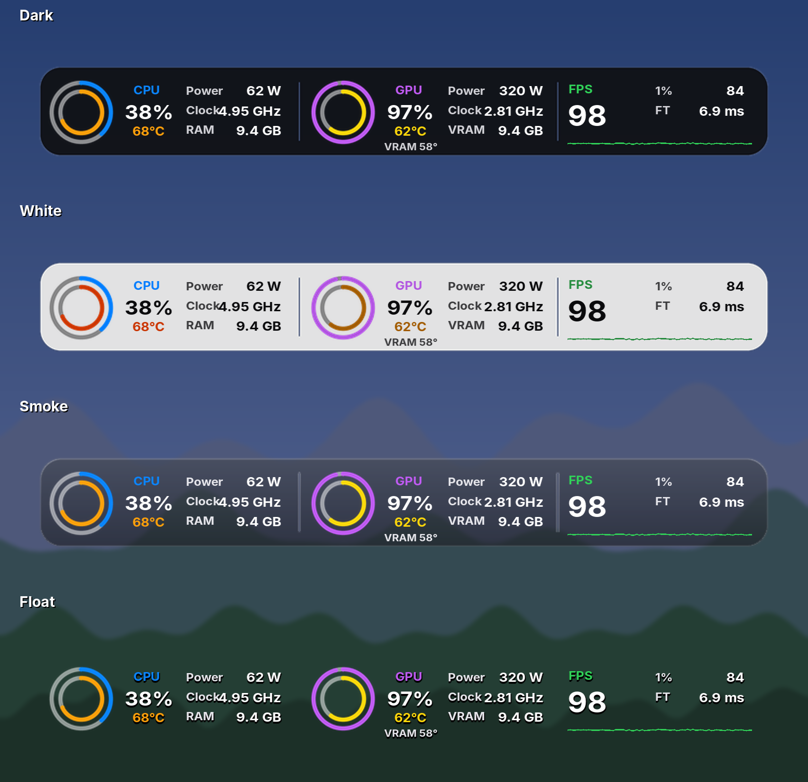</details></td>
</tr>
<tr>
<td width="50%" valign="top" align="center">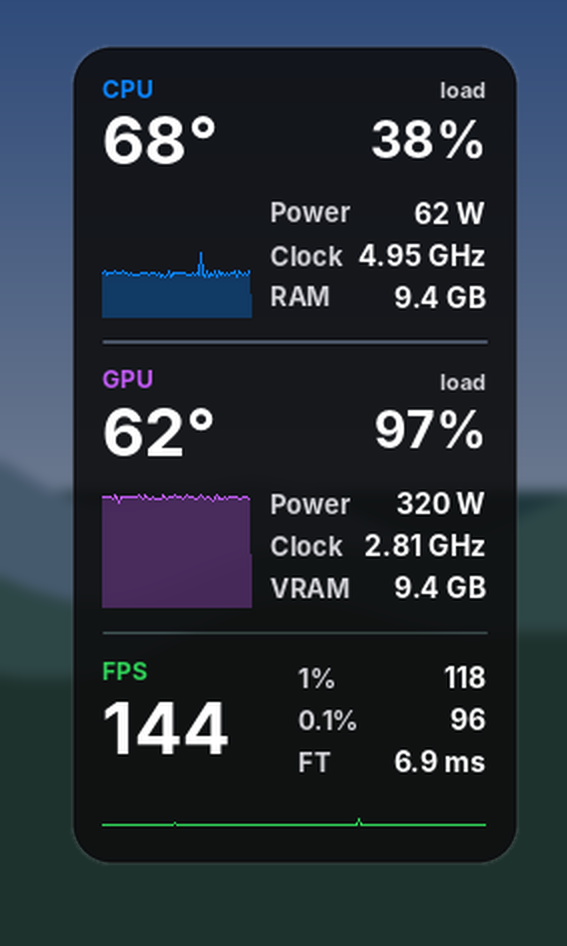<br><b>Sleek Side</b><br><sub>A panel for the side of the screen with CPU / GPU load graphs, VRAM temp and FPS</sub><details><summary><sub>🎨 See all 4 themes</sub></summary>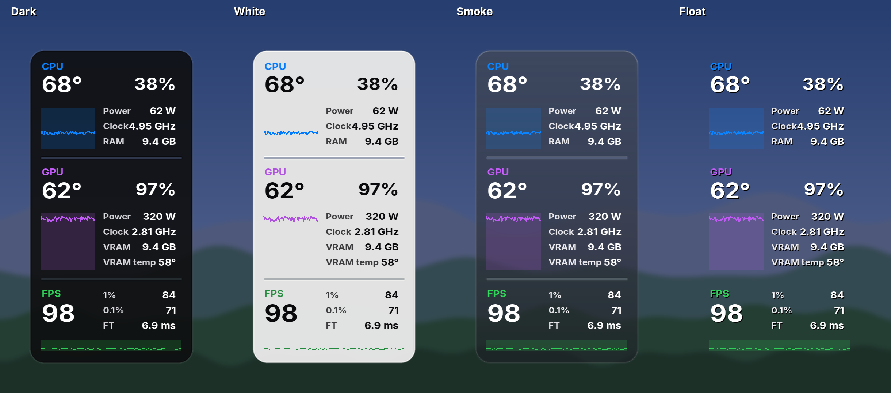</details></td>
<td width="50%" valign="top" align="center">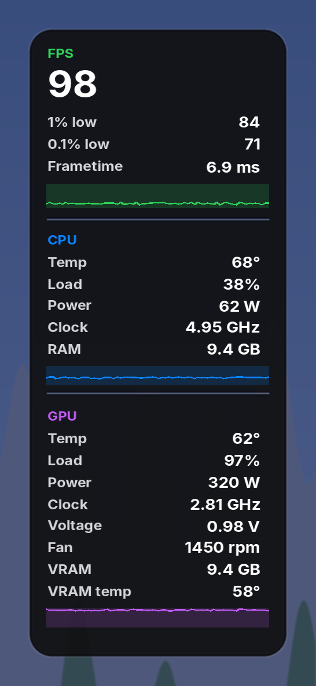<br><b>Performance</b><br><sub>Every number for benchmarking: voltage, fan, VRAM temp and graphs</sub><details><summary><sub>🎨 See all 4 themes</sub></summary></details></td>
</tr>
</table>

Gaming laptop? See [💻 Laptops](#laptops).

---

<a id="volt"></a>
## ⚡ Volt (RTSS + MSI Afterburner + HWiNFO)

### Everything in Essential, plus the 12V-2x6 / 12VHPWR cable monitor.

Volt reads your graphics card's 12V cable voltage through HWiNFO ([step 2](#hwinfo-setup-shared-memory)). Files start with `volt_`. Tap **See all 4 themes** under any overlay.

<p align="center"><a href="#download"><b>⬇️ Download Volt</b></a> · <a href="#get-started">🧭 How to set it up</a> (do every step, including step 2)</p>

<table>
<tr>
<td width="50%" valign="top" align="center"><br><b>Sleek Compact</b><br><sub>Full stats in one wide bar, with a frametime graph and the 12V cable voltage</sub><details><summary><sub>🎨 See all 4 themes</sub></summary></details></td>
<td width="50%" valign="top" align="center"><br><b>Sleek Meters</b><br><sub>A thin meter under every value, so you see how close each one is to its limit</sub><details><summary><sub>🎨 See all 4 themes</sub></summary></details></td>
</tr>
<tr>
<td width="50%" valign="top" align="center"><br><b>Sleek Meters Universal</b><br><sub>Meters scaled for <b>any</b> build, up to an RTX 5090 (<a href="#meter-scales">scales</a>)</sub><details><summary><sub>🎨 See all 4 themes</sub></summary></details></td>
<td width="50%" valign="top" align="center"><br><b>Sleek Rings</b><br><sub>Activity-style double rings: load outside, temperature inside</sub><details><summary><sub>🎨 See all 4 themes</sub></summary></details></td>
</tr>
<tr>
<td width="50%" valign="top" align="center"><br><b>Sleek Side</b><br><sub>A side panel with CPU and GPU graphs, VRAM temperature and the 12V cable</sub><details><summary><sub>🎨 See all 4 themes</sub></summary></details></td>
<td width="50%" valign="top" align="center"><br><b>Performance</b><br><sub>Every number for benchmarking, plus a 12V section</sub><details><summary><sub>🎨 See all 4 themes</sub></summary></details></td>
</tr>
</table>

---

<a id="laptops"></a>
## 💻 Laptops

### Small, slim designs made for laptop screens, where every pixel counts.

Only need **MSI Afterburner + RTSS**. No VRAM readings (most laptops don't report them), and the temperature colours are tuned for laptops: CPU turns amber at 90° and red at 95°, GPU at 85° and 92°. In the [💻 laptop packs](#laptop-download).

<p align="center"><a href="#laptop-download"><b>⬇️ Download a laptop pack</b></a> · <a href="#get-started">🧭 How to set it up</a> (skip step 2)</p>

<table>
<tr><td align="center"><br><b>Notch</b><br><sub>Top centre, like a phone's notch: CPU and GPU rings with temperatures, FPS in the middle</sub><details><summary><sub>🎨 See all 4 themes</sub></summary></details></td></tr>
<tr><td align="center"><br><b>Minibar</b><br><sub>A small bar: CPU and GPU rings with temperatures, FPS and 1% low</sub><details><summary><sub>🎨 See all 4 themes</sub></summary></details></td></tr>
<tr><td align="center"><br><b>Island</b><br><sub>One slim line: CPU and GPU usage and temperature, FPS and 1% low</sub><details><summary><sub>🎨 See all 4 themes</sub></summary></details></td></tr>
<tr><td align="center"><br><b>Island Time</b><br><sub>The same line with a clock, so you see the time without leaving your game</sub><details><summary><sub>🎨 See all 4 themes</sub></summary></details></td></tr>
<tr><td align="center"><br><b>Card</b><br><sub>A small card in the top-left corner: FPS, 1% low, CPU and GPU temperature, usage and power</sub><details><summary><sub>🎨 See all 4 themes</sub></summary></details></td></tr>
</table>

Want a bigger desktop design on your laptop instead? The Essential and Volt packs also come in **1920x1200**, **2560x1600** and **2880x1800**.

---

<a id="tvs"></a>
## 📺 TVs

### Big numbers you can read from the couch.

Made and tested on **55" and 65" 4K TVs** from about 3 m away. Only need **MSI Afterburner + RTSS** (no HWiNFO). Files start with `tv_` and end in `_4k` or `_1080p`. In the [📺 TV packs](#tv-download).


<p align="center"><a href="#tv-download"><b>⬇️ Download a TV pack</b></a> · <a href="#get-started">🧭 How to set it up</a> (skip step 2)</p>

<table>
<tr><td align="center"><br><b>TV Pill</b><br><sub>Big CPU and GPU rings with temperature and power, FPS and 1% low</sub><details><summary><sub>🎨 See all 4 themes</sub></summary></details></td></tr>
<tr><td align="center"><br><b>TV Line</b><br><sub>One slim line with usage rings, temperatures, FPS and 1% low</sub><details><summary><sub>🎨 See all 4 themes</sub></summary></details></td></tr>
<tr><td align="center"><br><b>TV Box</b><br><sub>Three big columns: FPS, CPU and GPU</sub><details><summary><sub>🎨 See all 4 themes</sub></summary></details></td></tr>
<tr><td align="center"><br><b>TV Side</b><br><sub>A panel on the right edge: FPS, CPU and GPU with load, power, VRAM and VRAM temp</sub><details><summary><sub>🎨 See all 4 themes</sub></summary></details></td></tr>
</table>

Only copy in **one** TV pack, the one that matches your TV's resolution. TV size doesn't matter: a 55" and an 85" 4K TV use the same 4K pack.

---

<a id="rainmeter"></a>
## 📱 Monitors & Widgets 1.7.1 (Rainmeter + MSI Afterburner)

### Your stats on a second monitor, a case screen (HYTE, Lian Li), a Corsair Xeneon Edge or your desktop, live while you play.

> 🔜 **Monitors & Widgets 2.0** is in testing: a remake that fits any screen by itself, with 17 themes. Everything below is for **1.7.1**, the current version. [Roadmap](https://github.com/realHfde/Apple-Style-Inspired-RTSS-Overlay/discussions/12)

RTSS overlays only show **inside a game**. Monitors & Widgets is a set of **Rainmeter** skins that sit on the **desktop** of any screen instead, in the same Apple style. It only needs **MSI Afterburner + Rainmeter**: no HWiNFO, and nothing to set up in RTSS (it installs with Afterburner and only passes the FPS along).

<p align="center"><a href="#monitor-setup"><b>⬇️ Download and set up</b></a> · about 5 minutes</p>


**What it shows:** CPU and GPU usage, temperature, clock and power, CPU and GPU temperature graphs, GPU core and memory clock, FPS, 1% and 0.1% lows, frame time with a chart, RAM, VRAM, free space on C:, network speed, and separate CPU, GPU and FPS charts for the last 2 minutes, plus the time, date and uptime.

### Pick your screen

Every layout comes two ways: **Cards** are separate rounded cards with your wallpaper showing between them, and **Box** is one solid panel with thin dividers. In Rainmeter's **Manage** window, open **MonitorsAndWidgets**, then the folder below.

| Your screen | Resolution | Load this |
|---|---|---|
| <a id="mw-second"></a>🖥️ **Second monitor** (1080p, 1440p, 4K) | 16:9 | **Second Monitor → 16x9** |
| Second monitor, smaller strip (no performance chart) | 16:9 | **Second Monitor → 16x9 Compact** |
| Monitor turned upright | 1080x1920 | **Second Monitor → Portrait** |
| Monitor turned upright, top half only | 1080x1920 | **Second Monitor → Portrait Compact** |
| <a id="mw-hyte"></a>**HYTE Y70 Touch** (1st gen, 14.1") | 1100x3840 | **Case Screen (upright) → HYTE Y70 Touch 1100x3840** |
| **HYTE Y70 Touch Infinite** (14.5" / 14.9") | 688x2560 / 682x2560 | **Case Screen (upright) → HYTE Y70 Touch Infinite 688x2560** or **682x2560** |
| <a id="mw-lianli"></a>**Lian Li 8.8"** Universal Screen, sideways | 1920x480 | **Bar Screen (sideways) → Lian Li 8.8in 1920x480** |
| **Lian Li 8.8"** Universal Screen, upright | 480x1920 | **Case Screen (upright) → Lian Li 8.8in 480x1920** |
| **Lian Li 9.2"** O11 Vision-M kit | 1920x462 | **Bar Screen (sideways) → Lian Li 9.2in O11 Vision-M 1920x462** |
| **Lian Li Lancool 207 Digital** (6"), sideways as it sits in the case | 1600x720 | **Bar Screen (sideways) → Lian Li Lancool 207 1600x720** |
| **Lian Li Lancool 207 Digital**, set to portrait | 720x1600 | **Case Screen (upright) → Lian Li Lancool 207 720x1600** |
| <a id="mw-xeneon"></a>**Corsair Xeneon Edge** (14.5"), sideways | 2560x720 | **Bar Screen (sideways) → Corsair Xeneon Edge 2560x720** |
| **Corsair Xeneon Edge**, upright | 720x2560 | **Case Screen (upright) → Corsair Xeneon Edge 720x2560** |
| <a id="mw-desktop"></a>💻 **Desktop widgets** | any | **Desktop Widgets → Horizontal** (Horizontal, Horizontal 2) or **Vertical** (Vertical, Sidebar, Sidebar 2) |

- Each file ends in **- Cards** or **- Box**, for example **16x9 - Box**.
- Rainmeter shows **one file per folder** at a time, so loading Sidebar 2 swaps out Sidebar.
- **Desktop widgets:** set the size in the [Menu](#monitor-options) and drag them anywhere. With **Memory bars** on, they show RAM and VRAM bars out of your PC's real sizes.
- The **Xeneon Edge** connects with HDMI or USB-C, so Windows sees it as a normal monitor.
- The **Settings** folder is the Menu. You don't load it yourself; it opens when you right-click a skin → **Menu…**

<details>
<summary><b>👀 See every layout</b> (click to open)</summary>

<table>
<tr>
<td width="50%" align="center"><a href="previews/rainmeter/second-screen-layouts.png"></a><br><sub><b>16x9 and Portrait</b> · Cards</sub></td>
<td width="50%" align="center"><a href="previews/rainmeter/box-versions.png"></a><br><sub><b>Box versions</b> · one solid panel, thin dividers instead of gaps</sub></td>
</tr>
<tr>
<td colspan="2" align="center"><a href="previews/rainmeter/compact-layouts.png"></a><br><sub><b>16x9 Compact and Portrait Compact</b> · CPU, GPU, FPS, clock, memory and network, without the big performance chart</sub></td>
</tr>
<tr>
<td width="50%" align="center"><a href="previews/rainmeter/case-screens.png"></a><br><sub><b>Upright case screens</b> · HYTE Y70, plus Lian Li 8.8" and Lancool 207 set upright</sub></td>
<td width="50%" align="center"><a href="previews/rainmeter/xeneon-edge.png"></a><br><sub><b>Corsair Xeneon Edge</b> · sideways and upright</sub></td>
</tr>
<tr>
<td width="50%" align="center"><a href="previews/rainmeter/bar-screens.png"></a><br><sub><b>8.8" and 9.2" bar screens</b></sub></td>
<td width="50%" align="center"><a href="previews/rainmeter/lancool-sideways.png"></a><br><sub><b>Lancool 207 Digital</b> · sideways, with big text</sub></td>
</tr>
<tr>
<td colspan="2" align="center"><a href="previews/rainmeter/desktop-widgets.png"></a><br><sub><b>5 desktop widgets</b> · any screen</sub></td>
</tr>
</table>

</details>

<a id="monitor-options"></a>
### Make it yours (the Menu)

Right-click any Monitors & Widgets skin → **Menu…**. Everything is controlled from this one panel. **Look** and **Readings** change every skin you have open. **This layout** changes one skin: the one you opened the Menu from, or **any layout you click while the Menu is open** (its name shows under **Menu**). Close it with **×**.


| Option | What it does |
|---|---|
| **Theme: Dark / White / Smoke / Tint / Float** | **Smoke** is tinted glass, like the overlays. **Tint** is the older, more see-through look (it used to be called Clear). Had **Clear** picked? You now get **Tint** |
| **Corners: Rounded / Square** | Square looks cleaner when a skin sits in the corner of a screen |
| **Clock: 12-hour / 24-hour** | How the time shows on every clock, e.g. **12:17** or **00:17**. 12-hour is the default |
| **Date: 21 October / October 21 / 10/21/2026** 🆕 | How the date shows on every layout. Day first is the default |
| **Fill a screen: Screen 1 / 2 / 3 / Center** | **Screen 1 / 2 / 3** fills that whole screen: the one for a case screen or a second monitor. **Center** puts it back in the middle of its screen. Not sure which number is which? In **Manage**, the **Display monitor** list shows each screen's number |
| **Size** | A set size you can drag anywhere, from **1% to 300%** 🆕: drag the **slider**, use **−** / **+** or the mouse wheel for 1% steps, or click the **% number** and type a size. **Reset** goes back to **100%**, the real size it has on the case screen. A layout never grows bigger than its screen |
| **FPS chart top: Auto / 60 / 120 / 144 / 165 / 240 / 360 / 480** | The top of the FPS charts. Pick your **FPS cap**, or your **monitor's refresh rate** if you don't cap. **Auto** zooms to your recent FPS |
| **Memory bars: Off / On** 🆕 | **On** adds "of 32 GB" and a bar under RAM and VRAM, using your PC's real sizes. A bar turns **red** above 90%. **Off** shows plain numbers (the default) |
| **GPU: First / Second** | Pick **Second** if your PC has integrated graphics and the GPU numbers look wrong |


<a id="monitor-setup"></a>
### ⬇️ Set it up (about 5 minutes)

**1️⃣ Install the programs**

| Program | What it does |
|---|---|
| [**Rainmeter 5**](https://www.rainmeter.net/changes-5.0/) | Shows the skins on your desktop. Works on Rainmeter 5 and on [4.5](https://www.rainmeter.net/) (5 needs 64-bit Windows 10 1903 or newer, or Windows 11) |
| [**MSI Afterburner**](https://www.msi.com/Landing/afterburner) | Reads your temperatures, clocks, power and FPS. Keep it running in the background |

You **don't** need to install the Inter font for this one: it comes inside the pack.

**2️⃣ Turn on the readings in MSI Afterburner**

Open Afterburner → **Settings → Monitoring**. Scroll through the list, tick each of these, then press **Apply** and **OK**:

| Tick these | Used for |
|---|---|
| **GPU temperature**, **GPU usage**, **Power** | GPU card and graph |
| **Core clock**, **Memory clock** | GPU clocks |
| **Memory usage** | VRAM |
| **CPU temperature**, **CPU clock**, **CPU power** | CPU card and graph |
| **Framerate**, **Frametime**, **Framerate 1% low**, **Framerate 0.1% low** | FPS card and charts |

Anything that isn't ticked shows **"–"** on the skin. FPS, the lows and frame time only fill in **while a game is running** (Afterburner gets them from RTSS, which installs together with Afterburner).


**3️⃣ Install the skin**

Download **`Monitors and Widgets 1.7.1.rmskin`** from the [Monitors & Widgets 1.7.1 release](https://github.com/realHfde/Apple-Style-Inspired-RTSS-Overlay/releases/tag/monitor-1.7.1) (or the [`rainmeter`](rainmeter) folder) and double-click it. In the installer, make sure **both boxes are ticked**:

| # | In the installer | Do this |
|---|---|---|
| 1 | **MonitorsAndWidgets** (Skins) | ✅ Ticked |
| 2 | **AfterburnerData.dll** (Plugins) | ✅ Ticked. This is what reads Afterburner; without it everything stays blank |
| 3 | **Load included skins** | ✅ Ticked |
| 4 | **Install** | Click it. The 16:9 dashboard opens straight away |


**4️⃣ Pick your layout**

Right-click the Rainmeter icon in the taskbar tray → **Manage**, open **MonitorsAndWidgets**, then the folder for your screen (see the tables above). Click the layout file, for example **Second Monitor → 16x9 - Box**, and click **Load**. Each folder can show one layout at a time; unload the ones you don't use.


**5️⃣ Put it on your screen**

Right-click the skin and click **Menu…** (at the top, under *Custom skin actions*). Don't confuse it with Rainmeter's own **Settings** further down.

 

In the Menu:

- **Screen 1 / 2 / 3** (under *Fill a screen*) to fill a HYTE, Lian Li or Xeneon screen, or a second monitor.
- Or pick a **size** and drag the skin where you want it. **Center** puts it back in the middle.
- More than one layout? Keep the Menu open and click the next layout.

It remembers its size, screen and options after a restart.

> 💡 **Updating from 1.7?** Just install 1.7.1 over it; your settings stay. **From 1.6 or older?** Close Rainmeter and delete `Documents\Rainmeter\Skins\MonitorsAndWidgets` before installing, so the old folder names don't stay in the list.

**6️⃣ HYTE and Lian Li screens only**

- **Lian Li:** in **L-Connect 3**, switch the screen to **secondary screen** mode so Windows uses it as a normal monitor.
- **HYTE and Corsair Xeneon Edge:** make sure the screen shows up as a monitor in **Windows Settings → System → Display**. Set it to **Landscape** or **Portrait** to match how it's mounted.
- **Upright screens:** set the screen to **Portrait** in Windows display settings and use a layout from **Case Screen (upright)**.
- **Lancool 207 Digital:** set the screen to **Landscape** (1600x720) and use **Bar Screen (sideways) → Lian Li Lancool 207 1600x720**.
- **Taskbar:** turn off **Settings → Personalization → Taskbar → Taskbar behaviors → "Show my taskbar on all displays"**, or Windows puts a taskbar on the small screen too and the skin can't fill it.

### Good to know

- The **charts fill up over time**: they start empty and cover the last 2 minutes (frame time: the last 60 seconds) once full.
- **Network** is your internet download (blue) and upload (orange) speed.
- **Made and tested on Windows 11** with a 5120x1440 and a 2560x1440 monitor. The HYTE, Lian Li and Xeneon Edge layouts are sized from each screen's official resolution and size; if you have one, I'd love a photo!

### Troubleshooting (Monitors & Widgets)

| Problem | Fix |
|---|---|
| A value shows **"–"** | That reading isn't ticked in Afterburner's **Monitoring** tab ([step 2](#monitor-setup)), or Afterburner isn't running. FPS, 1% / 0.1% lows and frame time only show **during a game**. |
| Everything is **0** or blank | Start **MSI Afterburner** and keep it running. |
| GPU numbers look wrong on a laptop or a PC with integrated graphics | Right-click → Custom skin actions → **Menu…** → **GPU: Second**. |
| It fills the wrong screen | In **Menu…**, use **Fill a screen: Screen 1 / 2 / 3** and check the numbers in Manage → **Display monitor**. |
| The Menu changes the wrong layout | Click the layout you want while the Menu is open. Its name shows under **Menu**. |
| The size doesn't fit right on a HYTE screen | A known issue, fixed in 2.0. For now, use Rainmeter 5's **Zoom**. |
| It's too big on my monitor | In **Menu…**, set **Size** (1% to 300%) with the slider, **−** / **+**, or type one. **Reset** goes back to 100%. |
| RAM or VRAM shows the wrong total (like 8 GB on a 12 GB card) | Update to 1.7.1. With **Memory bars** on, it uses your PC's real sizes. |
| The FPS chart sits at the top or bottom | Set **FPS chart top** to your FPS cap or refresh rate, or **Auto**. |
| Dark corners at the edges when it fills a screen | Pick **Corners: square**. Also check you picked the layout for your screen's shape. |
| A strip is left empty on the case screen | Turn off **"Show my taskbar on all displays"** in Windows taskbar settings. |
| Text from other skins shows behind it | That's Rainmeter's built-in **illustro** skins. In Manage, open **illustro** and **Unload** each one. |
| The Lian Li screen doesn't show up in Windows | Turn on **secondary screen** mode in L-Connect 3. |
| Old folders (Case Screen Classic, Sidebar 2…) still show in Manage | Close Rainmeter, delete `Documents\Rainmeter\Skins\MonitorsAndWidgets`, and install 1.7.1 again. |
| I can't show Sidebar and Sidebar 2 together | Rainmeter shows one file per folder at a time. Pick the one you like best. |

---

<a id="themes"></a>
## 🎨 Themes

Every overlay (Essential, Volt, laptop and TV) comes in four themes:

| Theme | Folder / file ending | Look |
|---|---|---|
| **Dark** | `dark` / no ending | Dark panel, white text |
| **White** | `white` / `_white` | Soft light-grey panel with dark text, toned down so it isn't glaring. Turn off **On-Screen Display shadow** in RTSS for sharp text |
| **Smoke** 🆕 | `smoke` / `_smoke` | Tinted glass, lighter at the top and darker at the bottom, with a thin soft edge. You can tell the game is behind it, but it never fights with the numbers |
| **Float** | `float` / `_float` | No panel at all: just the numbers, rings and meters with a drop shadow. Least distracting, and nice on OLED screens |


<a id="smoke"></a>
### 🌫️ Why Smoke replaced Clear

The old **Clear** theme was a mostly see-through panel. In game it let too much of the picture show through: the text wasn't sharp, and anything bright or busy behind it (sky, water, fences) pulled your eyes away from the game. RTSS can't blur what's behind an overlay, so a real "frosted glass" isn't possible. Smoke is the next best thing: a tinted panel that stays readable on any scene.


---

<a id="old-names"></a>
## 🏷️ Switching from older versions

The old copies don't get replaced automatically. RTSS also keeps showing an old picture until it's fully closed, so **exit RTSS and Afterburner once** after copying in new files.

| You had | Now | What to do |
|---|---|---|
| **Clear** theme (`…_clear.ovl`) | **Smoke** (`…_smoke.ovl`) | Delete the old `…_clear` files from the Overlays folder and load the `…_smoke` ones |
| **Island Bar / Island Bar Time** | The new [💻 laptop designs](#laptops) | Delete the `…island_bar…` files and copy in a laptop pack |
| **Volt Sleek** and the Volt **no 12V** versions (`…no12v…`) | Removed | Delete them. Use **Essential Sleek** instead of Volt Sleek; if your card doesn't report 12V, use **Essential** |
| Old **TV Pill / TV Side** | The new [📺 TV designs](#tvs) | Delete the old `tv_…` files, then copy in the TV pack for your TV |
| **MSI Edition** (`msi_…`) or the original overlays (`sleek.ovl`, `performance_overlay.ovl`…) | **🟢 Essential** (`essential_…`) / **⚡ Volt** (`volt_…`) | Copy in the new pack, then delete the old files so they don't show twice in **Layouts → Load** |
| **Apple Style Monitor** (Rainmeter) | **📱 Monitors & Widgets** | In **Manage**, unload the **AppleStyleMonitor** skins and load the same layout from **MonitorsAndWidgets**. Then delete `Documents\Rainmeter\Skins\AppleStyleMonitor` |

If you moved an overlay in the Overlay editor, move the new one the same way and save it.

## Notes

- The **12V cable** reading needs a graphics card that reports its 16-pin connector voltage in HWiNFO. On cards that don't, use **Essential**.
- **The 12V monitor is a visual hint, not a safety system.** It only changes colour on the overlay: no pop-up or sound, so it only helps if you happen to look at it. Readings depend on your card's sensors and can be imprecise, and most cards report one voltage for the whole connector. It's no substitute for a properly seated, undamaged cable. For a real alert, set an alarm on the 12V reading in HWiNFO.
- **The 12V warning:** the **12V** label turns **amber** if the cable voltage drops below 11.85 V and **red** below 11.75 V, but only while you're gaming (GPU using more than 150 W). The cable is only under real stress under heavy load. At idle almost no power flows through it, so a low number there doesn't mean anything and the label stays green. The number itself always shows the real voltage.
- **Sleek Meters** uses fixed scales for an upper-mid-range PC. For a high-end PC, use **Sleek Meters Universal**.
<a id="meter-scales"></a>
- **Sleek Meters Universal** fills its bars at the limits of today's fastest hardware, so nothing maxes out early:

  | Meter | Full at | Why |
  |---|---|---|
  | CPU power | 300 W | Above the max turbo power of today's top Intel and AMD CPUs |
  | CPU clock | 7.0 GHz | Headroom above the fastest desktop CPUs (about 6.2 GHz) |
  | GPU power | 800 W | Room for an RTX 5090 (575 W) and overclocked cards |
  | GPU clock | 4.0 GHz | Above the fastest boosting cards |
  | RAM | 64 GB | Fits 32 GB and 64 GB builds |
  | VRAM | 32 GB | Fits every card up to an RTX 5090 (32 GB) |
- To change a meter's scale, open **Data sources** in the Overlay editor and edit the matching `pct` source's formula. For example, `x / 8` means 800 W is full; change it to `x / 3.6` for 360 W.
- On the 4K **1.5×** and **2×** versions, some rings and meters move in slightly bigger steps, so the picture fits RTSS's size limit.

<a id="troubleshooting"></a>
## Troubleshooting

| Problem | Fix |
|---|---|
| Overlay doesn't appear in a game | Check **Show On-Screen Display** is ON ([step 4](#rtss-setup), #1), then tick **Enable benchmark mode** ([step 4](#benchmark-tip)). |
| I can't find the Overlay editor | **RTSS → Setup → Plugins**, tick **OverlayEditor.dll**, **click its name** so it's highlighted, then click **Setup** under the list ([pictures](#rtss-setup)). |
| The Overlay editor looks empty | The overlay is placed for a full screen. **Maximize the Overlay editor window** to see it. |
| I can't find the Overlays folder | The default is `C:\Program Files (x86)\RivaTuner Statistics Server\Plugins\Client\Overlays`. If RTSS is installed somewhere else, go to its folder → **Plugins → Client → Overlays**. |
| FPS, 1% or 0.1% low are blank or 0 | They come from **MSI Afterburner**: keep it running and tick **Framerate**, **Framerate 1% Low** and **Framerate 0.1% Low** in its Monitoring tab ([step 3](#get-started)). They only fill in while a game runs. Also check the [RTSS General settings](#rtss-setup). |
| GPU numbers are 0 or wrong | Your PC probably has integrated graphics. See [two GPUs](#two-gpus). |
| 12V is blank | **Volt only:** HWiNFO isn't running, or Shared Memory Support is off. See [step 2](#hwinfo-setup-shared-memory). If it's on and still blank, open **Data sources**, select **12V cable**, click **Setup** and pick your card's 12V reading. If your card doesn't report it, use **Essential**. |
| Text looks different, too wide, or doesn't line up | The **Inter** font isn't installed. Install [Inter](https://rsms.me/inter/) and restart RTSS. |
| Garbled letters instead of the panel | The `_atlas.png` file is missing or in a subfolder. Put it next to the `.ovl` in the main Overlays folder. |
| I still see the old look after updating | RTSS keeps old pictures until it's closed. Exit **RTSS and Afterburner** fully (from the tray) and open them again. |
| Text looks blurry on the White theme | Turn off **On-Screen Display shadow** in the main RTSS window ([step 4](#rtss-setup), #3). |

---

## Credits

Idea, design direction and testing by realHfde. AI helped build the files, scale them to every resolution and make the previews.

## License

MIT. Use them, change them and share them; just keep the license file with them. See [LICENSE](LICENSE).
