
# 📱 Monitors & Widgets 1.7.1 (Rainmeter + MSI Afterburner)

### Your stats on a second monitor, a case screen (HYTE, Lian Li), a Corsair Xeneon Edge or your desktop, live while you play.

> 🆕 **[Monitors & Widgets 2.0 beta](monitors-and-widgets.md)** is out and installs beside this one. Everything below is for **1.7.1**, the stable version. [Roadmap](https://github.com/realHfde/Apple-Style-Inspired-RTSS-Overlay/discussions/12)

RTSS overlays only show **inside a game**. Monitors & Widgets is a set of **Rainmeter** skins that sit on the **desktop** of any screen instead, in the same Apple style. It only needs **MSI Afterburner + Rainmeter**: no HWiNFO, and nothing to set up in RTSS (it installs with Afterburner and only passes the FPS along).

<a href="#monitor-setup"><b>⬇️ Download and set up</b></a> · about 5 minutes

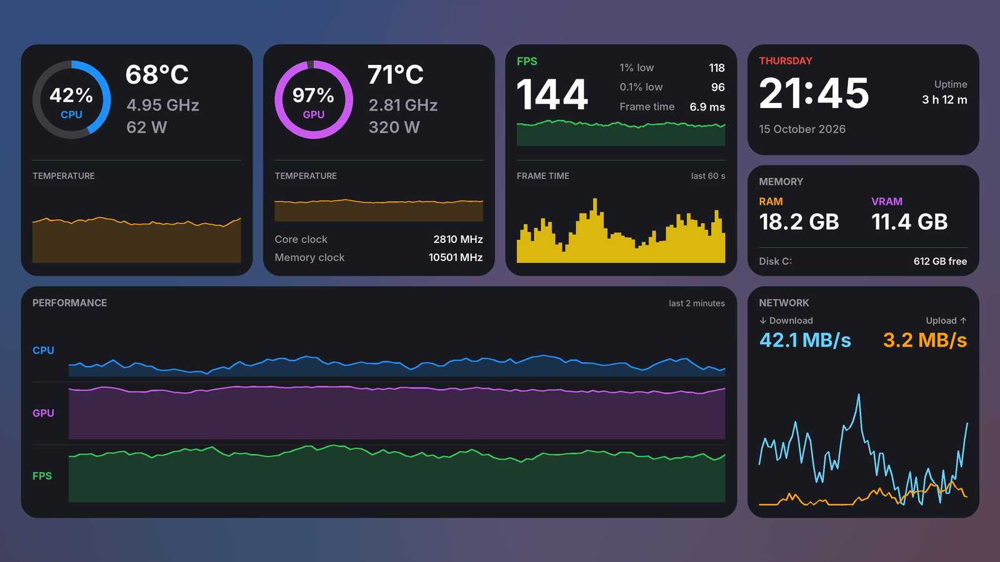

**What it shows:** CPU and GPU usage, temperature, clock and power, CPU and GPU temperature graphs, GPU core and memory clock, FPS, 1% and 0.1% lows, frame time with a chart, RAM, VRAM, free space on C:, network speed, and separate CPU, GPU and FPS charts for the last 2 minutes, plus the time, date and uptime.

### Pick your screen

Every layout comes two ways: **Cards** are separate rounded cards with your wallpaper showing between them, and **Box** is one solid panel with thin dividers. In Rainmeter's **Manage** window, open **MonitorsAndWidgets**, then the folder below.

| Your screen | Resolution | Load this |
|---|---|---|
| 🖥️ **Second monitor** (1080p, 1440p, 4K) | 16:9 | **Second Monitor → 16x9** |
| Second monitor, smaller strip (no performance chart) | 16:9 | **Second Monitor → 16x9 Compact** |
| Monitor turned upright | 1080x1920 | **Second Monitor → Portrait** |
| Monitor turned upright, top half only | 1080x1920 | **Second Monitor → Portrait Compact** |
| **HYTE Y70 Touch** (1st gen, 14.1") | 1100x3840 | **Case Screen (upright) → HYTE Y70 Touch 1100x3840** |
| **HYTE Y70 Touch Infinite** (14.5" / 14.9") | 688x2560 / 682x2560 | **Case Screen (upright) → HYTE Y70 Touch Infinite 688x2560** or **682x2560** |
| **Lian Li 8.8"** Universal Screen, sideways | 1920x480 | **Bar Screen (sideways) → Lian Li 8.8in 1920x480** |
| **Lian Li 8.8"** Universal Screen, upright | 480x1920 | **Case Screen (upright) → Lian Li 8.8in 480x1920** |
| **Lian Li 9.2"** O11 Vision-M kit | 1920x462 | **Bar Screen (sideways) → Lian Li 9.2in O11 Vision-M 1920x462** |
| **Lian Li Lancool 207 Digital** (6"), sideways as it sits in the case | 1600x720 | **Bar Screen (sideways) → Lian Li Lancool 207 1600x720** |
| **Lian Li Lancool 207 Digital**, set to portrait | 720x1600 | **Case Screen (upright) → Lian Li Lancool 207 720x1600** |
| **Corsair Xeneon Edge** (14.5"), sideways | 2560x720 | **Bar Screen (sideways) → Corsair Xeneon Edge 2560x720** |
| **Corsair Xeneon Edge**, upright | 720x2560 | **Case Screen (upright) → Corsair Xeneon Edge 720x2560** |
| 💻 **Desktop widgets** | any | **Desktop Widgets → Horizontal** (Horizontal, Horizontal 2) or **Vertical** (Vertical, Sidebar, Sidebar 2) |

- Each file ends in **- Cards** or **- Box**, for example **16x9 - Box**.
- Rainmeter shows **one file per folder** at a time, so loading Sidebar 2 swaps out Sidebar.
- **Desktop widgets:** set the size in the [Menu](#monitor-options) and drag them anywhere. With **Memory bars** on, they show RAM and VRAM bars out of your PC's real sizes.
- The **Xeneon Edge** connects with HDMI or USB-C, so Windows sees it as a normal monitor.
- The **Settings** folder is the Menu. You don't load it yourself; it opens when you right-click a skin → **Menu…**

<b>👀 See every layout</b> (click to open)

<table>
<tr>
<td width="50%" align="center"><a href="../previews/rainmeter/second-screen-layouts.png">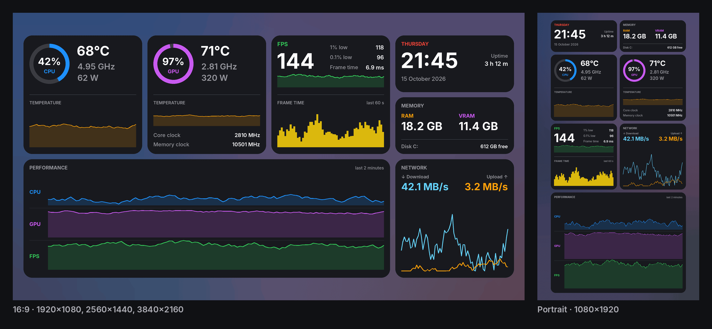</a> <b>16x9 and Portrait</b> · Cards</td>
<td width="50%" align="center"><a href="../previews/rainmeter/box-versions.png">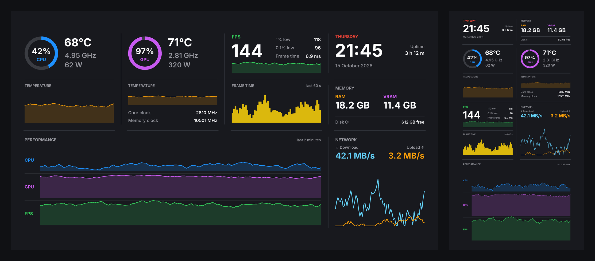</a> <b>Box versions</b> · one solid panel, thin dividers instead of gaps</td>
</tr>
<tr>
<td colspan="2" align="center"><a href="../previews/rainmeter/compact-layouts.png">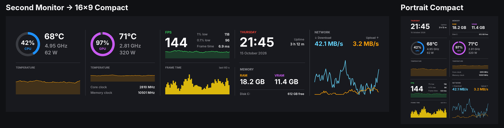</a> <b>16x9 Compact and Portrait Compact</b> · CPU, GPU, FPS, clock, memory and network, without the big performance chart</td>
</tr>
<tr>
<td width="50%" align="center"><a href="../previews/rainmeter/case-screens.png">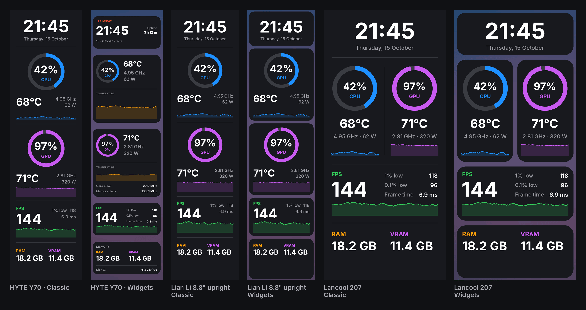</a> <b>Upright case screens</b> · HYTE Y70, plus Lian Li 8.8" and Lancool 207 set upright</td>
<td width="50%" align="center"><a href="../previews/rainmeter/xeneon-edge.png">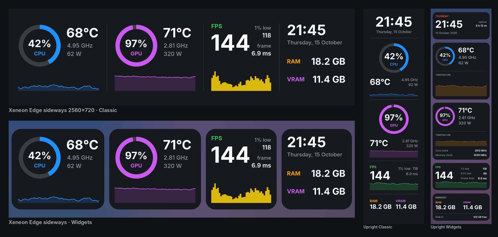</a> <b>Corsair Xeneon Edge</b> · sideways and upright</td>
</tr>
<tr>
<td width="50%" align="center"><a href="../previews/rainmeter/bar-screens.png">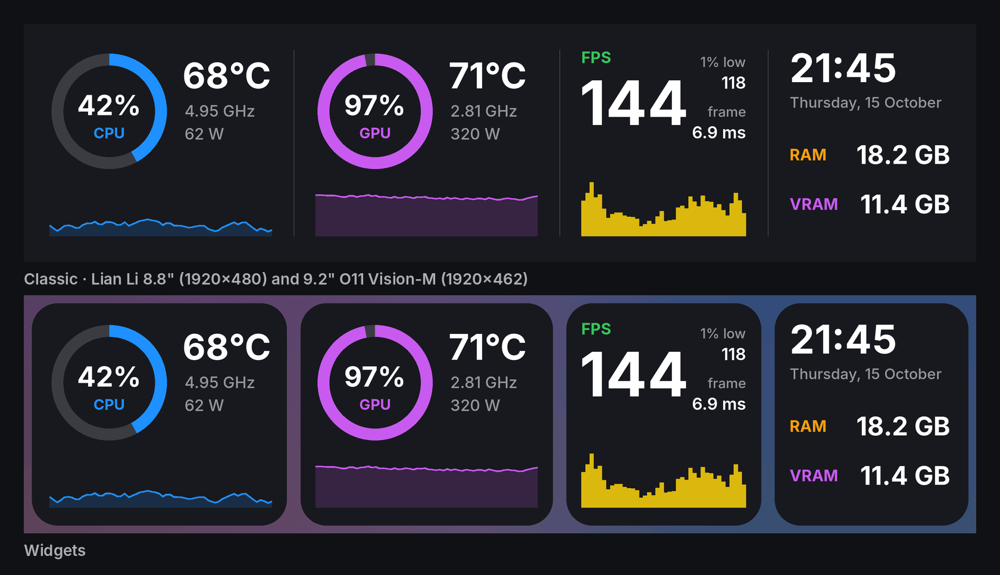</a> <b>8.8" and 9.2" bar screens</b></td>
<td width="50%" align="center"><a href="../previews/rainmeter/lancool-sideways.png">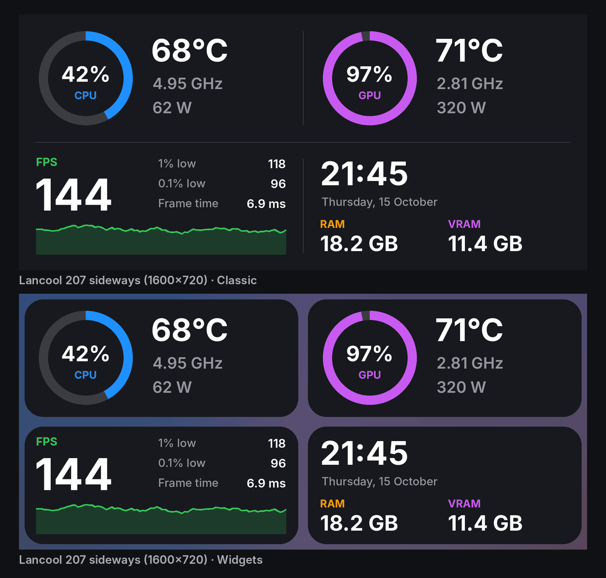</a> <b>Lancool 207 Digital</b> · sideways, with big text</td>
</tr>
<tr>
<td colspan="2" align="center"><a href="../previews/rainmeter/desktop-widgets.png">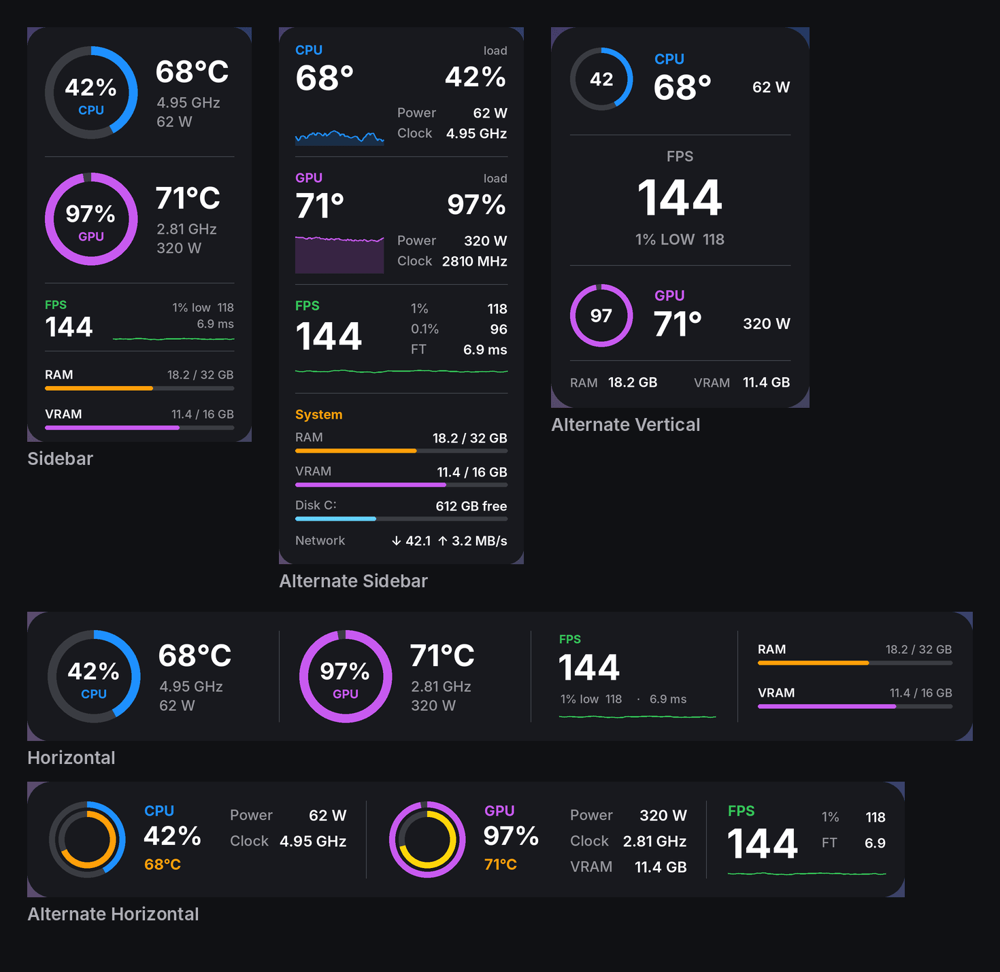</a> <b>5 desktop widgets</b> · any screen</td>
</tr>
</table>

### Make it yours (the Menu)

Right-click any Monitors & Widgets skin → **Menu…**. Everything is controlled from this one panel. **Look** and **Readings** change every skin you have open. **This layout** changes one skin: the one you opened the Menu from, or **any layout you click while the Menu is open** (its name shows under **Menu**). Close it with **×**.

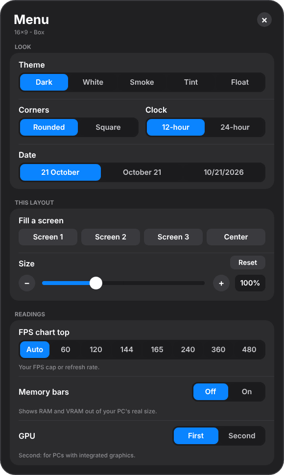

| Option | What it does |
|---|---|
| **Theme: Dark / White / Smoke / Tint / Float** | **Smoke** is tinted glass, like the overlays. **Tint** is the older, more see-through look (it used to be called Clear). Had **Clear** picked? You now get **Tint** |
| **Corners: Rounded / Square** | Square looks cleaner when a skin sits in the corner of a screen |
| **Clock: 12-hour / 24-hour** | How the time shows on every clock, e.g. **12:17** or **00:17**. 12-hour is the default |
| **Date: 21 October / October 21 / 10/21/2026** 🆕 | How the date shows on every layout. Day first is the default |
| **Fill a screen: Screen 1 / 2 / 3 / Center** | **Screen 1 / 2 / 3** fills that whole screen: the one for a case screen or a second monitor. **Center** puts it back in the middle of its screen. Not sure which number is which? In **Manage**, the **Display monitor** list shows each screen's number |
| **Size** | A set size you can drag anywhere, from **1% to 300%** 🆕: drag the **slider**, use **−** / **+** or the mouse wheel for 1% steps, or click the **% number** and type a size. **Reset** goes back to **100%**, the real size it has on the case screen. A layout never grows bigger than its screen |
| **FPS chart top: Auto / 60 / 120 / 144 / 165 / 240 / 360 / 480** | The top of the FPS charts. Pick your **FPS cap**, or your **monitor's refresh rate** if you don't cap. **Auto** zooms to your recent FPS |
| **Memory bars: Off / On** 🆕 | **On** adds "of 32 GB" and a bar under RAM and VRAM, using your PC's real sizes. A bar turns **red** above 90%. **Off** shows plain numbers (the default) |
| **GPU: First / Second** | Pick **Second** if your PC has integrated graphics and the GPU numbers look wrong |

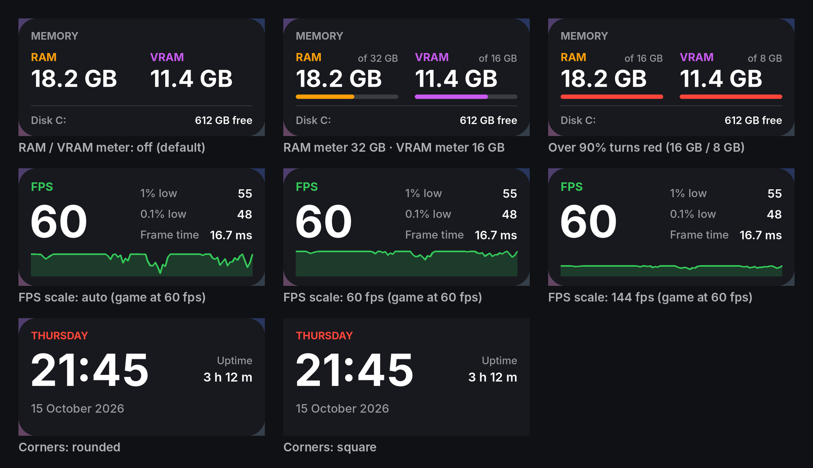

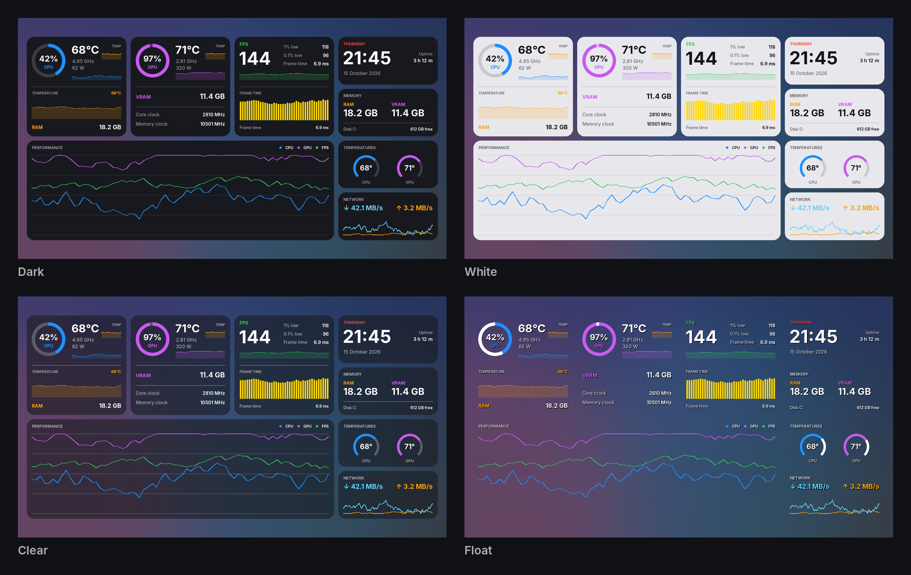

### ⬇️ Set it up (about 5 minutes)

**1️⃣ Install the programs**

| Program | What it does |
|---|---|
| [**Rainmeter 5**](https://www.rainmeter.net/changes-5.0/) | Shows the skins on your desktop. Works on Rainmeter 5 and on [4.5](https://www.rainmeter.net/) (5 needs 64-bit Windows 10 1903 or newer, or Windows 11) |
| [**MSI Afterburner**](https://www.msi.com/Landing/afterburner) | Reads your temperatures, clocks, power and FPS. Keep it running in the background |

You **don't** need to install the Inter font for this one: it comes inside the pack.

**2️⃣ Turn on the readings in MSI Afterburner**

Open Afterburner → **Settings → Monitoring**. Scroll through the list, tick each of these, then press **Apply** and **OK**:

| Tick these | Used for |
|---|---|
| **GPU temperature**, **GPU usage**, **Power** | GPU card and graph |
| **Core clock**, **Memory clock** | GPU clocks |
| **Memory usage** | VRAM |
| **CPU temperature**, **CPU clock**, **CPU power** | CPU card and graph |
| **Framerate**, **Frametime**, **Framerate 1% low**, **Framerate 0.1% low** | FPS card and charts |

Anything that isn't ticked shows **"–"** on the skin. FPS, the lows and frame time only fill in **while a game is running** (Afterburner gets them from RTSS, which installs together with Afterburner).

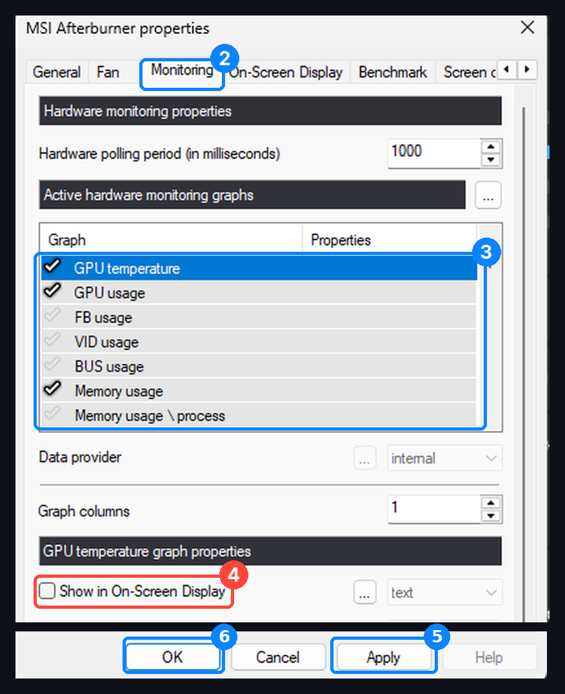

**3️⃣ Install the skin**

Download **`Monitors and Widgets 1.7.1.rmskin`** from the [Monitors & Widgets 1.7.1 release](https://github.com/realHfde/Apple-Style-Inspired-RTSS-Overlay/releases/tag/monitor-1.7.1) (or the [`rainmeter`](../rainmeter) folder) and double-click it. In the installer, make sure **both boxes are ticked**:

| # | In the installer | Do this |
|---|---|---|
| 1 | **MonitorsAndWidgets** (Skins) | ✅ Ticked |
| 2 | **AfterburnerData.dll** (Plugins) | ✅ Ticked. This is what reads Afterburner; without it everything stays blank |
| 3 | **Load included skins** | ✅ Ticked |
| 4 | **Install** | Click it. The 16:9 dashboard opens straight away |

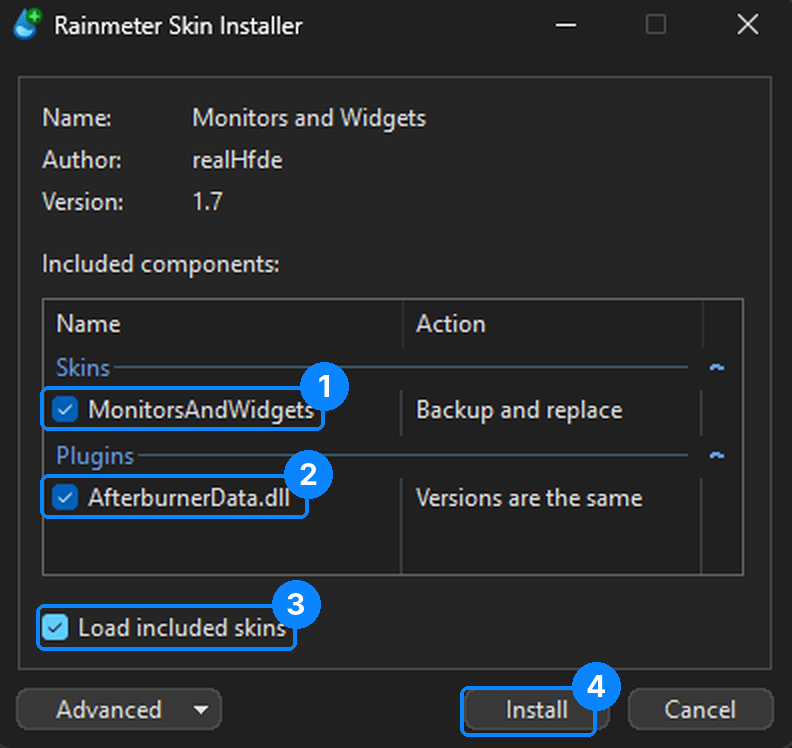

**4️⃣ Pick your layout**

Right-click the Rainmeter icon in the taskbar tray → **Manage**, open **MonitorsAndWidgets**, then the folder for your screen (see the tables above). Click the layout file, for example **Second Monitor → 16x9 - Box**, and click **Load**. Each folder can show one layout at a time; unload the ones you don't use.

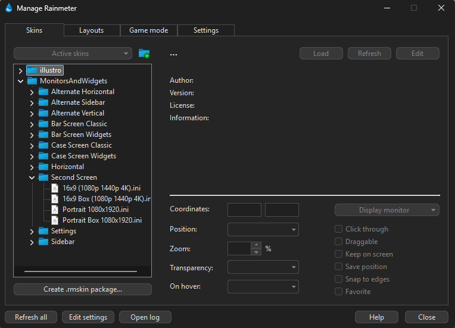

**5️⃣ Put it on your screen**

Right-click the skin and click **Menu…** (at the top, under *Custom skin actions*). Don't confuse it with Rainmeter's own **Settings** further down.

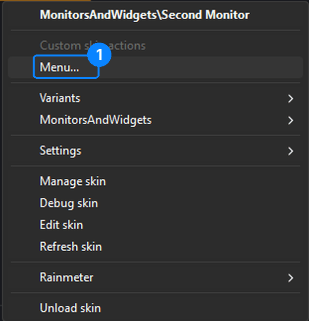 

In the Menu:

- **Screen 1 / 2 / 3** (under *Fill a screen*) to fill a HYTE, Lian Li or Xeneon screen, or a second monitor.
- Or pick a **size** and drag the skin where you want it. **Center** puts it back in the middle.
- More than one layout? Keep the Menu open and click the next layout.

It remembers its size, screen and options after a restart.

> 💡 **Updating from 1.7?** Just install 1.7.1 over it; your settings stay. **From 1.6 or older?** Close Rainmeter and delete `Documents\Rainmeter\Skins\MonitorsAndWidgets` before installing, so the old folder names don't stay in the list.

**6️⃣ HYTE and Lian Li screens only**

- **Lian Li:** in **L-Connect 3**, switch the screen to **secondary screen** mode so Windows uses it as a normal monitor.
- **HYTE and Corsair Xeneon Edge:** make sure the screen shows up as a monitor in **Windows Settings → System → Display**. Set it to **Landscape** or **Portrait** to match how it's mounted.
- **Upright screens:** set the screen to **Portrait** in Windows display settings and use a layout from **Case Screen (upright)**.
- **Lancool 207 Digital:** set the screen to **Landscape** (1600x720) and use **Bar Screen (sideways) → Lian Li Lancool 207 1600x720**.
- **Taskbar:** turn off **Settings → Personalization → Taskbar → Taskbar behaviors → "Show my taskbar on all displays"**, or Windows puts a taskbar on the small screen too and the skin can't fill it.

### Good to know

- The **charts fill up over time**: they start empty and cover the last 2 minutes (frame time: the last 60 seconds) once full.
- **Network** is your internet download (blue) and upload (orange) speed.
- **Made and tested on Windows 11** with a 5120x1440 and a 2560x1440 monitor. The HYTE, Lian Li and Xeneon Edge layouts are sized from each screen's official resolution and size; if you have one, I'd love a photo!

### Troubleshooting (Monitors & Widgets)

| Problem | Fix |
|---|---|
| A value shows **"–"** | That reading isn't ticked in Afterburner's **Monitoring** tab ([step 2](#monitor-setup)), or Afterburner isn't running. FPS, 1% / 0.1% lows and frame time only show **during a game**. |
| Everything is **0** or blank | Start **MSI Afterburner** and keep it running. |
| GPU numbers look wrong on a laptop or a PC with integrated graphics | Right-click → Custom skin actions → **Menu…** → **GPU: Second**. |
| It fills the wrong screen | In **Menu…**, use **Fill a screen: Screen 1 / 2 / 3** and check the numbers in Manage → **Display monitor**. |
| The Menu changes the wrong layout | Click the layout you want while the Menu is open. Its name shows under **Menu**. |
| The size doesn't fit right on a HYTE screen | A known issue, fixed in 2.0. For now, use Rainmeter 5's **Zoom**. |
| It's too big on my monitor | In **Menu…**, set **Size** (1% to 300%) with the slider, **−** / **+**, or type one. **Reset** goes back to 100%. |
| RAM or VRAM shows the wrong total (like 8 GB on a 12 GB card) | Update to 1.7.1. With **Memory bars** on, it uses your PC's real sizes. |
| The FPS chart sits at the top or bottom | Set **FPS chart top** to your FPS cap or refresh rate, or **Auto**. |
| Dark corners at the edges when it fills a screen | Pick **Corners: square**. Also check you picked the layout for your screen's shape. |
| A strip is left empty on the case screen | Turn off **"Show my taskbar on all displays"** in Windows taskbar settings. |
| Text from other skins shows behind it | That's Rainmeter's built-in **illustro** skins. In Manage, open **illustro** and **Unload** each one. |
| The Lian Li screen doesn't show up in Windows | Turn on **secondary screen** mode in L-Connect 3. |
| Old folders (Case Screen Classic, Sidebar 2…) still show in Manage | Close Rainmeter, delete `Documents\Rainmeter\Skins\MonitorsAndWidgets`, and install 1.7.1 again. |
| I can't show Sidebar and Sidebar 2 together | Rainmeter shows one file per folder at a time. Pick the one you like best. |

---

[← Back to the front page](../README.md)
