# 🖥️ Monitors & Widgets 2.0 beta

A dashboard for your desktop, made for Rainmeter: a clock, your photo, GIF or video, what is playing, the volume, your apps, the processor, the graphics card, memory, the frame rate of the game you play, the network and your drives.

<a href="https://github.com/realHfde/Apple-Style-Inspired-RTSS-Overlay/raw/main/rainmeter/Monitors%20and%20Widgets%202.0%20beta.rmskin"><b>⬇️ Download Monitors and Widgets 2.0 beta</b></a> · <a href="#install"><b>🧭 Install</b></a> · <a href="#screens"><b>🖥️ Screens</b></a> · <a href="#menu"><b>🎛️ The Menu</b></a> · <a href="#help"><b>🛠️ Help</b></a>

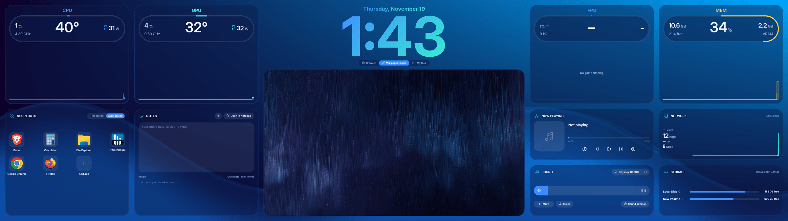

> **It is a beta.** The dashboards, the looks and the Console and Classic Menus are finished. The parts marked **Beta** below work and can be picked, and may still change. Found something? Open an [issue](https://github.com/realHfde/Apple-Style-Inspired-RTSS-Overlay/issues) with a screenshot and your resolution.

## What's new in 2.0

- **🖥️ 55 dashboards and widgets.** 21 new ones for 32:9, 21:9, 16:9 and portrait screens, as a full dashboard or a slim Dock or Band. Every 1.7.1 screen is here too, redone (Beta).
- **🎨 62 looks in one click**, 51 accent colours, and your own colours.
- **🖼️ Hand-made Themes** (Beta): seven, each with its own art, fonts and ornaments.
- **🎛️ A new Menu** in two styles, Console and Classic. Everything is set by clicking. No files to edit.
- **📐 One Scale slider** for every dashboard, from 1 to 300 %. Past what fits, the dashboard stops at the screen's edge.
- **🎬 Photos, GIFs and videos** on the dashboard, and browser videos with the small extension.
- **✨ Motion** in the Menu, made in Blender.
- **🤝 Installs beside 1.7.1.** It has its own folder and touches none of 1.7.1's files.

## Install (about 5 minutes)

**You need:** Windows 10 or 11 (64-bit), [Rainmeter](https://www.rainmeter.net) 5.0 or newer, and [MSI Afterburner](https://www.msi.com/Landing/afterburner) running for the processor and graphics card readings. For the frame rate, keep RTSS running too (it comes with Afterburner).

1. Install Rainmeter, and MSI Afterburner with RTSS.
2. Download **[Monitors and Widgets 2.0 beta.rmskin](https://github.com/realHfde/Apple-Style-Inspired-RTSS-Overlay/raw/main/rainmeter/Monitors%20and%20Widgets%202.0%20beta.rmskin)**, double-click it and click **Install**.
3. It starts by itself, on your second screen if you have one, with the dashboard for that screen's shape. The Menu opens once on **Size and place**.
4. To change anything later: right-click the dashboard → **Menu...**

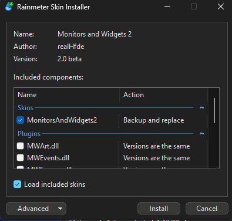 The installer. Updating later keeps your settings.

Your choices are kept in `Skins\MonitorsAndWidgets2\@Resources\UserSettings.inc`. An update keeps them.

**Without MSI Afterburner** the clock, photo, music, sound, apps, network, drives, processor load and memory still work. Temperatures, power, the graphics card and the frame rate show as dashes.

**Browser videos in the Photo card (optional):** download the [browser extension](https://github.com/realHfde/Apple-Style-Inspired-RTSS-Overlay/raw/main/rainmeter/Monitors%20and%20Widgets%20browser%20extension.zip) and follow "How to add it.txt" inside.

## Screens

Pick yours in **Menu → Size and place → Dashboard**. Every one comes as **Cards** (separate glass cards over your wallpaper) or **Box** (one panel).

| Your screen | Dashboards |
|---|---|
| **32:9 super ultrawide** | A full dashboard, a Photo Hero, a Dock and a Band |
| **21:9 ultrawide** | A full dashboard, a Photo Hero, a Dock and a Band |
| **16:9** | 16:9, Widescreen, Alternate, a Photo Hero, a Dock and a Band |
| **A 16:9 screen stood on its side** | 16:9 Portrait and 16:9 Portrait Widescreen. Five more are shown as "Not ready · concept" |

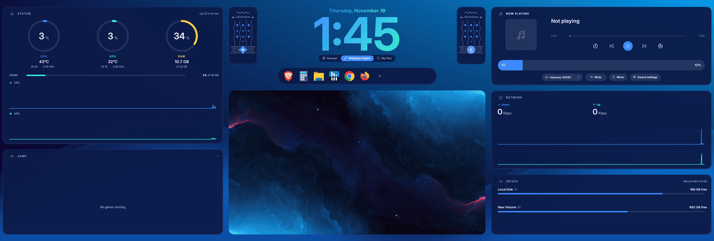 21:9 Ultrawide

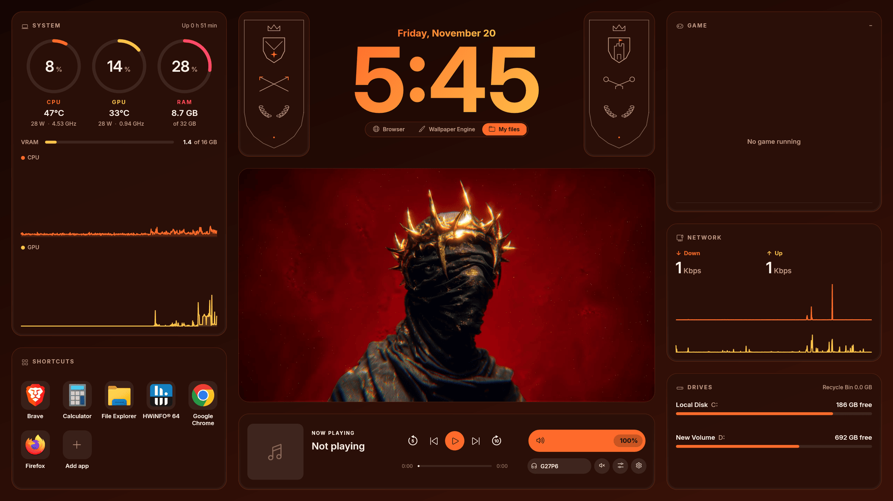 16:9 Widescreen

<table>
<tr>
<td width="50%" align="center">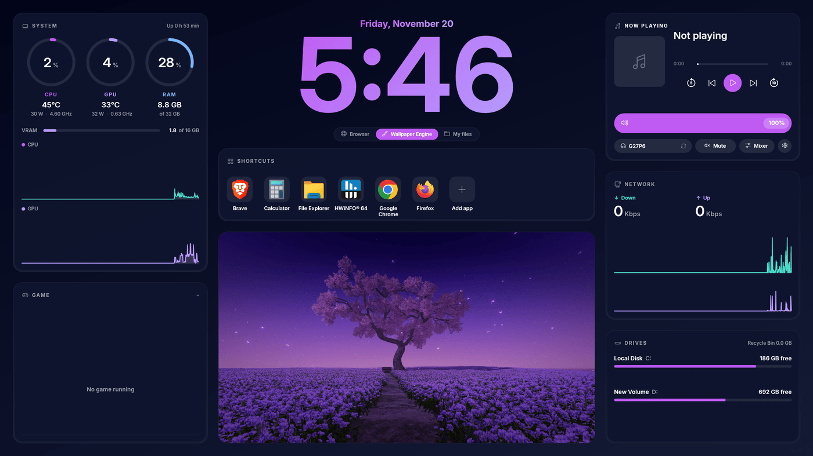 16:9 Alternate</td>
<td width="50%" align="center">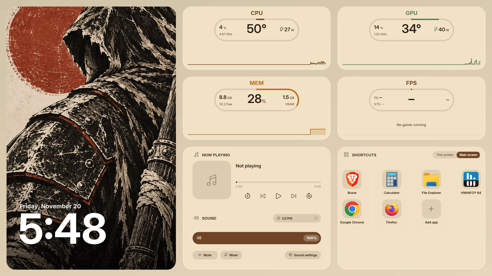 16:9 Photo Hero, in a light look</td>
</tr>
</table>

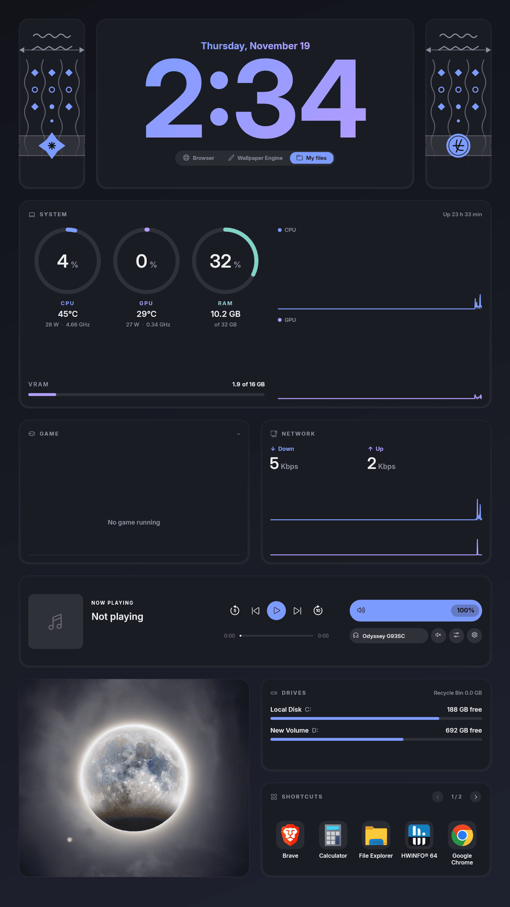 16:9 Portrait

### A Dock or a Band, when you want your desktop back

A slim strip along the top or the foot of the screen. The Dock is a row of small cards. The Band is one panel with the clock.

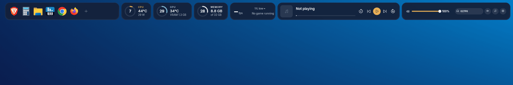

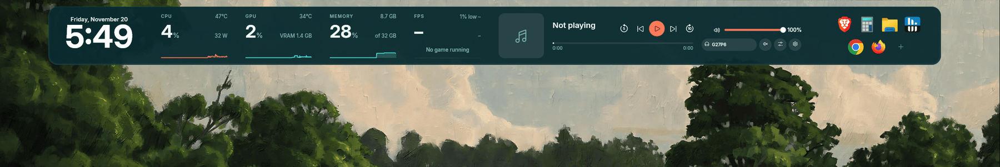

### Any size, anywhere

**Scale** runs from 1 to 300 % on every dashboard. In **Free size** you can also drag a dashboard where you want it.

<table>
<tr>
<td width="50%" align="center">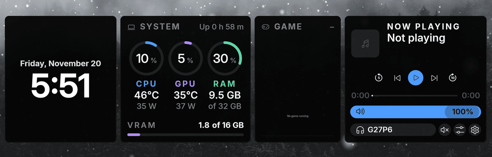</td>
<td width="50%" align="center">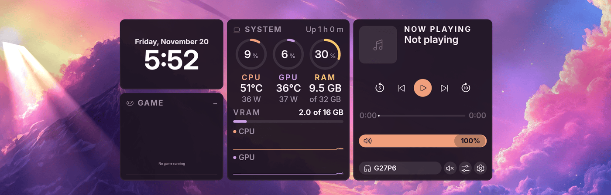</td>
</tr>
</table>

### 1.7.1's screens, redone (Beta)

Each comes twice: as 2.0 draws it, and with "Classic" after its name (for example **Sidebar Classic**), which is 1.7.1's layout drawn the 2.0 way. They are after the others in the Dashboard list.

| Kind | Screens |
|---|---|
| **Bar screens** (fill the screen) | Corsair Xeneon Edge 2560x720 · Lian Li 8.8in 1920x480 · Lian Li 9.2in O11 Vision-M 1920x462 · Lian Li Lancool 207 1600x720 |
| **Case screens** (fill the screen) | Corsair Xeneon Edge 720x2560 · HYTE Y70 Touch 1100x3840 · HYTE Y70 Touch Infinite 688x2560 and 682x2560 · Lian Li 8.8in 480x1920 · Lian Li Lancool 207 720x1600 |
| **Compact** | 16:9 Compact · 16:9 Portrait Compact |
| **Widgets** (float over the wallpaper) | Horizontal · Horizontal 2 · Sidebar · Sidebar 2 · Vertical |

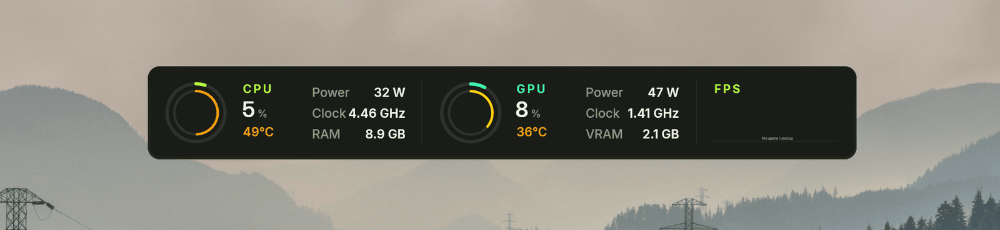

The installer does not pick these for you. On a bar screen it starts with 32:9 Super Ultrawide, on a case screen with 16:9 Portrait. Pick yours in the Menu.

## The Menu

Right-click the dashboard → **Menu...** A new install opens in the **Console** style. **Classic** has the same settings as tabs, tiles and rows.

<table>
<tr>
<td width="50%" align="center">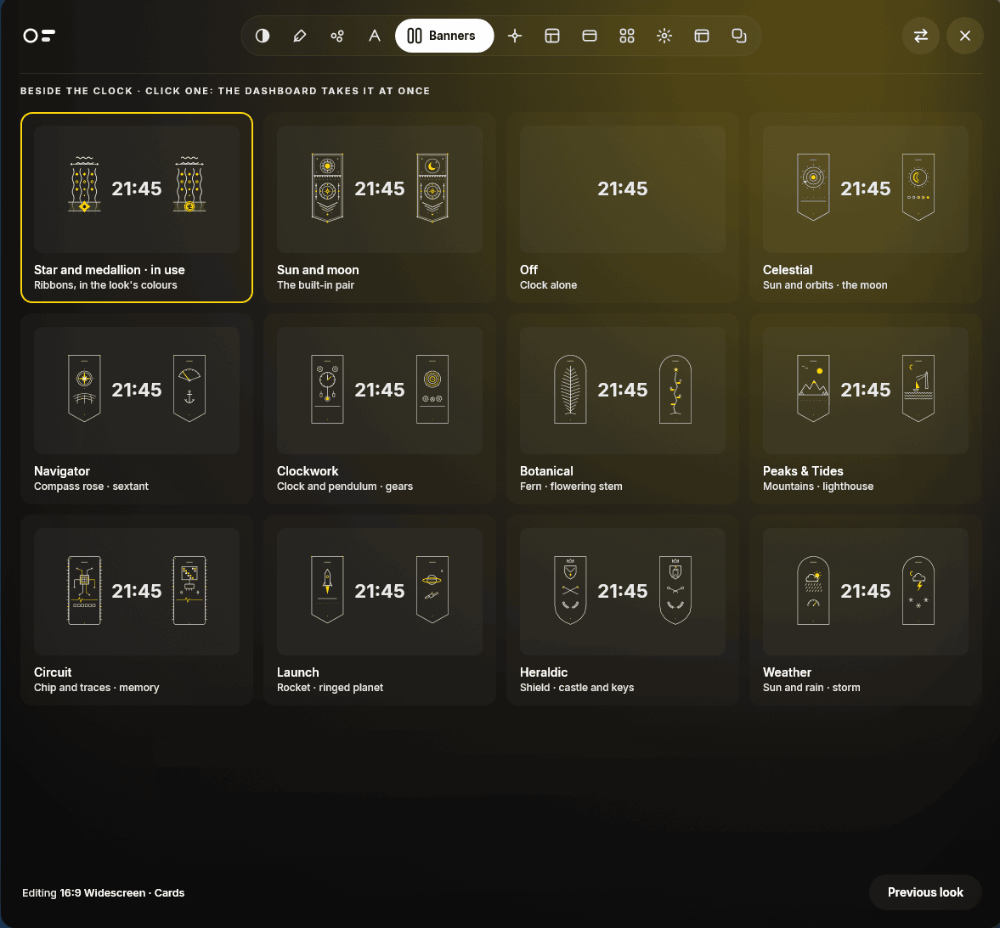 Console · Banners beside the clock</td>
<td width="50%" align="center">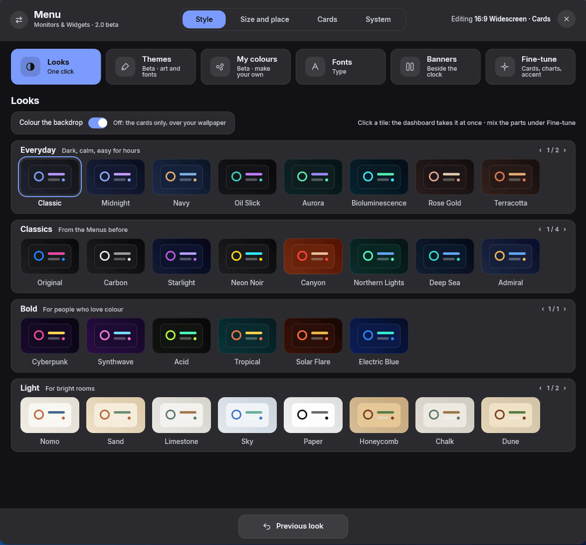 Classic · Looks</td>
</tr>
</table>

| Page | What you set there |
|---|---|
| **Style** | Looks, Themes (Beta), My colours (Beta), Fonts, Banners, Fine-tune |
| **Size and place** | The dashboard (all 55), the screen, Cards or Box, corners, Fill the screen or Free size, Scale, place |
| **Cards** | What each card shows |
| **System** | Sensors, the FPS graph's top, your files, the Menu's own look and style, reset |

<table>
<tr>
<td width="50%" align="center">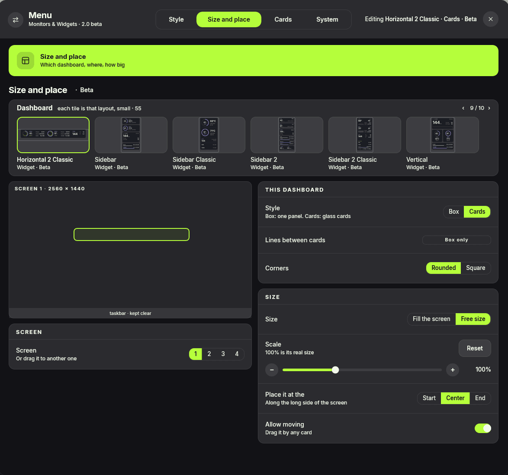 Size and place · the dashboard, the screen, Scale</td>
<td width="50%" align="center">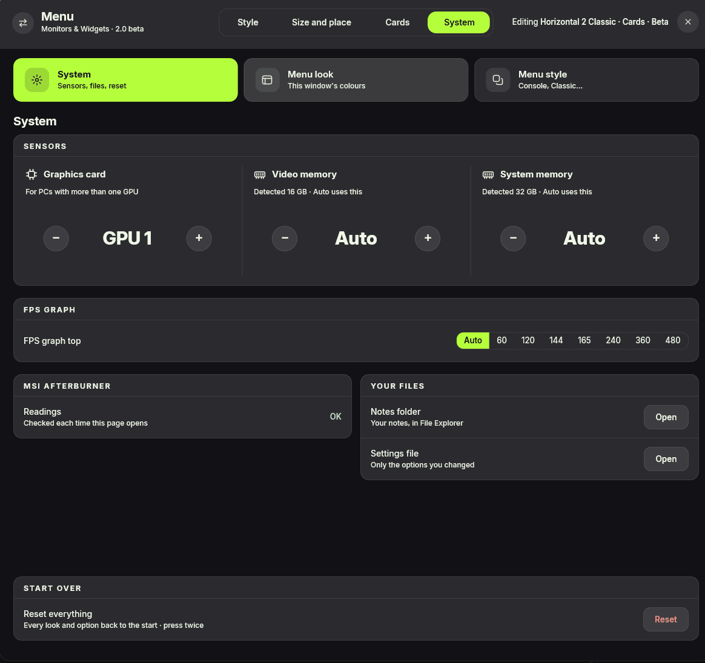 System · sensors and the FPS graph</td>
</tr>
</table>

### Looks and Themes

<table>
<tr>
<td width="50%" align="center">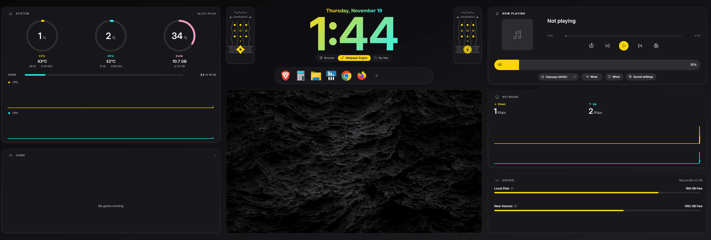 A look: Neon Noir</td>
<td width="50%" align="center">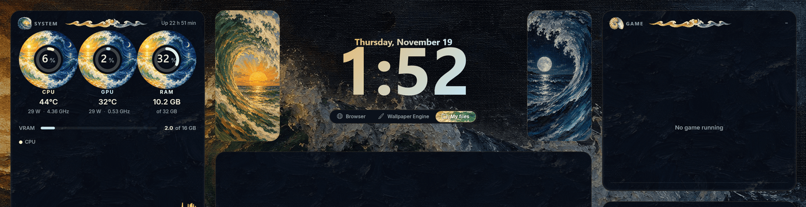 A Theme (Beta)</td>
</tr>
<tr>
<td width="50%" align="center">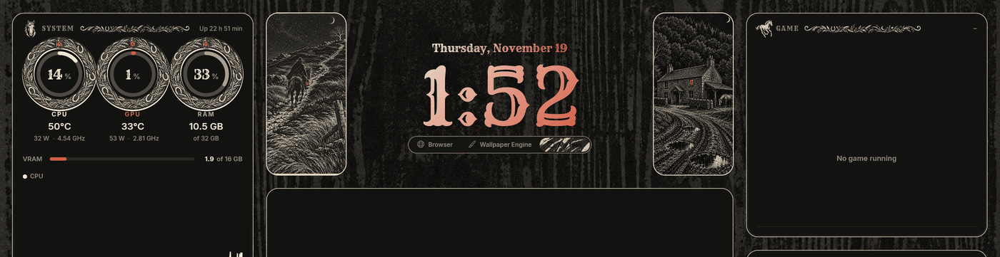 A Theme (Beta)</td>
<td width="50%" align="center">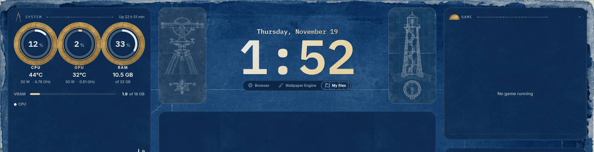 A Theme (Beta)</td>
</tr>
</table>

## What is Beta, and what is not ready

| Part | State |
|---|---|
| The 21 new dashboards, the 62 looks, the Console and Classic Menus | Finished |
| The 34 screens from 1.7.1 (bar, case, Compact, widgets) | Beta |
| Themes, My colours | Beta |
| The Menu styles Tile wall, Showroom, Ambient and the Wheel | Beta |
| Five more portrait dashboards | Not ready · concept (you can look at them) |
| Card shadows | Off for now |

## Help

- **Dashes instead of temperatures or FPS:** MSI Afterburner (and RTSS, for FPS) is not running.
- **It opened on the wrong screen, or the wrong shape:** Menu → Size and place → Screen, and Dashboard.
- **Too big or too small:** Menu → Size and place → Scale.
- **Coming from 1.7.1:** both can stay installed. To use only 2.0, unload 1.7.1's skins in Rainmeter's Manage window.
- **Anything else:** open an [issue](https://github.com/realHfde/Apple-Style-Inspired-RTSS-Overlay/issues) with a screenshot and your resolution.

[← Back to the front page](../README.md) · [Monitors & Widgets 1.7.1](monitors-and-widgets-1.7.1.md)
