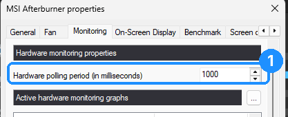
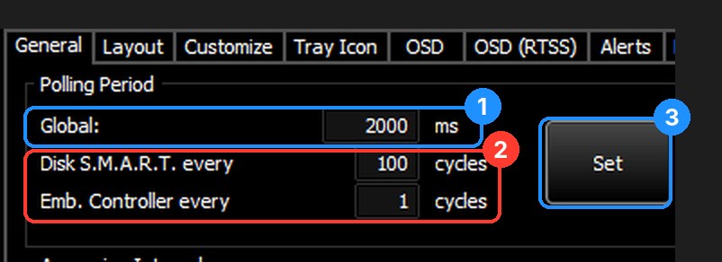
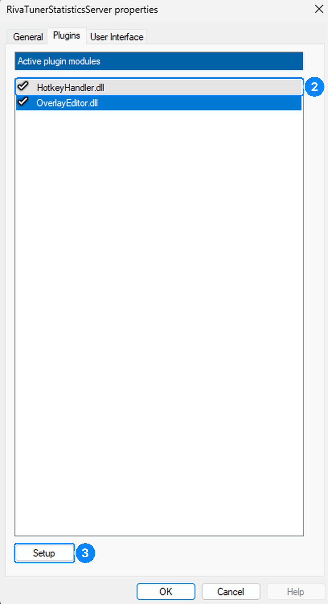
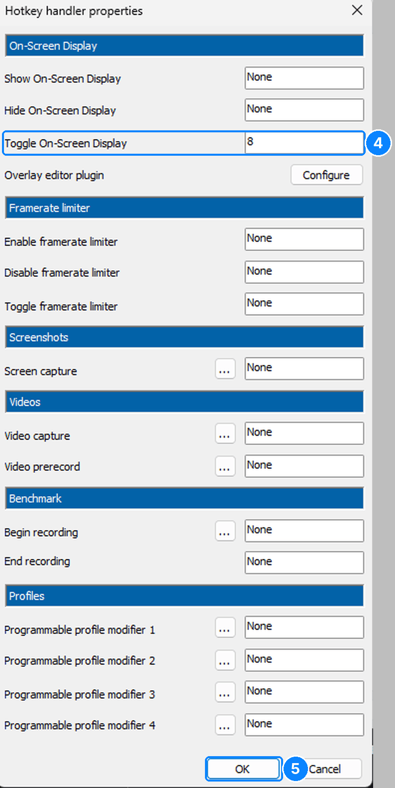
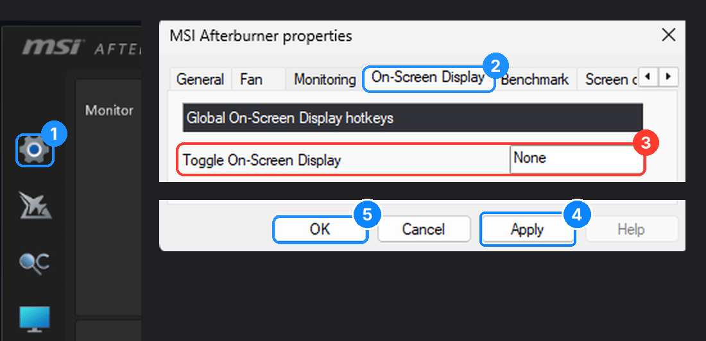
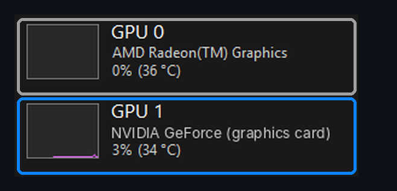
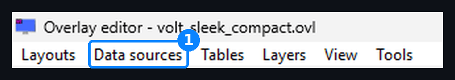
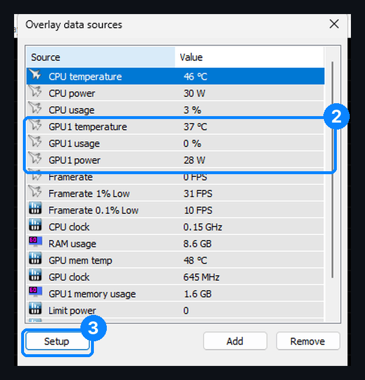
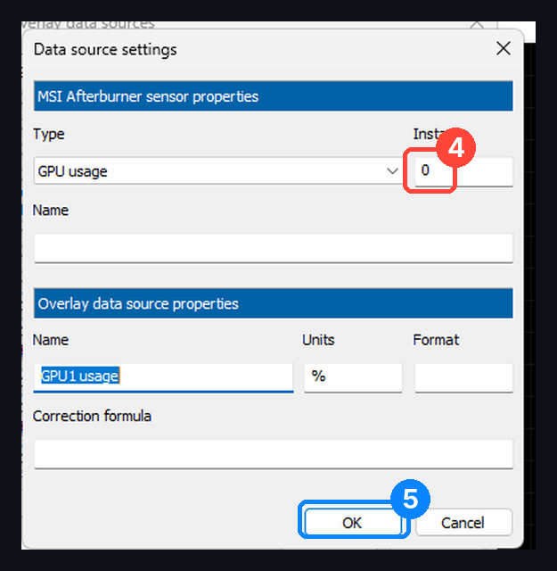
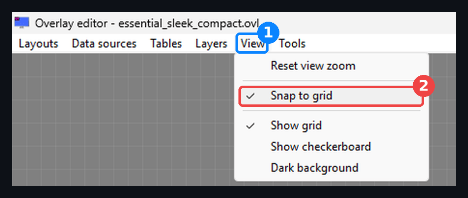

# 🧰 Optional extras for the overlays

Click the ones you need to open them:

<h3>🧈 Keep it smooth (no stutter)</h3>

The overlay itself is light: it redraws every **500 ms** (the RTSS refresh period from [step 4](overlay-setup.md#rtss-setup)). Stutter usually comes from monitoring apps reading sensors too often, so:

| # | App | Setting | Set it to |
|---|---|---|---|
| 1 | **MSI Afterburner** | Settings → Monitoring → **Hardware polling period** | **1000** ms |
| 2 | **HWiNFO** *(Volt only)* | Sensor Settings → General → **Global** polling period | **2000** ms |
| 3 | **HWiNFO** *(Volt only)* | Same box: **Disk S.M.A.R.T. every** … cycles and **Emb. Controller every** … cycles | **100** and **10**, then click **Set** |

 

Want the lightest setup? Use **🟢 Essential**: no HWiNFO at all.

<h3>⌨️ Show / hide the overlay with a hotkey</h3>

Pick **one** of the two ways. Both do the same thing.

**Option A: in RTSS** (works without Afterburner)

| # | What to do |
|---|---|
| 1 | Open **RTSS** and click **Setup**, then open the **Plugins** tab |
| 2 | Click the name **HotkeyHandler.dll** so it's highlighted (keep it ticked) |
| 3 | Click **Setup** under the list |
| 4 | Click the box next to **Toggle On-Screen Display** and press the key you want (e.g. **F10**) |
| 5 | Click **OK**, then **OK** again in RTSS Setup |

 

**Option B: in MSI Afterburner**

| # | What to do |
|---|---|
| 1 | Open **MSI Afterburner** → **Settings** (gear) |
| 2 | Open the **On-Screen Display** tab |
| 3 | Click the box next to **Toggle On-Screen Display** and press the key you want (e.g. **F10**) |
| 4 | Click **Apply** |
| 5 | Click **OK** |

Now press that key in game to show or hide the overlay. Handy for screenshots and recordings.

<h3>🖥️ CPU with integrated graphics, or two GPUs?</h3>

**If GPU load, temperature or power show 0 or look wrong, the overlay is probably reading your integrated graphics.**

**Which number is your graphics card?** Open **Task Manager** (Ctrl + Shift + Esc) → **Performance** and look at the GPU list. The number next to your graphics card (e.g. **GPU 1**) is the one to use:

| # | What to do |
|---|---|
| 1 | In the Overlay editor, click **Data sources** at the top |
| 2 | Select **GPU1 temperature** (then repeat for every other row that starts with **GPU**) |
| 3 | Click **Setup** |
| 4 | Pick your graphics card (change the GPU number from **0** to your card's number from Task Manager, usually **1**) |
| 5 | Click **OK**, then **OK** again, and **save** the layout |

 

Tip: watch the **Value** column in Data sources. Once it's right, GPU usage jumps up when you start a game.

<h3>📍 Move it anywhere you like</h3>

1. Open the overlay in the **Overlay editor**.
2. ### Turn off "Snap to grid" first! ⚠️
   Click **View** at the top, then click **Snap to grid** so the ✓ disappears. With snapping on, each piece snaps separately and the numbers slide out of place.

   

3. Select all the layers and drag the overlay where you want it, e.g. the lower-left corner.
4. **Save** the layout.

Everything stays lined up, and it remembers the new spot. (RTSS's own position box doesn't move these overlays, so this is the way to do it.)

<h3>📦 Only want one overlay?</h3>

Download this repo (**Code → Download ZIP**), then open `overlays/` → the version → the overlay → the theme (`dark`, `white`, `smoke` or `float`) → your resolution, e.g. `overlays/essential/sleek-meters/smoke/2560x1440`. Copy the `.ovl` and its `_atlas.png` into the Overlays folder.

Something not showing up? Check [Troubleshooting](help.md#troubleshooting). Most issues take a few seconds to fix.

---

[← Back to the front page](../README.md)
