<a id="get-started"></a>
# 🧭 Set up the overlays


> ⚡ **Already have MSI Afterburner and RTSS? Quick start**
> 1. Install the **[Inter font](#install-inter)**. For Volt only, also **HWiNFO** with [Shared Memory](#hwinfo-setup-shared-memory) on.
> 2. Afterburner → Settings → **Monitoring**: tick **Framerate**, **Framerate 1% Low** and **Framerate 0.1% Low** (On-Screen Display off).
> 3. [Download the pack](../README.md#download) for your resolution and copy the files from one theme folder into `C:\Program Files (x86)\RivaTuner Statistics Server\Plugins\Client\Overlays`.
> 4. RTSS → **Setup → Plugins → OverlayEditor.dll → Setup** → **Layouts → Load** → pick the `.ovl`. Play!
>
> **Nothing showing in game?** Follow the full setup below, step by step.

**New to this?** Takes about 5 minutes. Follow these in order. 👇

### 🟢 First: which version do you want?

| Version | 👀 Preview | ⬇️ Download | Needs | Shows |
|---|---|---|---|---|
| 🟢 **Essential** (easiest) | [See it](overlays.md#essential) | [Pick your screen](../README.md#download) | MSI Afterburner + RTSS | CPU & GPU usage, temps, power, clocks, RAM, VRAM, VRAM temp, FPS, 1% / 0.1% lows, frametime |
| ⚡ **Volt** | [See it](overlays.md#volt) | [Pick your screen](../README.md#download) | MSI Afterburner + RTSS + **HWiNFO** | All of that **plus the 12V cable voltage** |
| 💻 **Laptops** | [See it](overlays.md#laptops) | [Laptop packs](../README.md#laptop-download) | MSI Afterburner + RTSS | Slim bars and a card made for laptop screens |
| 📺 **TVs** | [See it](overlays.md#tvs) | [TV packs](../README.md#tv-download) | MSI Afterburner + RTSS | Big numbers for the couch |
| 📱 **Monitors & Widgets** | [See it](monitors-and-widgets-1.7.1.md#rainmeter) | [Its own download](monitors-and-widgets-1.7.1.md#monitor-setup) | MSI Afterburner + **Rainmeter** (no RTSS setup) | Your stats on a **second monitor**, a **case screen** (**HYTE Y70**, **Lian Li** 8.8" / 9.2" / Lancool 207), a **Corsair Xeneon Edge** or your desktop |

**Only Volt needs HWiNFO (step 2).** Everyone else skips it. You can always switch from Essential to Volt later.

### 1️⃣ Install the free programs

| Program | Why you need it |
|---|---|
| [**MSI Afterburner**](https://www.msi.com/Landing/afterburner) **with RTSS** | **Install this one.** Its installer has a box for **RivaTuner Statistics Server (RTSS)**: keep it ticked and you get both in one go. RTSS draws the overlay. Afterburner gives it the **FPS, 1% low and 0.1% low** numbers: RTSS can't hand those to the overlays on its own. |
| [**HWiNFO64**](https://www.hwinfo.com/) *(Volt only)* | Reads the **12V cable voltage**. Not needed for Essential, laptops or TVs. |
| [**Inter font**](https://rsms.me/inter/) | The font the overlays use. Without it the text won't line up ([how to install](#install-inter)). |

> Already have RTSS on its own? It works, but install Afterburner too, or FPS and the lows stay blank. Don't install a second RTSS on top of the one that comes with Afterburner.

<a id="install-inter"></a>
### 🔤 Install the Inter font

| # | What to do |
|---|---|
| 1 | Go to [rsms.me/inter](https://rsms.me/inter/) and click **Download** |
| 2 | Find **Inter-4.1.zip** in your Downloads and click it |
| 3 | Click **Extract all** at the top, then **Extract** |
| 4 | In the folder that opens, **right-click Inter.ttc** |
| 5 | Click **Install for all users**. Some programs only see fonts installed for all users |

<details>
<summary>📷 Show the pictures</summary>

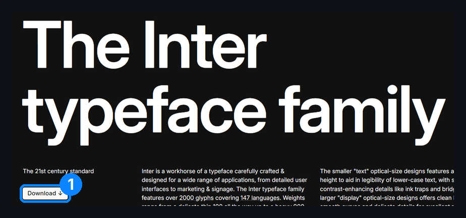

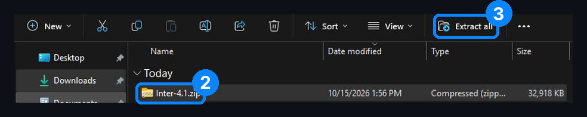

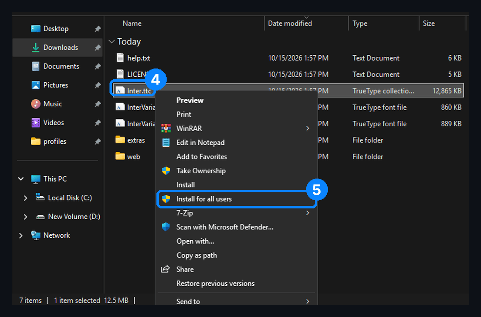

</details>

Then **restart RTSS** (close it from the tray and open it again).

<a id="hwinfo-setup-shared-memory"></a>
### 2️⃣ Turn on HWiNFO Shared Memory ⚡ (Volt only)

### 🛑 Using Essential, a laptop or a TV overlay? You don't need HWiNFO. Skip to [step 3](#afterburner-setup).

### ⚡ Volt only: without this, the 12V cable stays blank.

1. Start HWiNFO64 and tick **Sensors-only**, then click **Start**. In the sensors window, click the **gear** button at the bottom.

   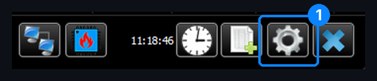

2. *(Optional)* In **Sensor Settings**, the **Global** polling period can stay at **2000 ms**. That's plenty for an overlay and keeps HWiNFO light.
3. Click **Main Settings** at the bottom.

   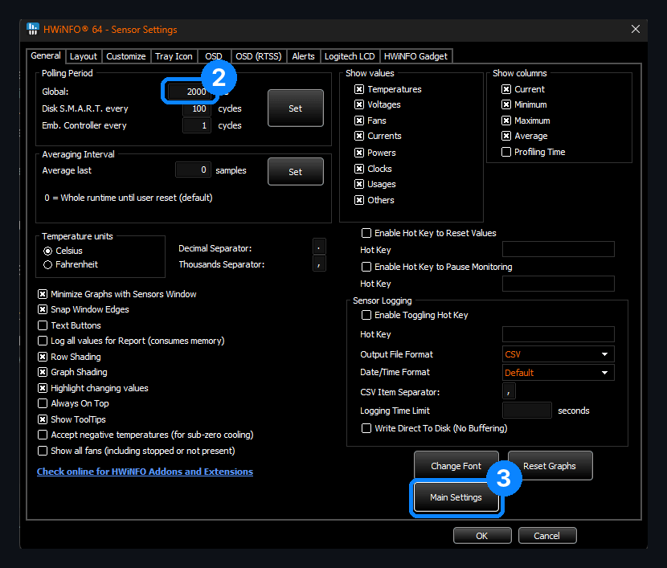

4. Tick **Shared Memory Support** and click **OK**.

   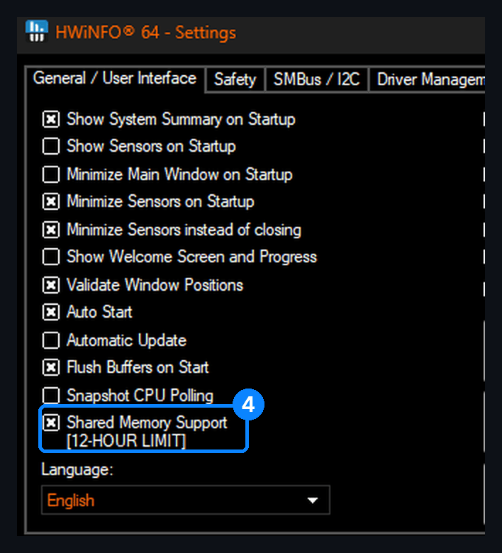

5. Keep HWiNFO running in the background (ticking **Auto Start** in the same window starts it with Windows).

> On the free version, Shared Memory switches itself off after **12 hours**. If 12V goes blank after a long session, tick it again (or restart HWiNFO).

<a id="afterburner-setup"></a>
### 3️⃣ Set up MSI Afterburner

| # | What to do |
|---|---|
| 1 | Click the **gear** (Settings) on the left |
| 2 | Open the **Monitoring** tab |
| 3 | **Scroll down** the list to the bottom and **tick** these three: **Framerate**, **Framerate 1% Low** and **Framerate 0.1% Low** |
| 4 | Click each ticked item and make sure **Show in On-Screen Display** is ❌ **unticked**, so Afterburner's own text doesn't stack on top of the overlay |
| 5 | Click **Apply**, then **OK** |

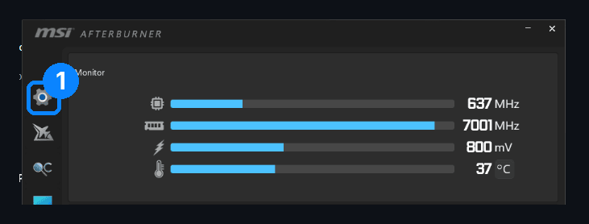 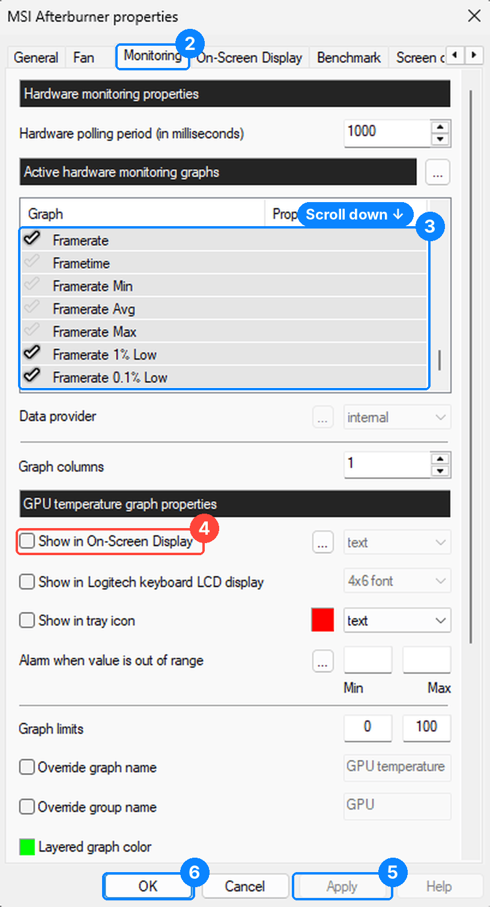

That's all the overlays need from Afterburner: everything else comes from RTSS itself. Ticking more doesn't hurt.

Keep Afterburner running in the background.

<a id="rtss-setup"></a>
### 4️⃣ Set up RTSS (picture guide)

Open RTSS (the monitor icon in your taskbar tray). The numbers in the pictures match the steps.

| # | In the main RTSS window | Set it to | Why |
|---|---|---|---|
| 1 | **Show On-Screen Display** | ✅ **ON** | Nothing shows in game without it |
| 2 | **On-Screen Display support** | ✅ **ON** | Also needed for any overlay |
| 3 | **On-Screen Display shadow** | ❌ **OFF** | Keeps text sharp (White looks blurry with it on) |
| 4 | **Setup** button (bottom) | Click it | Opens the settings window |

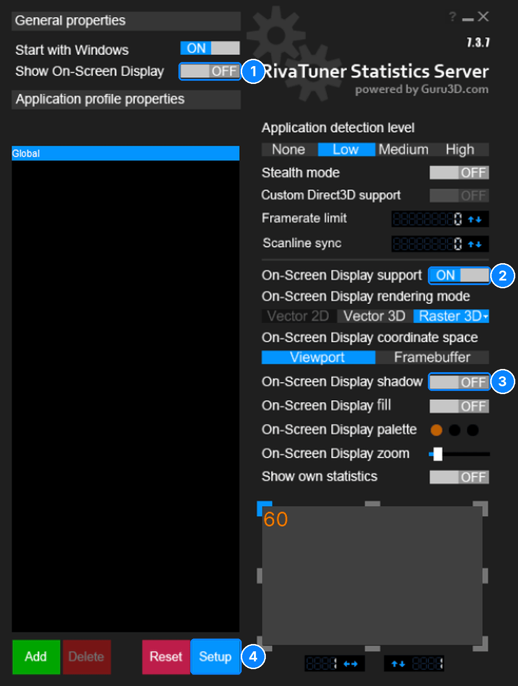

<a id="benchmark-tip"></a>
In **Setup**, stay on the **General** tab. The FPS, 1% low and 0.1% low numbers depend on these. If they're changed, the lows can show **0** or freeze:

| # | In **Setup → General** tab | Set it to |
|---|---|---|
| 5 | **General** tab | It opens on this tab |
| 6 | **Framerate averaging interval** | **1000** |
| 7 | **Refresh period** | **500** |
| 8 | **Percentile calculation mode** | **integral** |
| 9 | **Percentile buffer** | **ring** (keeps the 1% / 0.1% lows updating live) |
| 10 | **Enable benchmark mode**: **scroll down** to *Compatibility properties* | ✅ **ON**. Sometimes this is what makes the overlay show up in a game |

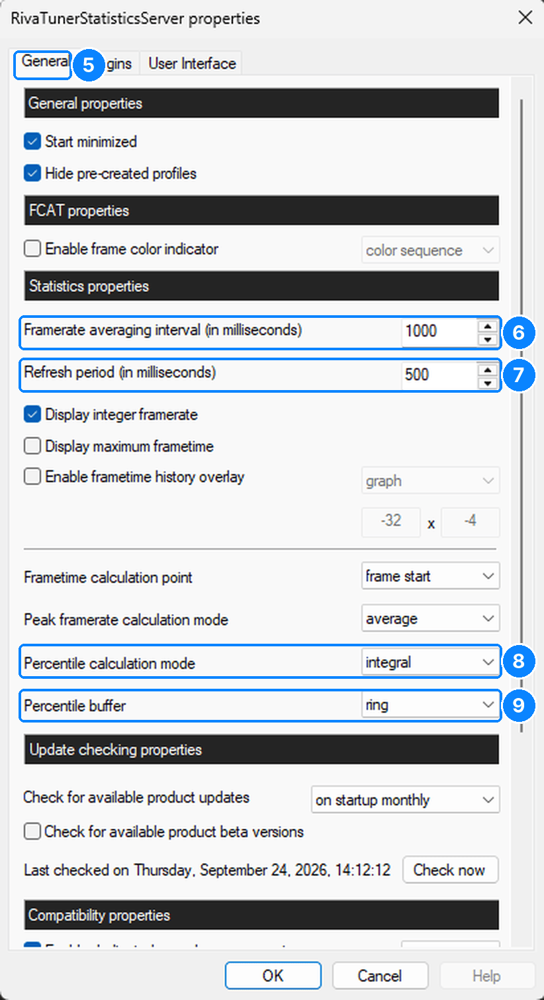 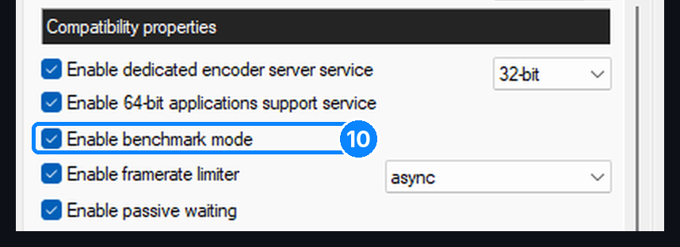

Then open the **Plugins** tab:

| # | In **Setup → Plugins** tab | Do this |
|---|---|---|
| 11 | **HotkeyHandler.dll** | ✅ Tick it |
| 12 | **OverlayEditor.dll** | ✅ Tick it, then **click its name** so it's highlighted in blue |
| 13 | **Setup** button (under the list) | Click it. This opens the **Overlay editor**, where you load the overlays. ⚠️ It only opens if OverlayEditor.dll is both **ticked and highlighted** |

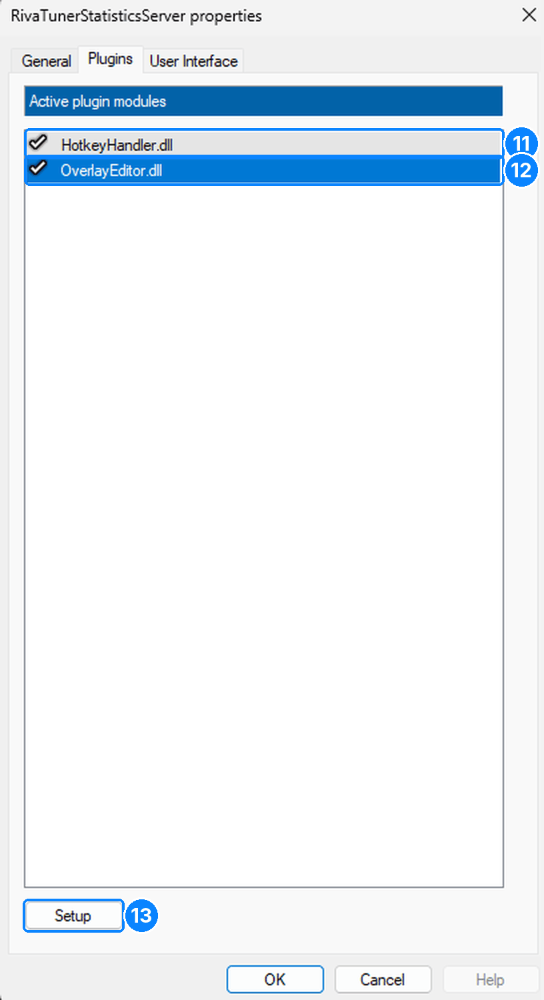

Close the Overlay editor for now and click **OK** in Setup. You'll open it again in [step 7](#load-it) to load your overlay.

### 5️⃣ Download the pack for your screen

Pick your screen in the **[download tables](../README.md#download)** (laptops: [laptop packs](../README.md#laptop-download), TVs: [TV packs](../README.md#tv-download)). Each pack has every overlay in every theme.

### 6️⃣ Copy the files into the Overlays folder

Unzip the pack, open the theme folder you want (**Dark**, **White**, **Smoke** or **Float**, or several) and copy **the files inside** straight into RTSS's Overlays folder:

```
C:\Program Files (x86)\RivaTuner Statistics Server\Plugins\Client\Overlays
```

That's where RTSS installs by default. If you installed it somewhere else, open RTSS's install folder and go to **Plugins → Client → Overlays**.

### ⚠️ Copy the files, not the theme folder! Each `.ovl` needs its `_atlas.png` right next to it, directly in **Overlays**.

| # | Check |
|---|---|
| 1 | The address bar ends in **RivaTuner Statistics Server › Plugins › Client › Overlays** |
| 2 | Each `.ovl` has its matching `_atlas.png` right next to it (e.g. `essential_sleek_smoke.ovl` + `essential_sleek_smoke_atlas.png`) |

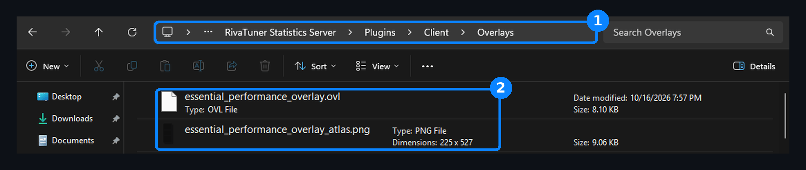

The theme is in the file name: no ending = **Dark**, then `_white`, `_smoke` and `_float`.

<a id="load-it"></a>
### 7️⃣ Load it and play 🎮

Open the Overlay editor the same way as in step 4: **RTSS → Setup → Plugins → select OverlayEditor.dll → Setup**.

| # | In the Overlay editor | Do this |
|---|---|---|
| 1 | **Layouts** menu (top left) | Click it |
| 2 | **Load** | Click it |

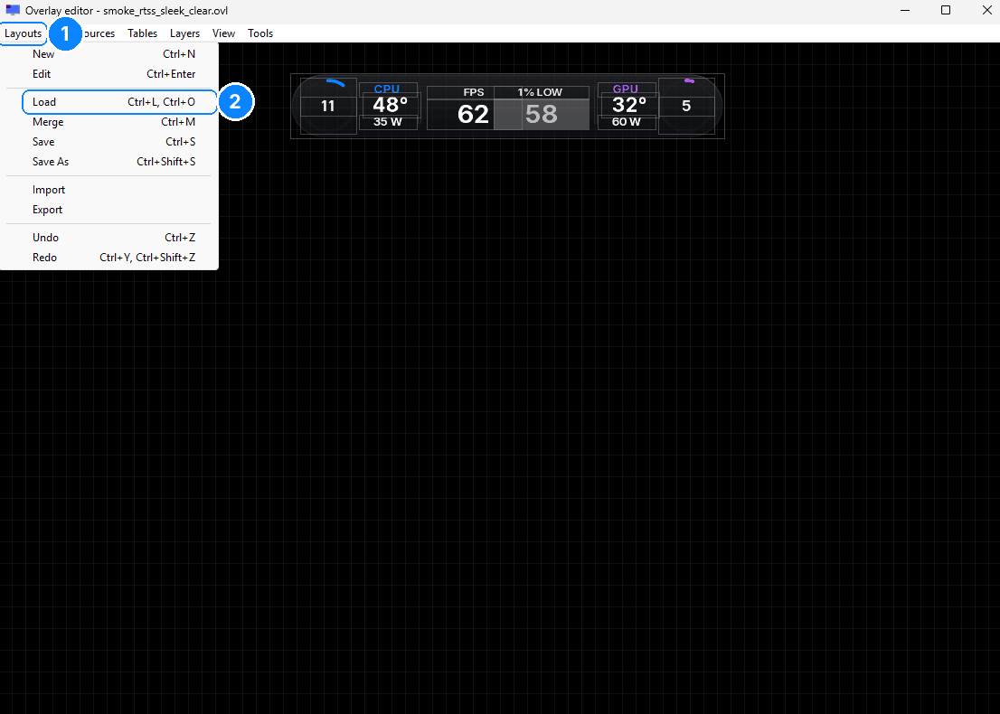

| # | In the Open window | Do this |
|---|---|---|
| 3 | Pick your overlay | e.g. `essential_sleek_smoke.ovl` |
| 4 | **Open** | Click it, then launch a game |

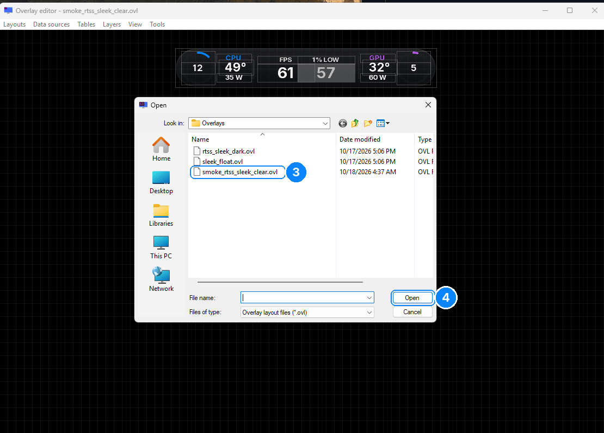

Can't see your overlay in the editor? These are demo pictures. Maximize the Overlay editor (full screen) to see your overlay where it will sit in game: at the top centre, or on the right edge for Sleek Side and Performance.

[← Back to the front page](../README.md)
